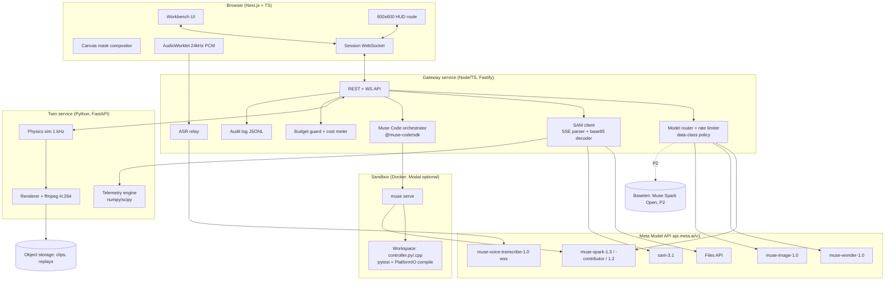
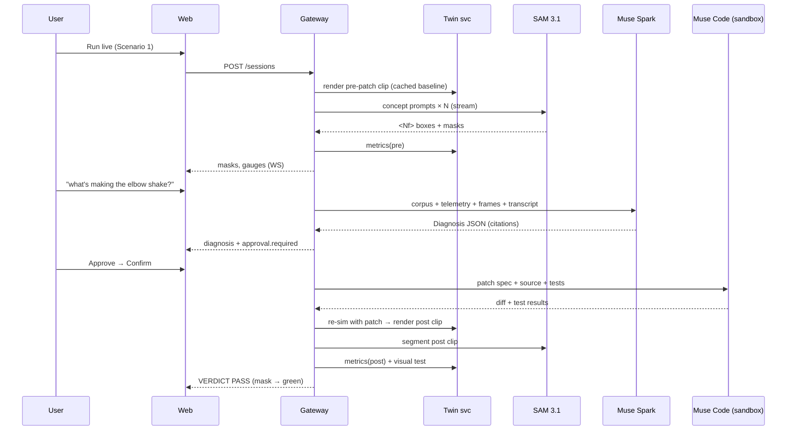

# ChronoSight — Product Requirements Document

> **The visual unit test for physical systems.**
> Software has CI. Hardware still has a technician squinting at a camera. ChronoSight turns a camera into a test oracle. It watches a machine misbehave, works out why, writes the fix, and then *watches the fix work* before anyone calls it done.

| Field | Value |
| :--- | :--- |
| Product | ChronoSight (working codename in the source report: *ChronoSight-MCP*) |
| Document | Product Requirements Document (PRD), v1.4 |
| Status | Draft for build. v1.3 back-ports the 19 deltas (DL-1..DL-19) found while writing `DESIGN.md`: exact Meta API request shapes, the Muse Code session protocol, the strict structured-output subset, and three corrections to the Visual Unit Test maths. v1.4 back-ports DL-20..DL-23 from `TECHNICAL.md` (adopted in `DESIGN.md` v1.1): Node 24, Next.js 16, a sandbox launcher that alone holds the Docker socket, and one registrable domain for web and gateway. See the document history below. The Stage 2 rubric table and §9 Prizes still did not come through, so the criteria stay unverified. |
| Date | 2026-10-26 (hackathon kickoff day); v1.3 and v1.4 on 2026-10-27 |
| Companion | `DESIGN.md` (technical design). This PRD owns *what*; the design owns *how* and cites the FR-IDs here. |
| Event | Meta Global AI Developer Hackathon (Meta × Cerebral Valley), Oct 26 – Nov 4, 2026 |
| Recommended track / theme | **Indie Developer Track** · primary theme **Push the Frontier**, secondary **Build for Your World** |
| Source | `gemini-code-1793034493579.md` (strategy report), checked line by line against Meta's official docs on 2026-10-26 |
| Provenance note | This PRD is a planning document written before any code exists. It contains no implementation code (only illustrative schemas). Run `git init` and commit implementation work only **after** the kickoff (see §18.2). |

### Document history

| Version | Date | Changes |
| :--- | :--- | :--- |
| v1.0 | 2026-10-26 | First draft from the strategy report, checked line by line against Meta's docs (§2). |
| v1.1 | 2026-10-26 | Adds the Participant Guide §1 and §4–§6 (problem statements, rules, Meta and partner resources). Most open questions are answered from the docs (§2, §23). |
| v1.2 | 2026-10-26 | Adds guide §7 (submission) and §8 (judging). The video is 3:00, not 2:00, and judging runs in three stages (§2.1 E13 and E15, §3, §20). |
| v1.3 | 2026-10-27 | Back-ports `DESIGN.md` §3 (DL-1..DL-19). **APIs:** SAM request shape, and a 400 is never retried (FR-PER-1, FR-PER-2, §14.1). ASR handshake fields, upstream event mapping, close codes and 55-minute rotation (FR-VOI-1, FR-VOI-2, §15.1). Muse Code `session/resume`, the `approval/decide` shape, `approval/resolved`, the open `turn/completed` terminal set, the **Ask me** profile and `turn/cancel` (FR-PAT-1, FR-PAT-2). The strict structured-output subset, with a reshaped `Diagnosis` (FR-DIA-3, §15.2). `reasoning: {effort, summary}` (FR-DIA-4, §14.1). `prompt_cache_key`, and cache retention set by data class (M20, FR-DIA-1, §17.4). Files API `expires_after` and explicit DELETE (FR-CAP-5, §14.3). Glasses runtime limits and the HUD transport fallback (FR-HUD-1..3). **Maths:** f* now comes from Lomb–Scargle on gapped timestamps, with Welch as a cross-check (§10.2, FR-MEA-1). Two reference markers: A for ego-motion and B for the noise floor (§10.1–§10.3, FR-TWN-3, §11). Typed `assertions[]` in `VisualTestResult` for Scenarios 2 and 3 (§15.2, §11). Doc sources are added to §24.6. Unconfirmed details stay ⚠️ and are settled by the design's spikes (SP-1..SP-11). |
| v1.4 | 2026-10-27 | Back-ports `DESIGN.md` §3.2 (DL-20..DL-23, proposed in `TECHNICAL.md` §2.3). **Stack (§13.3):** Node 24 LTS replaces Node 22, which is superseded (DL-20); Next.js 16.4.x, never below 16.2.6, replaces Next.js 15, with `apps/web/proxy.ts` issuing CSP nonces (DL-21). **Sandbox (FR-PAT-2, §13.3, §13.4):** a `services/sandbox-launcher` is the only component with the Docker socket, and the gateway can't choose images, mounts or flags (DL-22). **Hosting (§13.3):** the web app and the gateway share one registrable domain, `app.<domain>` and `api.<domain>`, live by D6, because the `SameSite=Strict` session cookie is never sent from `*.vercel.app` (DL-23). Sources added to §24.6. No requirement, K target or scope changes. |

---

## Table of contents

1. [Executive summary](#1-executive-summary)
2. [Source verification ledger](#2-source-verification-ledger-what-the-report-got-right-and-wrong)
3. [Hackathon context and constraints](#3-hackathon-context-and-constraints)
4. [Problem statement](#4-problem-statement)
5. [Users, personas and jobs-to-be-done](#5-users-personas-and-jobs-to-be-done)
6. [Goals, non-goals and success metrics](#6-goals-non-goals-and-success-metrics)
7. [Product concept: the closed loop](#7-product-concept-the-closed-loop)
8. [Scope and prioritization (P0 / P1 / P2)](#8-scope-and-prioritization)
9. [Functional requirements](#9-functional-requirements)
10. [The Visual Unit Test: specification](#10-the-visual-unit-test-specification)
11. [Digital Twin scenarios](#11-digital-twin-scenarios)
12. [UX specification](#12-ux-specification)
13. [System architecture](#13-system-architecture)
14. [Model routing, rate limits and failover](#14-model-routing-rate-limits-and-failover)
15. [Data model and API contracts](#15-data-model-and-api-contracts)
16. [Cost model and budget guardrails](#16-cost-model-and-budget-guardrails)
17. [Non-functional requirements](#17-non-functional-requirements)
18. [Compliance and rules safeguards](#18-compliance-and-rules-safeguards)
19. [Delivery plan (10-day sprint)](#19-delivery-plan-10-day-sprint)
20. [Demo video blueprint](#20-demo-video-blueprint)
21. [Test and QA plan](#21-test-and-qa-plan)
22. [Risk register](#22-risk-register)
23. [Open questions](#23-open-questions)
24. [Appendix](#24-appendix)

---

## 1. Executive summary

**What it is.** ChronoSight is a web app (with a smart-glasses HUD mode) for robotics, manufacturing and energy-hardware engineers. Point a camera at a misbehaving electromechanical system, such as an oscillating robot joint, a stepper losing steps, or a fault LED blinking a code, and ChronoSight does five things:

1. **Perceives** the fault over time with **SAM 3.1** video segmentation and tracking, turning masks into physical telemetry: oscillation amplitude in px or mm, dominant frequency in Hz, drift, and blink codes.
2. **Diagnoses** the root cause with **Muse Spark 1.3**, reasoning over the whole engineering corpus pinned in its 1M-token context: datasheets, the board manual, the firmware source and logs. It cites page numbers, and it uses no vector database.
3. **Gates** every consequential action behind an **app-enforced human approval**, with an optional **Muse Wonder** risk review. Nothing touches hardware without a human saying yes.
4. **Repairs** the controller by having **Muse Code** (`@muse-code/sdk`) write, compile and numerically test a firmware or controller patch inside an isolated sandbox.
5. **Verifies visually.** The patched system is re-run and re-filmed, and SAM 3.1 runs a **visual unit test**: a calibrated, statistically defined assertion that the physical misbehaviour has stopped. The red fault mask turns green only when the camera proves it.

**Why it wins.** Every past winner the report studied was narrow: it either analyzed (video in, report out) or acted (agent writes code). ChronoSight **closes the loop between perception and code synthesis**, so perception becomes the *test oracle* for generated code. That is the non-obvious, "surprise us" use of Meta tooling the judging asks for. It also sits squarely inside **Push the Frontier** ("give a machine a new capability… control a physical system") and stays well clear of every banned category the report lists (no medical, no basic RAG, no single-frame image analysis).

**What it is not.** It is not a chatbot, not a document Q&A tool, not a static image captioner, and it does not give advice about live high-voltage or mains work.

**Key corrections to the source report** (details in §2). The Contributor tier is capped at **150 RPM**, not 3,000. The image model ID is **`muse-image-1.0`**. Meta Ray-Ban Display is a **600×600 px, ~20° FOV, additive, monocular** display, not "70×66°". Glasses web apps **cannot access the camera or microphone**. SAM 3.1 processes **MP4/MOV clips, not live streams, and rejects WebM**, which is Chrome's default recording format. Muse Wonder's "pauses to check in with humans" behaviour is **not documented**, so the approval gate must live in the app. The submission deadline in IST is **07:30 IST Nov 5**, not 06:30 (US DST ends Nov 1).

**Scope discipline.** The **P0** loop runs entirely on the guaranteed Meta Model API plus local Docker, with one scenario. Partner credits (Baseten, Modal, Fireworks), the glasses HUD and fine-tuning are all P1/P2 upgrades behind feature flags. They are never on the critical path.

---

## 2. Source verification ledger: what the report got right and wrong

Every load-bearing claim in the source report was checked against primary sources on 2026-10-26. **Status key:** ✅ Verified · ❌ Contradicted (the official source says otherwise) · ⚠️ Unverified (no primary source found, so treat as an assumption) · 🔧 Design consequence.

### 2.1 Event and rules

| # | Claim in report | Finding | Status | Source |
| :-- | :--- | :--- | :-- | :--- |
| E1 | Oct 26 – Nov 4, 2026; submissions due Nov 4, 9:00 PM ET; judging Nov 4–8; closing and live finals Nov 9 | Matches event page | ✅ | [event page](https://cerebralvalley.ai/e/meta-ai-developer-hackathon), [dev.meta.ai event](https://dev.meta.ai/events/global-hackathon) |
| E2 | Deadline = "Nov 5, 02:00 UTC / 6:30 AM IST" | **Internally inconsistent.** US DST ends **Sun Nov 1, 2026**, so Nov 4 9:00 PM ET = EST (UTC−5) = **02:00 UTC = 07:30 IST Nov 5**. The 06:30 figure is an hour early. That is safe, but it is wrong. | ❌ | Calendar arithmetic |
| E3 | Kickoff Oct 26, 12:00 PM "EST" | The event page lists the kickoff without a time. Oct 26 is still **EDT** (UTC−4), so 12:00 PM ET = 16:00 UTC = 21:30 IST. | ⚠️ | event page |
| E4 | $1,000,000 cash pool across two tracks | Verified. No per-place breakdown is published. | ✅ | event page |
| E5 | Indie track: "creativity, technical ambition, whether it works". Startup track: "technical execution, holds up in production" | Verified wording | ✅ | event page |
| E6 | Themes *Build for Your World* / *Push the Frontier* | Verified | ✅ | event page |
| E7 | 20,000 builder cap | Verified | ✅ | event page |
| E8 | Exclusions: Belarus, China, Russia, Ukraine (+ Crimea, Donetsk, Luhansk), Syria, Cuba, North Korea, Iran; Meta/CV staff, government-affiliated people and families | Verified | ✅ | event page |
| E9 | Brazil and Quebec excluded | Not in the Participant Guide sections reviewed, nor on the event pages | ⚠️ | — |
| E10 | Teams of at most 4, solo allowed | **Verified:** "A maximum of four participants per team. Solo participants are allowed." | ✅ | Participant Guide §4 |
| E11 | **$150 Meta credits** per participant, claimed individually by Nov 4 9 PM ET, card required, spend-limit notifications | **Verified, with details the report lacked:** claimed through a Google Form; credits arrive **in batches** (check the Billing page); a card is required and triggers a **temporary pre-authorization charge**; each participant claims their own, and **nobody can claim on someone else's behalf**; the Billing page offers a "Spend Limit" **notification**. | ✅🔧 | Participant Guide §5 |
| E12 | Baseten $100 + 2M TPM, Modal $100, Fireworks $25, all for *select* participants | **Verified, with caps:** Baseten is for up to **2,000** participants, reviewed by use case, granted **per individual, not per team**. Modal goes to the **first 1,000** participants, for running Meta's open-weight models through Endpoints plus GPUs, sandboxes and training. Fireworks is **$25 per team**, for a shortlist of select teams, with redemption details sent by email. "Credits are not guaranteed." | ✅🔧 | Participant Guide §6 |
| E13 | Three-stage judging, a **40-point equal-weight rubric** (Impact / Use of Meta AI Tooling / Technical Depth / Demo), Top 5 per track to live finals | **Structure verified; criteria not.** Stage 1 is pass/fail on whether the project "reasonably fits the theme and reasonably used Meta Model API and/or Meta's open-weight models". Stage 2 scores each criterion **0–10**. Stage 3: the **top 5 per track** go to a final round where judges "watch the video demos live" and rank them with the same rubric. The rubric table itself did not come through in the copy provided, so the four criteria names, their count and any weighting stay unverified. | ✅/⚠️ | Participant Guide §8 |
| E14 | "Sample Anti-Projects" list (medical advice, basic RAG, simple image analyzers, education chatbots, job screeners, nutrition, personality, sports, political/war) | **Verified word for word**, including the "not an exhaustive list" caveat | ✅ | Participant Guide §4 |
| E15 | Public GitHub repo, demo URL, 2-minute video, "new work only" | **Video length contradicted; the rest verified.** The video is a **three-minute** demo "highlighting the specific features, code, and functionality you built during the Hackathon", and it is one of the primary judging artifacts "along with your code and live product" (so the live demo is judged too). Submit at the [submission page](https://cerebralvalley.ai/e/meta-ai-developer-hackathon/hackathon/submit) by **Nov 4, 9:00 PM EST**; "Late submissions won't be considered." One project per team, entered by a single **Representative**. Check that the repo is public, the video link is accessible and every contributor is listed on the submission page. Public repo and "new work only" were already verified in §4. | ❌/✅ | Participant Guide §4, §7 |
| E16 | *(new)* Demo scope rule | "Your demo must only highlight the specific features, code, and functionality that you built during the Hackathon. Judges must be able to clearly identify what was created during the Hackathon." Failing to do so means **immediate disqualification** at the judges' discretion. | ✅🔧 | Participant Guide §4 |
| E17 | *(new)* Rights and policy rule | Projects are disqualified if they "violate legal, ethical, or platform policies, use code, data, or assets you do not have the rights to." | ✅🔧 | Participant Guide §4 |
| E18 | *(new)* Required model use | "Your project must incorporate Meta's models." The guide lists Muse Spark, Wonder, Image, Voice Transcribe and SAM 3.1 through the Model API; open weights Muse Glimmer and Muse Spark Open; and Muse Code. | ✅ | Participant Guide §1 |

> 🔧 **Consequences:**
> - **E16** is the strictest rule in the guide. It turns provenance from good hygiene into a disqualification risk. §18.2 adds a "Built during the Hackathon" ledger to the README, a matching on-screen label in the video, and a clear split between our code and third-party or Meta-provided components.
> - **E11:** credits can't be pooled. Each member needs their own account and card, and the Spend Limit is a *notification*, not a hard stop (§16.3).
> - **E12:** apply to Modal on D0, because it is first-come for 1,000 participants. Write the Baseten application around the ChronoSight use case, because requests are reviewed.
> - **E15:** the video is **3:00, not 2:00**. §20 is re-timed. The video is judged in Stage 2 and played live in Stage 3, so it must stand alone. It must also show what *we* built, which is the E16 rule restated for the video.
> - **E13:** Stage 1 is a pass/fail gate on theme fit and Meta model use. The video's first 25 s must make both obvious (§20). Stage 2 is 0–10 per criterion, so §6.3 now targets ≥ 8.5 on every criterion instead of a 40-point total.
> - **Still open:** the Stage 2 rubric table (criteria and weights), §9 Prizes, guide §2–§3, and E9. Ask about these in the Discord on D0 (task D0-3 in §19).

### 2.2 Meta Model API

| # | Claim in report | Finding | Status | Source |
| :-- | :--- | :--- | :-- | :--- |
| M1 | Base URL `https://api.meta.ai/v1`; OpenAI-compatible (`/chat/completions`, `/responses`) and Anthropic-compatible (`/messages`) | Verified | ✅ | [docs index](https://dev.meta.ai/docs), protocols pages |
| M2 | `muse-spark-1.3`: 1,048,576-token context, released Sep 2, 2026, ~25% fewer tokens than 1.2 | Verified | ✅ | [models](https://dev.meta.ai/docs/models), [LiteLLM day-0](https://docs.litellm.ai/blog/muse_spark_1_3) |
| M3 | Standard pricing $1.25 in / $0.15 cached / $4.25 out per 1M tokens | Verified | ✅ | pricing |
| M4 | Contributor pricing $0.10 in / $0.002 cached / $0.20 out | Verified | ✅ | pricing |
| M5 | Team limit **3,000 RPM / 4M TPM** applies generally | True for Standard Spark and Wonder only. **`muse-spark-1.3-contributor` = 150 RPM / 3M TPM.** `muse-image-1.0` = 150 RPM. `sam-3.1` = 3,000 RPM, no TPM. Transcribe = 256 concurrent streams, 16,000 streams/hour. Background submissions are capped at 600/min. **Limits apply "per team, not per API key"**, so extra keys in the same team add no headroom. | ❌🔧 | pricing |
| M6 | Route "high-frequency sub-agent loops" to Contributor | **Breaks at 150 RPM.** Contributor becomes the cheap, low-RPM lane, and Standard absorbs bursts (§14). | ❌🔧 | pricing |
| M7 | `reasoning_effort="max"` only on Standard | Verified. "Max isn't available on `muse-spark-1.3-contributor`." (LiteLLM's "xhigh is the ceiling" is outdated.) | ✅ | models |
| M8 | Audio regression in 1.3; route speech through Transcribe | Verified. The docs recommend **`muse-spark-1.2`** or Transcribe for audio. | ✅🔧 | models |
| M9 | Web search grounding included | **Billed separately: $2.50 per 1,000 queries** on both tiers. Missing from the report's cost model. | ❌ | pricing |
| M10 | Contributor = Meta may use prompts and completions to improve products | Verified ("to train future models"). Only for Spark 1.2/1.3; not for Wonder or Transcribe. | ✅🔧 | pricing |
| M11 | `muse-wonder-1.0`: $4 / $0.20 cached / $20 out, 1M context, computer use | Verified. Preview. Not available in South Korea. | ✅ | pricing, models |
| M12 | Muse Wonder is "specifically aligned to pause… and check in with human operators" | **Not in the docs.** | ⚠️🔧 | models |
| M13 | Image model `muse-image`, $0.01/image, agentic (web search + layout code) | Price and agentic behaviour verified. **The model ID is `muse-image-1.0`.** Only successful images are billed. 150 RPM. | ❌ (ID) | pricing, models |
| M14 | Transcribe: `wss://api.meta.ai/v1/asr/realtime`, $0.18/hour, diarization, vocabulary biasing | Verified. Billed per whole second. **The key goes inside the handshake JSON** (`authorization.accessToken`), so **a backend relay is required.** Audio = 16-bit LE mono PCM at **24 kHz**, ~80 ms frames. No word-level timestamps. | ✅🔧 | [realtime ASR](https://dev.meta.ai/docs/api-reference/voice/realtime), models |
| M15 | SAM 3.1 via `/v1/responses`, $2.50/1k images, $0.20/1k video frames | Verified, plus a **50-frame billing minimum per video request** | ✅🔧 | pricing |
| M16 | SAM 3.1 video: up to 15,000 frames per session, 16-object multiplex | Verified: up to **15,000 frames (~10 min) per request** and **16 objects per frame** | ✅ | [segmenting](https://dev.meta.ai/docs/sam/segmenting) |
| M17 | SAM 3.1 for "live 30–60 FPS streaming" | **Not supported as a live stream.** You submit an MP4/MOV clip (URL, base64 or `file_id`) and results stream back per frame over SSE. **VP9/WebM are rejected.** | ❌🔧 | segmenting |
| M18 | Masks = "row-major binary byte arrays cropped to bbox, sparse IDs, omitted frames" | Mostly right. Each mask is `data=H,W,<enc>payload`, **base85** (not base64), and decodes to a **row-major 0/1 raster**. Frame markers `<Nf>` **may skip and are not always ascending**. IDs are sparse. **Whether the raster is cropped to the box is *not stated*.** Official parsers exist: **`@meta-sam/parser`** (TS; `parseVideoStream`, `decodeMaskToRaster` / `RLE` / `SVGPath`) and **`meta-sam-parser`** (Python; same contract), plus optional `@meta-sam/graphics`, `@meta-sam/video` and `@meta-sam/react`. `decodeMaskToRaster` returns "exactly `width * height` entries", which still leaves crop vs. full-frame open. A stream can be consumed only once. | ✅/⚠️🔧 | [reading segmentation](https://dev.meta.ai/docs/sam/reading-segmentation), [client libraries](https://dev.meta.ai/docs/sam/client-libraries) |
| M20 | *(new)* Prompt caching for 1M-context pinning | **Automatic prefix caching.** It "runs on every request with no action from you", with no flag or breakpoints, and ordering is the main control. **v1.3 correction (DL-13, DL-14):** the same page documents an optional `prompt_cache_key`, and `prompt_cache_retention` takes `in_memory` or `24h`. The Responses API treats retention as "a hint, not a guarantee". By default a prefix is evicted under memory pressure or after inactivity, and no TTL is given. Cached tokens are reported in `usage.input_tokens_details.cached_tokens` (Responses) or `usage.prompt_tokens_details.cached_tokens` (Chat Completions). Contributor cached input is $0.002 per 1M. | ✅🔧 | [prompt caching](https://dev.meta.ai/docs/prompt-caching), pricing |
| M19 | SAM 3.1: 848M params, released Mar 27, 2026; "sam3.1-tiny (380 MB) / base (1.4 GB)" self-hostable | Not on the official pages checked | ⚠️ | [SAM 3.1 page](https://dev.meta.ai/models/sam-3-1) |

### 2.3 Open weights, partners, Muse Code, glasses

| # | Claim in report | Finding | Status | Source |
| :-- | :--- | :--- | :-- | :--- |
| O1 | Muse Spark Open = 816B MoE, 42B active, multimodal incl. audio | Verified: text, image, audio and video in, text out, with a **1,048,576-token** native context, under the Muse Model License plus an Acceptable Use Policy. BF16 needs 8 × B300-class GPUs and NVFP4 a 4-GPU Blackwell node, so self-hosting is out of reach and a provider is required. Listed platforms: Baseten, Fireworks, Groq, Modal, Nebius, Together. **Not on the Model API.** | ✅🔧 | [Muse Spark Open docs](https://dev.meta.ai/docs/muse-spark-open) |
| O2 | Hackathon Baseten ID must be `meta-models/muse-spark-open-1026` | **Verified:** "The docs use meta-models/muse-spark-open. For the hackathon, use meta-models/muse-spark-open-1026 instead." On Baseten, `reasoning_effort` takes `low`/`medium`/`high`/`xhigh` (default `xhigh`; the model "always reason[s]"). Reasoning comes back in `reasoning_content` and the answer in `content`. Audio goes in as `audio_url` parts: WAV/MP3/FLAC/OGG/M4A, 8–48 kHz, up to 4 files, 25 MB and 5 min each. Providers may serve less than the native context (Groq: 131K). | ✅ | Participant Guide §6, [Baseten reasoning](https://docs.baseten.co/inference/model-apis/reasoning), [Baseten audio](https://docs.baseten.co/inference/model-apis/audio) |
| O3 | Muse Glimmer 30B, Apache 2.0, distilled from Muse Spark, SFT/RL capable | Verified (secondary sources: Aug 10, 2026 release, Apache 2.0). Official docs: **text + image in only (no audio)**, built for your own hardware. | ✅ | models, [Artificial Analysis](https://artificialanalysis.ai/articles/muse-glimmer) |
| O4 | Fireworks GRPO/LoRA fine-tuning of Glimmer for $25 | The guide confirms only "$25 in Fireworks credits for your team" for shortlisted teams, with no mention of fine-tuning. $25 is unlikely to fund meaningful RL on a 30B model. | ⚠️ | Participant Guide §6 |
| C1 | Muse Code install `curl -fsSL https://dev.meta.ai/install.sh \| sh`; `muse exec`, `muse serve`, `muse schema`; `@muse-code/sdk` | Verified. **Windows is supported** (`irm https://dev.meta.ai/install.ps1 \| iex`), but **voice input and session messaging are unavailable on Windows**. OS sandbox and approvals are on by default. CI uses `META_API_KEY`. | ✅🔧 | [Muse Code](https://dev.meta.ai/docs/muse-code) |
| C2 | Parallel multi-agent workers | Workflows need "a build that includes the workflow script engine and access to the staged `WorkflowTool` rollout". The public Apple-silicon macOS package lacks the engine. **There is an independent alternative:** cookbook recipe 06, "Subagent fanout across isolated worktrees", or simply several SDK sessions, each with its own `workspaceRoot`. | ⚠️🔧 | [workflows](https://dev.meta.ai/docs/muse-code/workflows), [cookbook 04](https://github.com/meta-models/meta-model-cookbook/tree/main/04_muse_code) |
| C3 | Muse Code default model | **`muse-spark-1.2`** by default. It can be changed with `--model <id>`, `/models`, `settings.json`, and the SDK method `session/setModel`. Whether `muse-spark-1.3` IDs are accepted is not stated, so check with the Models list endpoint on D0. API-key use is billed pay-as-you-go ("you're billed for the tokens your requests consume"), so it **draws on the $150 credit**. | ✅/⚠️🔧 | [configuration](https://dev.meta.ai/docs/muse-code/configuration), [auth & billing](https://dev.meta.ai/docs/muse-code/auth) |
| C4 | *(new)* SDK shape | `@muse-code/sdk` 1.4 (also the Python `muse-code-sdk`). The flow is: `spawnMspConnection({command, args:["serve"], cwd})` → `handshake.initialize()` → `command("session/start", {workspaceRoot})` → `command("turn/start", …)`. Progress streams as `item/delta` / `item/completed` / `turn/completed{terminal}`. When the agent needs consent the host sends `approval/requested`, and the client answers with `approval/decide{choiceId}`. Other methods: `session/setApprovalMode`, `session/setPermissionProfile`, `session/resume`. **v1.3 detail (DL-5..DL-10):** `session/start` returns `sessionId` and `viewCursor`; `session/resume{sessionId, excludeItems}` returns `session`, `viewCursor`, `history` and `pendingRequests`; `approval/decide` takes `{sessionId, approvalId, requirementId: {approvalId, sourceIndex}, choiceId, feedback}`, and `approval/resolved` closes each request; the `turn/completed` terminal set is open, errors arrive as `{kind, message, retryable}`, and `turn/cancel` exists; permission profiles are Ask me, Auto-review, Unrestricted and Read-only. | ✅🔧 | [SDK quickstart](https://meta-models.github.io/muse-code-sdk/1.4/guides/quickstart/) |
| G1 | Meta Ray-Ban Display "70×66° FOV" | **Wrong.** 600×600 px, ~20° FOV, right eye only, additive waveguide (black renders transparent). | ❌ | [UploadVR](https://uploadvr.com/meta-ray-ban-display-glasses-officially-announced), [build guide](https://wearables.developer.meta.com/docs/develop/webapps/build/) |
| G2 | Web apps render on the glasses | Verified. HTTPS only; installed via a `fb-viewapp://` QR deep link or `navigator.install()`; developer mode required; glasses software ≥ v125. | ✅ | [web apps](https://wearables.developer.meta.com/docs/develop/webapps) |
| G3 | Glasses capture video for the pipeline | **Glasses web apps do not support Camera or Microphone** ("not yet supported"). | ❌🔧 | build guide |
| G4 | WebMCP lets Meta AI invoke web-app JS functions hands-free | Reported by one secondary source as documented but off by default; **not in the official build guide** | ⚠️ | [Born City](https://borncity.com/news/ray-ban-display-meta-oeffnet-web-apps-fuer-sprachsteuerung-per-ki/) |
| G5 | Glasses input | Arrow keys + Enter + Escape/Backspace (Neural Band / cap-touch). Fixed viewport, no scrolling, dark UI. Body text ≥ 16 px, primary 20–24 px. `speechSynthesis` available. **v1.3 (DL-16):** interactive targets ≥ 88 px tall. History holds 5 entries including the root. Icons are PNG ≥ 52 px, with no SVG. TTS volume is ignored, and `audio-busy` can occur. There is no camera, mic or notification access. WebSocket support is undocumented. | ✅🔧 | build guide |

### 2.4 Report-internal errors and over-claims

| # | Report statement | Problem | Correction in this PRD |
| :-- | :--- | :--- | :--- |
| R1 | "Orchestrate all 7 Meta releases" | The report names 8–9 distinct components | Count accurately (§8.4). Never claim a model the build doesn't actually call. |
| R2 | "Zero-latency" diagnostics | SAM is clip-based and reasoning takes seconds | Publish a measured latency budget (§17.1) |
| R3 | `assert mask_centroid_jitter_px < 0.5` | Segmentation noise alone can exceed 0.5 px. The threshold depends on resolution and is uncalibrated. | Calibrated, relative and absolute test with a noise floor (§10) |
| R4 | "Spatial centroid jitter (Hz)" | Jitter is an amplitude; Hz is a frequency | Report both: RMS amplitude (px/mm) and dominant frequency (Hz) |
| R5 | Detect "flickering fault LEDs" | At 30 fps, Nyquist is 15 Hz, so PWM flicker (hundreds of Hz to kHz) is invisible or aliased | Use human-scale **blink codes** (≤ 5 Hz) only |
| R6 | Scenario 2 "thermal derating", Scenario 3 "back-EMF spikes" | Neither is visible to an RGB camera | Each scenario is redesigned around a **visible observable** (§11) |
| R7 | Contributor tier for "tenant isolation" | Contributor content may be used for training | Data-classification router: only PUBLIC data is allowed on Contributor (§14.3) |
| R8 | Bundle "1,000-page" vendor PDFs in the repo | Copyright and redistribution risk | Fetch vendor PDFs at runtime from their URL, or use original CC-BY docs we write (§18.3) |
| R9 | "~$114 total burn" | Omits web search, the SAM 50-frame minimum, cold-cache loads and judge traffic | Bottom-up model plus hard guardrails (§16) |
| R10 | Keep Modal L4 pinned through judging | 24×5 days ≈ 120 GPU-hours, the entire $100 | Never pin. Use the hosted SAM API in P0. |

---

## 3. Hackathon context and constraints

### 3.1 Timeline (corrected)

| Milestone | ET | UTC | IST | Imperative |
| :--- | :--- | :--- | :--- | :--- |
| Kickoff and build start | Mon Oct 26, 12:00 PM **EDT** *(time per report)* | Oct 26, 16:00 | Oct 26, 21:30 | Earliest valid commit. `git init` after this. |
| Workshops and office hours | Oct 27 – Nov 4 | — | — | Attend SAM, Muse Code and Baseten sessions; log any rule clarifications |
| **US DST ends** | Sun Nov 1, 2:00 AM | — | — | ET offset changes from −4 to −5. Recheck every reminder. |
| Internal submission target | Wed Nov 4, 9:00 AM **EST** | Nov 4, 14:00 | **Nov 4, 19:30** | 12-hour safety margin |
| **Hard deadline** (submission and credit claim, both verified in the Participant Guide §5, §7; no late submissions) | Wed Nov 4, 9:00 PM **EST** | Nov 5, 02:00 | **Nov 5, 07:30** | Repo public, demo URL live, video uploaded, all members listed, entered by the Representative |
| Judging | Nov 4 – Nov 8 | — | — | Demo must stay up and warm. Budget guard active. |
| Closing ceremony and live finals | Mon Nov 9 | — | — | Top 5 per track; judges "watch the video demos live" (guide §8), so the video must stand alone |

### 3.2 Judging model we design against

The Participant Guide §8 confirms the **process**:
1. **Stage 1:** pass/fail on theme fit and use of Meta models.
2. **Stage 2:** 0–10 per rubric criterion.
3. **Stage 3:** top 5 per track, with the videos watched live and ranked on the same rubric.

The guide does not confirm the Stage 2 **criteria**: the rubric table is missing from the copy provided. Two framings of the criteria exist, and we satisfy both at once.

| Official (event page, verified) | Report rubric (criteria unverified; 0–10 scale verified) | How ChronoSight scores |
| :--- | :--- | :--- |
| **Creativity** | Use of Meta AI Tooling ("surprise us") | Perception used as the *test oracle* for generated code. Video becomes a CI assertion. |
| **Technical ambition** | Technical Depth & Execution | Calibrated signal processing on masks, ground-truth validation of the visual test, mutation testing (a placebo patch must fail), sandboxed synthesis, data-class routing |
| **Whether it works** | Demo | Zero-login replay of real recorded runs plus a budget-capped "Run live" button, three scenarios, HUD mode |
| *(theme fit, Stage 1)* | Impact | E-waste and downtime in robotics, manufacturing and energy. Engineers' hands are busy, and the fix is verified by the camera rather than by trust. |

### 3.3 Hard constraints (design inputs)

- **C-1 Budget:** Plan on **$150 of Meta credit per participant** (verified; individual, not poolable) and **$0 partner credit** ("Credits are not guaranteed").
- **C-8 Demo scope (E16):** everything shown must be identifiable as built during the Hackathon. Ambiguity here means disqualification.
- **C-2 Provenance:** All code is written after kickoff. Every commit is timestamped inside the window.
- **C-3 Public repo:** No secrets in the repo. All keys come from environment variables.
- **C-4 Rights:** Only original footage and assets, or assets with clear licences.
- **C-5 Zero-login judging:** A judge must reach a working demo with one click and no account.
- **C-6 Uptime:** The demo must survive from Nov 4 to Nov 9 without anyone tending it.
- **C-7 Category firewall:** No medical, coaching, political or military framing anywhere in the UI, README or video.

---

## 4. Problem statement

### 4.1 The pain

Board-level and controller-level faults in electromechanical systems need rare cross-disciplinary skill: electronics, control theory, firmware and the specific part's datasheet, all held in one head at once. The report frames the stakes as part of the **~50 million tonnes of e-waste** the world produces each year. *(The e-waste total is broadly consistent with public UN Global E-waste Monitor figures. The share caused by "unrepairable because nobody could diagnose it" is not quantified, so present it as context, not as a claim.)*

The concrete moment of pain:

> A robotics engineer's arm joint is hunting (oscillating ±2° at about 4 Hz). Their hands hold a multimeter probe and a hex key. They are trying to (a) *see* which link oscillates and how badly, (b) remember which register in an 80-page encoder datasheet sets the filter, (c) cross-check the PID code, (d) write a patch, then (e) decide, by eyeballing it, whether the patch fixed anything. Step (e) is the worst: there is **no objective test for "it stopped wobbling"**, so fixes get declared done on vibes, and regressions come back.

### 4.2 Why now

- SAM 3.1 makes **text-prompted, identity-preserving video tracking** a single API call (`"robot elbow joint"` in, masks for every frame out).
- Muse Spark 1.3's **1M-token context** lets the whole corpus (datasheets, firmware, logs) sit in one prompt, with no retrieval step to miss the one errata note that matters.
- `@muse-code/sdk` lets a product **embed a coding agent at runtime**, not just at development time.
- Combining these is new: **perception → reasoning → code → perception**. No single model does this alone.

### 4.3 Problem statement (one sentence)

> *Engineers repairing robots and power electronics have no hands-free way to measure a physical fault, find its cause across thousands of pages of documentation, and objectively prove that a firmware fix worked. ChronoSight makes the camera the proof.*

---

## 5. Users, personas and jobs-to-be-done

| Persona | Context | Primary job | What success looks like |
| :--- | :--- | :--- | :--- |
| **P1 · Robotics developer** (primary) | University lab or startup, ESP32/Arduino/ROS hardware, writes their own control code | "Stop my joint oscillating and *prove* it's fixed before I run the arm near people." | Oscillation measured in Hz and mm, a patch proposed with datasheet citations, and a pass/fail verdict on video |
| **P2 · Field service technician** | Industrial site, hands occupied, gloves, glasses HUD | "Tell me which component to check and what the blink code means, hands-free." | Voice in, HUD step list out, never has to touch a screen |
| **P3 · Maker / hardware hobbyist** | Home bench, webcam, open-source boards | "Something is wrong with my stepper. What, and how do I fix the code?" | Uploads a phone clip and gets a diagnosis plus a patch |
| **P4 · Hackathon judge** (critical for launch) | Laptop browser, 3–5 minutes per project, no hardware | "Does this actually work, and is it impressive?" | Clicks the link, sees a full loop complete in under 90 s, can rerun it live |

**Jobs-to-be-done (JTBD)**
- *When* my mechanism misbehaves, *I want to* quantify the misbehaviour from video, *so I can* stop arguing about whether it is "a bit wobbly".
- *When* I have a hypothesis, *I want to* see the exact datasheet evidence, *so I can* trust the diagnosis.
- *When* a patch is proposed, *I want to* approve it explicitly and see it verified, *so I can* ship firmware without fear.

---

## 6. Goals, non-goals and success metrics

### 6.1 Goals

- **G1** Demonstrate a complete, real (not mocked) **perceive → diagnose → approve → patch → verify** loop on at least one scenario (P0), and on three for the final cut.
- **G2** Make the visual unit test **trustworthy**: validated against simulation ground truth, and shown to *fail* placebo patches.
- **G3** Give judges a **one-click, zero-login, zero-cost-to-us** experience that still proves the loop is real.
- **G4** Stay **inside the guaranteed budget** with hard guardrails.
- **G5** Have an **airtight compliance posture**: provenance, rights and category firewall.

### 6.2 Non-goals

- Not a general hardware chatbot or documentation Q&A tool.
- No guidance for live work on mains or high-voltage circuits. The product always instructs de-energize-first.
- No flashing of real hardware without explicit human approval, and none at all in P0.
- No medical, biometric, sports, political or military applications, examples or wording.
- Not a production multi-tenant SaaS during the hackathon (Startup-track framing lives in §24.4).
- No custom model training on the critical path.

### 6.3 Success metrics

**Hackathon outcomes**

| Metric | Target |
| :--- | :--- |
| Stage 1 gate (pass/fail, guide §8) | Pass. Theme fit and Meta model use are self-evident within the first 25 s of the video, in the README's first screen, and on the demo's landing view. |
| Stage 2 score (0–10 per criterion, guide §8) | ≥ 8.5 on **every** criterion, whatever the final list turns out to be (the rubric table is unverified) |
| Finals (Stage 3) | Top 5 in the Indie track. The video holds up when played live with nobody narrating over it. |

**Product and engineering KPIs (measured, shown in the README)**

| ID | KPI | Target | How measured |
| :--- | :--- | :--- | :--- |
| K1 | Loop success rate (twin scenarios) | ≥ 90% over 20 runs per scenario | Automated nightly runs |
| K2 | Visual-test accuracy vs sim ground truth | Amplitude error ≤ 15% or ≤ 0.3 px RMS; frequency error ≤ 0.2 Hz | Twin emits true trajectories |
| K3 | False-pass rate (placebo / no-op patch) | ≤ 5% (target 0%) | Mutation test suite (§10.6) |
| K4 | False-fail rate (known-good patch) | ≤ 10% | Same suite |
| K5 | Time-to-verified-fix, excluding the human approval wait | Median ≤ 120 s, p90 ≤ 180 s | Event-log timestamps |
| K6 | Cost per live loop | ≤ $0.30 median | Usage fields → cost meter |
| K7 | Judge time-to-first-wow (replay) | ≤ 5 s to first mask overlay; full loop ≤ 90 s | Synthetic check |
| K8 | Secrets in repo | 0 | gitleaks in CI |
| K9 | Demo availability Nov 4–9 | ≥ 99% | Uptime monitor |
| K10 | Datasheet-citation accuracy | ≥ 90% of cited pages contain the cited fact | Manual audit of 20 diagnoses |

---

## 7. Product concept: the closed loop

### 7.1 The loop

```mermaid
flowchart LR
    A[Capture<br/>webcam / phone / twin render<br/>H.264 MP4 clip] --> B[Perceive<br/>SAM 3.1 concept prompts<br/>masks + IDs per frame]
    B --> C[Measure<br/>centroids, RMS amplitude,<br/>FFT frequency, blink codes]
    C --> D[Diagnose<br/>Muse Spark 1.3 + 1M-token pinned corpus<br/>structured JSON + page citations]
    V[Voice<br/>Muse Voice Transcribe] --> D
    D --> E{Human approval gate<br/>app-enforced<br/>+ Muse Wonder risk review}
    E -- reject / edit --> D
    E -- approve --> F[Repair<br/>@muse-code/sdk in sandbox<br/>write + compile + numeric tests]
    F --> G[Re-run<br/>twin re-simulation<br/>or real rig]
    G --> H[Verify<br/>SAM 3.1 re-segments post-patch clip<br/>Visual Unit Test]
    H -- FAIL --> D
    H -- PASS --> I[Report<br/>audit log, diff, before/after<br/>overlay, cost]
```

### 7.2 The signature moment

The fault mask on the oscillating joint is **red**, with a live gauge reading `4.1 Hz · 2.3 mm RMS`. After approval, a terminal pane streams Muse Code writing `controller.py`. Unit tests go green. The twin re-runs, SAM re-segments, and the gauge falls to `0.2 mm RMS`. The verdict reads **"Visual Unit Test PASSED: amplitude −91%, 4.1 Hz peak −23 dB"**, and the mask turns **green**. Then we run a **placebo patch**, and the test **fails**. That second part is what makes judges believe the first.

### 7.3 Reality ladder (how "real" each mode is)

| Level | Mode | What is real | Priority |
| :--- | :--- | :--- | :--- |
| L0 | **Replay** | A recorded *real* run (real API outputs, clips and masks) replayed by the same UI | P0 (judge default) |
| L1 | **Twin live** | Physics sim → rendered H.264 clip → real SAM, Spark and Muse Code calls → real verification | P0 |
| L2 | **Bring-your-own clip** | User video → real perception, measurement and diagnosis (no patch loop) | P1 |
| L3 | **Real rig** | ESP32 + servo + webcam. The patch is compiled in the sandbox and, after approval, flashed from the browser via Web Serial. | P2 (stretch; video bonus) |

---

## 8. Scope and prioritization

### 8.1 P0: must ship (the minimum winning loop)

Everything in P0 runs on the **Meta Model API plus local Docker**, with no partner credits.

1. Scenario 1 twin (robot joint oscillation): sim, renderer, ground truth.
2. Clip pipeline: H.264 MP4 with faststart, at least 50 frames, Files API upload.
3. SAM 3.1 client: streaming SSE parser, base85 mask decoder, frame/ID bookkeeping.
4. Canvas compositor: masks over video, ID colours, red/green verdict states.
5. Telemetry engine: centroids, detrending, RMS, FFT, noise floor.
6. Corpus pinning plus Spark 1.3 diagnosis with structured output and citations.
7. App-enforced approval gate (UI plus audit log).
8. Muse Code patch synthesis in a local Docker sandbox, with numeric tests.
9. Visual unit test (calibrated) plus the placebo negative control.
10. Voice: Transcribe via a backend relay, with text input fallback.
11. Replay recorder and player; public deploy; budget guard; provenance badge.

### 8.2 P1: should ship (turns a good demo into a great one)

- Scenarios 2 and 3.
- Muse Image annotated probe/pinout overlays.
- Muse Wonder risk review of the patch before approval.
- 600×600 HUD mode (browser preview plus real glasses install via QR).
- Bring-your-own-clip mode.
- Device-sound analysis via `muse-spark-1.2` (stepper resonance or coil whine audio, which is not speech).
- Live cost and token telemetry bar.

### 8.3 P2: stretch (only if P0 and P1 are green by Nov 2, 23:59 IST)

- Baseten Muse Spark Open "second opinion" consensus with a visible reasoning trace (needs Baseten credit).
- Modal Sandbox for patch builds (needs Modal credit; Docker remains the fallback).
- WebMCP tool registration (feature-detected).
- Real rig L3 with Web Serial flashing.
- Muse Glimmer local verifier, or Fireworks fine-tune (needs credit; likely skipped).

### 8.4 Meta component usage (an honest count)

| Component | Model / package ID | Role | Priority |
| :--- | :--- | :--- | :--- |
| SAM 3.1 | `sam-3.1` | Perception plus visual unit test | P0 |
| Muse Spark 1.3 (Standard) | `muse-spark-1.3` | Root-cause synthesis at `max` effort; escalation | P0 |
| Muse Spark 1.3 (Contributor) | `muse-spark-1.3-contributor` | Cheap lane for PUBLIC data: routine diagnosis, errata search | P0 |
| Muse Voice Transcribe | `muse-voice-transcribe-1.0` | Hands-free operator speech with vocabulary biasing | P0 |
| Muse Code | `muse` CLI + `@muse-code/sdk` | Runtime patch synthesis | P0 |
| Muse Image | `muse-image-1.0` | Annotated probe/pinout overlays | P1 |
| Muse Wonder | `muse-wonder-1.0` | High-consequence risk review | P1 |
| Muse Spark 1.2 | `muse-spark-1.2` | Device-sound analysis (the docs' recommended audio model) | P1 |
| Muse Spark Open | `meta-models/muse-spark-open-1026` (Baseten, hackathon ID) | Independent second opinion and reasoning trace | P2 |
| Muse Glimmer | open weights | Offline verifier | P2 |

**Claim in the video only what is wired, and count products, not pricing tiers.**

| Scope | Meta products | Model IDs called |
| :--- | :--- | :--- |
| P0 | **4**: SAM 3.1, Muse Spark 1.3 (in two tiers), Muse Voice Transcribe, Muse Code | 5 (Muse Code runs `muse-spark-1.2` underneath by default; C3) |
| P0+P1 | **6**: adds Muse Image and Muse Wonder | 7 |

---

## 9. Functional requirements

Format: **FR-ID · Priority · Requirement**, followed by acceptance criteria (AC).

### 9.1 Capture and ingest (CAP)

- **FR-CAP-1 · P0 · Scenario launcher.** The home screen lists the three twin scenarios with a thumbnail, a one-line fault description and a **Replay** button (default) and a **Run live** button.
  - AC: Replay starts within 2 s of clicking, with no login. Run live shows the remaining budget.
- **FR-CAP-2 · P0 · Clip normalization.** All video sent to SAM is **MP4 (H.264, yuv420p, `+faststart`)**, 30 fps, ≤ 1280 px on the long edge, and **≥ 50 frames** (≥ 1.7 s at 30 fps).
  - AC: WebM or VP9 input is never sent to SAM. Clips under 50 frames are padded or extended before upload. An ffmpeg command is logged per clip.
- **FR-CAP-3 · P1 · Webcam capture.** The browser records via `MediaRecorder` using `video/mp4;codecs=avc1` where `isTypeSupported` allows. Otherwise it records WebM and the **server transcodes** to H.264.
  - AC: Works in Chrome desktop and Safari. The time from record-stop to SAM-ready is ≤ 3 s for a 5 s clip.
- **FR-CAP-4 · P1 · Upload.** Drag-and-drop MP4/MOV of 100 MB or less, at most 60 s long (product limit, below the API's 15,000-frame cap).
  - AC: Rejects other formats with a clear message. Shows a consent notice before upload (§17.4).
- **FR-CAP-5 · P0 · Files API.** Clips upload through `POST /v1/files` (`purpose=user_data`) and are referenced by `file_id`. Base64 is used only for clips under 5 MB. The API allows larger inline payloads (up to 50 MB) and files up to 1 GiB; we keep the 5 MB product limit for latency and clean retries.
  - Every upload sets `expires_after`, which has no default and must be 3,600–2,592,000 s. **PUBLIC:** 2,592,000 s (30 days, past judging). **CONFIDENTIAL:** 86,400 s, plus an explicit `DELETE /v1/files/{id}` when the session expires. The team quota is 100 GiB (v1.3, DL-15).
  - AC: Upload retries with backoff, and `file_id`s are reused within a session (PUBLIC baselines across sessions). An expired `file_id` (404) is re-uploaded once.

### 9.2 Voice (VOI)

- **FR-VOI-1 · P0 · Backend ASR relay.** The browser captures mic audio, resamples to **24 kHz 16-bit LE mono PCM** in an AudioWorklet, and streams ~80 ms frames to *our* WebSocket. The backend opens `wss://api.meta.ai/v1/asr/realtime` and sends the handshake (with the key) within 10 s.
  - **Handshake (v1.3, DL-2).** The first frame is JSON and carries `authorization.accessToken`, `model: "muse-voice-transcribe-1.0"`, `audioEncoding: "PCM_24KHZ"`, `mode` (we use `ENDPOINTING`, so speech is hands-free), `partialMode` (we use `CUMULATIVE`, so each partial replaces the line for its `turnId`), `keywords` (FR-VOI-2), `languageBias` and `emitAudioProgress`. Audio then follows as binary PCM frames. To finish, the relay sends `{"type":"endStream"}` and expects close code 1000.
  - **Close codes and lifecycle (v1.3, DL-4).**
    - 1008 (policy or auth): never retried. The UI falls back to text input, and the team is alerted.
    - 1011 (server error): one retry after 1 s. If the reason is the maximum duration, a new session opens transparently.
    - 1013 (try again later): backoff from 2 s to 30 s with full jitter.
    - Sessions last at most 60 minutes and can't be resumed. At about 55 minutes the relay opens a second session and switches over at the next `speechComplete`, so no utterance is cut.
  - AC: No API key ever reaches the browser. Each close code above has a fault-injection test (§21 chaos row).
- **FR-VOI-2 · P0 · Domain vocabulary biasing** with terms like `PID, PWM, I2C, SPI, encoder, MOSFET, gate driver, back-EMF, microstepping, Kp, Ki, Kd, ESP32, stepper, servo` plus the active scenario's part numbers. These go in the handshake's `keywords` field (DL-2). The list-size limit is unpublished and is measured on D3 (⚠️ design SP-8).
  - AC: On a 20-utterance test script, domain-term word error rate (WER) is lower with biasing than without (report both numbers).
- **FR-VOI-3 · P0 · Intents.** A small intent grammar maps final transcripts to actions: "inspect the elbow", "what's causing that", "approve", "reject", "show the datasheet", "run the test". There is always a button or text-box equivalent.
  - AC: **"Approve" by voice requires a second confirmation** (§9.6).
- **FR-VOI-4 · P0 · Speech is never sent as raw audio to `muse-spark-1.3`.** That model has a documented audio regression.

### 9.3 Perception (PER)

- **FR-PER-1 · P0 · Concept prompts.** Each scenario defines up to 16 short noun-phrase concepts, for example `"robot arm elbow joint"`, `"aluminium link"` and `"reference marker"`. The docs allow one concept per request, so concepts are issued as parallel requests, merged, and keyed by `(concept, objectId)`.
  - **Request (v1.3, DL-1).** `POST /v1/responses` with `model: "sam-3.1"` and `stream: true`. The user content holds one `input_text` part (the concept) and one `input_video` part (`file_id`, or `video_url`). Video must be MP4 or MOV with H.264, H.265 or MPEG-4 Part 2.
    - Metadata values are **strings**: `include_confidence: "true"` and `mask_encoding: "lossless"`. Metrics need lossless; `one_bit` is the alternative.
    - `propagation_direction` applies only to box and point prompts, so it is never sent with text concepts.
    - The stream emits `response.output_text.delta` events, then `response.completed`, then `[DONE]`.
  - AC: Concurrency is bounded below the SAM rate limit, and results are merged deterministically. The exact content-array nesting is pinned by a recorded fixture on D1 (⚠️ design SP-1).
- **FR-PER-2 · P0 · Streaming parser.** Use the **official `@meta-sam/parser`** (`parseVideoStream`) in the gateway and **`meta-sam-parser`** in the Python metrics service. Each stream can be consumed once, so tee the raw SSE to disk first; the saved copy becomes the replay bundle. Write our own parser only if the official one fails a fixture. The parser, official or ours, consumes `response.output_text.delta` lines and parses `<Nf>` frame markers, object IDs, box tokens `x1,y1,x2,y2,w,h[,c]` and mask tokens `data=H,W,<enc>payload`. Fields are parsed **by key**, and only the first character after `H,W,` is read as the encoding marker (`~` lossless, `!` one-bit).
  - **Errors (v1.3, DL-1).**
    - HTTP 400 is **terminal and never retried**, because it means a bad prompt or format.
    - 429 and 5xx follow §14.1–§14.2.
    - A stream that ends without `response.completed` is kept as a `.partial` tee and retried once as a new request, because a consumed stream can't be resumed.
  - AC: Correct on fixtures containing skipped frames, descending frames (box/point prompts with `both` direction), sparse IDs, zero-match responses and truncated streams. Unit tests use recorded real responses.
- **FR-PER-3 · P0 · Mask decoder.** Use the official `decodeMaskToRaster` (TS) / `decode_mask_to_raster` (Py) to get a row-major 0/1 `Uint8Array` of `width * height`. Use `decodeMaskToSVGPath` for crisp outlines in the compositor and the key frames sent to diagnosis.
  - AC: The TS and Python decoders agree byte for byte on 10 recorded fixtures, so the gateway's view and the metrics view are guaranteed identical.
- **FR-PER-4 · P0 · Raster-to-frame alignment (day-1 spike).** Empirically determine whether the H×W raster is **cropped to the box** (place it at `x1,y1` and scale to the box size) or **full-frame**.
  - AC: On a synthetic clip with a known square, the reconstructed mask IoU (overlap with the known square) is ≥ 0.95. The finding is recorded in `docs/sam-format.md`.
- **FR-PER-5 · P0 · Temporal bookkeeping.** Frames with no match are treated as *missing* (not zero). Tracks are keyed by ID, never by array position. Track coverage = present frames ÷ total frames.
  - AC: Missing frames are interpolated only for display, never for metrics, and each metric reports its coverage.
- **FR-PER-6 · P0 · Compositor.** Canvas/WebGL overlay at video frame rate: per-ID colour fill (35% alpha) plus outline, label chip `concept #id`, centroid trail (last 1 s), and red/amber/green state per fault object. Coordinates are scaled by display px ÷ source px.
  - AC: 60 fps rendering in Chrome on a 2020-era laptop, with ≤ 1 frame of overlay lag versus video.
  - Build option: evaluate the official `@meta-sam/graphics` (Canvas 2D overlays) and `@meta-sam/video` (frame-accurate playback) on D2 before writing a custom compositor. Our verdict states, gauges and centroid trails layer on top. The README must list these packages as Meta-provided, not ours (E16).
- **FR-PER-7 · P1 · Pre-computed baselines.** For each twin scenario, the pre-patch SAM result is cached and replayed, so a live run only pays for the post-patch clip.

### 9.4 Measurement (MEA)

- **FR-MEA-1 · P0 · Telemetry engine** (Python, numpy/scipy) computes per track: centroid series, ego-motion compensation (marker A), detrended displacement, RMS amplitude, peak-to-peak, a Lomb–Scargle spectrum on the present-frame timestamps (Welch is a cross-check only, v1.3 DL-17), dominant frequency, band power, noise floor (marker B, DL-18), mask-area series and blink-code decoding. The full specification is in §10.
- **FR-MEA-2 · P0 · Units.** Pixels convert to mm through a scale from reference marker A, whose size is known (twin: exact; real: user-entered) (FR-TWN-3). Without a scale, results are shown in px with a "px (uncalibrated)" label.
- **FR-MEA-3 · P0 · Live gauges.** The UI shows amplitude, frequency and coverage per fault object, updating as frames stream.

### 9.5 Diagnosis (DIA)

- **FR-DIA-1 · P0 · Corpus pinning.** Each scenario ships a corpus: component reference documents (original CC-BY docs written by the team for twin parts, and/or vendor PDFs fetched at runtime by URL), the **full controller source**, the config, and recent logs. It is assembled in a **stable order** (static corpus first, then dynamic content) to maximize prompt-cache hits. There is no vector database, no chunk retrieval and no embeddings.
  - Caching is **automatic prefix caching** (M20), so the main lever is a **byte-identical prefix**. The pinned corpus is serialized deterministically (fixed document order, no timestamps or session IDs in the prefix) and placed before all dynamic content. Diagnosis calls use the **Responses API**.
  - **Cache key (v1.3, DL-13).** Each call also sets `prompt_cache_key` = `cs:{scenarioId}:{corpusHash12}:{lane}`, where `corpusHash12` is the first 12 hex characters of the prefix's SHA-256. The lane is part of the key because the two lanes are separate endpoints.
  - **Retention by data class (v1.3, DL-14).** The allowed values are `in_memory` and `24h`, and both are hints.
    - `prompt_cache_retention: "24h"` is used only when the whole request is PUBLIC.
    - Any request containing CONFIDENTIAL content uses `in_memory`, so visitor content is never kept for 24 h on Meta's side because of us (§17.4).
  - A **cache warmer** sends one cheap request per scenario corpus on deploy, and about every 4 h during judging, so the first judge run doesn't pay a cold load.
    - It warms **only the Contributor lane** (about $0.03 each), which is the judge default for PUBLIC twins.
    - Standard escalations accept a cold load, which the budget's cold-load line covers. Don't assume the two lanes share a cache.
    - The warmer is budgeted in §16.3.
  - AC: The corpus token count is shown in the UI. `usage.input_tokens_details.cached_tokens` is logged and shown as a "cache hit %" chip. A second identical run reports ≥ 90% of corpus tokens cached (D1 spike).
- **FR-DIA-2 · P0 · Multimodal evidence.** The diagnosis request includes the telemetry summary (JSON), 2–4 key frames with mask outlines drawn in, the operator's request, and the pinned corpus.
  - The operator's request is passed as the **canonical intent** from the FR-VOI-3 grammar (for example "what's causing that" → `intent: explain_fault`). Intents are PUBLIC, so the loop can stay on the Contributor lane.
  - Free-form visitor speech that doesn't match an intent is CONFIDENTIAL (§14.3), and passing it **forces the Standard lane** for that diagnosis. Replays recorded by the team use team speech and can be classed PUBLIC.
- **FR-DIA-3 · P0 · Structured output.** Responses conform to the `Diagnosis` JSON schema (§15.2): ranked hypotheses, evidence with **document + page + short quote**, confidence, risk level, safety preconditions and a **patch spec** (target file, interface, parameter bounds).
  - **Strict subset (v1.3, DL-11).** Structured output accepts only a strict JSON Schema subset:
    - The root is a plain object with `additionalProperties: false`, and every key is listed in `required`.
    - There is no `oneOf` or `allOf`. `anyOf` is allowed below the root, so nullable values are `anyOf` with `null`. Depth is at most 10.
    - The **model-facing** schema therefore differs from the stored `Diagnosis` (§15.2). Server-owned fields (`diagnosisId`, `lane`) are added after parsing, and `bounds` is an array of `{param, min, max}`.
    - Range limits (confidence 0–1, page ≥ 1) are checked by the server after parsing.
  - **Bounds only narrow.** Model-proposed bounds are intersected with the scenario's hard bounds. A bound for an unknown parameter, or one outside the hard bounds, is rejected and counts as a schema failure (FR-SAF-5).
  - AC: 100% schema-valid (retry once on failure, then surface the error). Every hypothesis has at least one citation.
- **FR-DIA-4 · P0 · Tiering.**
  - Default lane: `muse-spark-1.3-contributor`, effort `xhigh`. Twin corpora are PUBLIC data (§14.3).
  - Escalation lane: `muse-spark-1.3` Standard, effort `max`. Used when confidence < 0.6, when the top two hypotheses are within 0.1 of each other, or for any CONFIDENTIAL data.
  - **Parameter shape (v1.3, DL-12).** On the Responses API, effort is sent as `reasoning: {effort, summary}`, for example `{effort: "xhigh", summary: "auto"}`. The summary stream feeds FR-DIA-7. The flat `reasoning_effort` field is the Baseten form (O2). The accepted `summary` values are confirmed on D3 (⚠️ design SP-11).
  - AC: The UI shows which lane ran and why.
- **FR-DIA-5 · P1 · Errata grounding.** Optionally enables web search grounding to check part errata. Capped at 3 queries per diagnosis ($2.50 per 1k).
- **FR-DIA-6 · P1 · Device-sound analysis.** A 3–5 s device audio clip (stepper resonance, whine) goes to `muse-spark-1.2` (the docs recommend it for audio) and returns a short acoustic finding that is merged into the evidence.
- **FR-DIA-7 · P0 · Streaming UX.** Reasoning summary and progress stream into a "Diagnosis" pane. Citations are clickable and open the document at that page.

### 9.6 Safety and approval gate (SAF)

- **FR-SAF-1 · P0 · App-enforced gate.** No patch is applied (to the twin or to hardware) without an explicit approval event recorded with timestamp, approver label, diagnosis ID and patch-spec hash. **Model behaviour is never the control.** A model may *recommend* pausing, but only the app can *allow* proceeding.
- **FR-SAF-2 · P0 · Two-step approval.** Approving requires (1) reviewing the risk card and (2) confirming. By voice, that means "approve" then "confirm". On the HUD, Enter then a second Enter on a distinct "Confirm" focus target.
- **FR-SAF-3 · P0 · Safety preconditions.** Every diagnosis lists preconditions (for example "power off the motor driver before re-seating the encoder cable"). For any scenario involving mains or ≥ 50 V DC, the system **only** gives de-energized procedures and states that live work needs qualified personnel. It never instructs live probing.
- **FR-SAF-4 · P1 · Muse Wonder risk review.** Before approval, `muse-wonder-1.0` reviews the diagnosis, the patch spec and (after synthesis) the diff, and returns `{risk_level, concerns[], recommend: proceed|revise|stop}`. A `stop` blocks the Approve button until an "override with reason" is entered and logged.
- **FR-SAF-5 · P0 · Parameter bounds.** Patches must respect the bounds in the patch spec (for example `0 ≤ Kp ≤ 5`, PWM duty ≤ 90%, step rate ≤ the max in the corpus). They are enforced by a static check before any run.

### 9.7 Patch synthesis (PAT)

- **FR-PAT-1 · P0 · Muse Code orchestration.** The backend uses `@muse-code/sdk` against `muse serve`, running inside a Linux container (also on Windows dev machines, via WSL2/Docker, for parity). The agent receives the **structured patch spec**, the controller source, the test harness and the constraints, *not* the raw corpus. This limits prompt-injection surface and cost.
  - **SDK flow (C4):**
    1. `spawnMspConnection({command: "muse", args: ["serve"], cwd: <workspace>})`, then `handshake.initialize`.
    2. Subscribe to notifications before any other call.
    3. `session/start{workspaceRoot}`, which returns `sessionId` and `viewCursor`. Then `session/setModel` (pin per FR-PAT-6).
    4. `turn/start` with the patch prompt.
    5. Stream `item/delta` to the Repair pane and finish on `turn/completed`.
  - **Permission profile (v1.3, DL-9).**
    - Muse Code offers four profiles: **Ask me**, **Auto-review**, **Unrestricted** and **Read-only**.
    - We run **Ask me** with the `untrusted` approval policy and `--approval-judge off`, so every command reaches our policy engine and no model judge approves on our behalf.
    - Settings are baked into the image as `~/.config/muse/settings.json` with `schema_version: 1`. `--sandbox-network` and `--contributor-mode` follow the run's data class.
    - The exact keys and flag meanings are confirmed on D4 (⚠️ design SP-4).
  - **Turn outcome (v1.3, DL-7).**
    - The `turn/completed` terminal set is **open**, so only `terminal: "completed"` counts as success. Any other value, including ones we don't know, is a failure.
    - Errors arrive as `{kind, message, retryable}`. If `retryable` is true, the turn is retried once in a fresh session.
  - **Crash recovery (v1.3, DL-5).** If `muse serve` exits or the connection drops, the orchestrator respawns it and calls `session/resume{sessionId, excludeItems: false}`. That returns `session`, `viewCursor`, `history` and `pendingRequests`. The history is replayed into the Repair pane, and every pending request is answered through the policy. If the resume fails, the candidate fails, so a run never hangs on a dead session.
  - **Two separate approval layers:**
    - The **human gate (FR-SAF-1) comes first.** Without it, no Muse Code session is started at all.
    - Inside the sandbox, Muse Code's own `approval/requested` prompts for shell commands are answered by a **policy, not a person**.
      - `allow_once` covers allowlisted commands only (`pytest`, `python -m pytest`, `pio run -t compile`). Commands are matched as an argument vector. Any shell metacharacter, environment assignment or path outside `/workspace` is denied.
      - Anything else gets a deny with feedback. Every decision is logged.
    - **Decide shape (v1.3, DL-6).** The reply is `approval/decide{sessionId, approvalId, requirementId: {approvalId, sourceIndex: 0}, choiceId, feedback}`. Choice IDs are read from the request's payload. The policy **never** picks a choice scoped to "always" or the session. With no `allow_once` choice on offer, it denies.
    - **Resolution (v1.3, DL-8).** Each request is closed by an `approval/resolved` notification, which is logged. A request still unresolved after 10 s is logged as `APPROVAL_UNRESOLVED`, and the turn is cancelled.
  - Muse Code is billed pay-as-you-go against the API key, so the same $150 credit and cost meter apply (C3).
- **FR-PAT-2 · P0 · Sandbox.** Patch work runs in a container with no network egress (except the Meta API, through an allowlist proxy), CPU ≤ 2, RAM ≤ 2 GB, a 120 s wall clock, a read-only root and a writable `/workspace`. Muse Code's own OS sandbox and approval modes stay enabled. Containers are created and destroyed only by a sandbox launcher, the one component that holds the Docker socket; the gateway asks it for a container and can't choose the image, mounts or flags (v1.4, DL-22).
  - **Wall-clock guard (v1.3, DL-10).** At 110 s the orchestrator sends `turn/cancel`. At 120 s it kills the container, and the candidate fails with `SANDBOX_TIMEOUT`.
- **FR-PAT-3 · P0 · Deliverable contract.** The agent must produce:
  - a modified `controller.py` implementing `Controller.step(state, dt) -> command`;
  - for the twin scenarios, an equivalent `controller.cpp` that compiles under the PlatformIO ESP32 toolchain (compile check only in P0/P1);
  - passing numeric tests: step-response overshoot ≤ the spec, settling time ≤ the spec, steady-state error ≤ the spec, measured in the sim.
- **FR-PAT-4 · P0 · Live transparency.** The UI streams agent progress (files touched, tests run, pass/fail) and shows the final unified diff.
- **FR-PAT-5 · P1 · Parallel candidates.** Spawn 2–3 candidate patches as **independent SDK sessions, each with its own `workspaceRoot`** (the pattern from cookbook recipe 06). Example candidates: conservative gains, a notch filter, a Kalman encoder filter. All are numerically tested, and the best is promoted to visual verification.
  - This **does not depend on the workflow engine** (C2), which may be missing from the build or rollout.
  - Concurrency is capped by the rate-limit bucket and the sandbox host's CPU. Above the cap, sessions run one after another.
- **FR-PAT-6 · P0 · Model pin.** On D0, list the IDs Muse Code accepts (`/models` or `GET /v1/models`).
  - Pin `muse-spark-1.3-contributor` for PUBLIC twin code, which is open source anyway, and `muse-spark-1.3` for CONFIDENTIAL user code.
  - If 1.3 IDs aren't accepted, use `muse-spark-1.2` (and `-contributor` per data class). That is the documented default with a published Contributor price, and the cost model's Muse Code line is re-priced accordingly.
  - The chosen ID is recorded in each patch's audit entry.
- **FR-PAT-7 · P1 · Session evidence.** Export the Muse Code append-only session log (cookbook recipe 01) into the run's audit bundle. Recorded session events also serve as golden CI fixtures (recipe 02, deterministic replay), so the patch stage is tested without spending credits.

### 9.8 Twin simulation and rendering (TWN)

- **FR-TWN-1 · P0 · Deterministic sim.** Each scenario is a seeded Python simulation at a 1 kHz physics step, using the controller under test, with injected faults (for example encoder noise or gain mis-tuning). It outputs **ground-truth trajectories** for every rendered object.
- **FR-TWN-2 · P0 · Renderer.** Renders at 30 fps, 1280×720, with a realistic look: a textured bench background, mild sensor noise, slight lighting variation and optional camera shake. This keeps SAM's job non-trivial and the noise floor honest. Output is an H.264 MP4 via ffmpeg, with ≤ 8 s render time for a 5 s clip.
- **FR-TWN-3 · P0 · Reference markers (v1.3, DL-18).** Every scene holds **two** static reference markers of known size.
  - **Marker A** compensates ego-motion and gives the px→mm scale.
  - **Marker B** measures the noise floor $N_0$ after the same compensation.
  - One marker can't do both jobs, because compensating a marker by itself always leaves zero residual. The one with the smaller box-centre x at the first frame where both are present is A.
  - AC: A clip that doesn't show exactly two markers is blocked with "Place both reference markers in view". On the real rig (Scenario 4), the user places two markers.
- **FR-TWN-4 · P0 · Patch application.** The twin hot-loads the approved `controller.py` in a subprocess with the same sandbox limits. Crashes or timeouts end as `PATCH_RUNTIME_ERROR`, and the loop returns to diagnosis with the error included as evidence.

### 9.9 Visual unit test (VUT)

- **FR-VUT-1 · P0** implements the test in §10 and emits a `VisualTestResult` (§15.2).
- **FR-VUT-2 · P0 · Verdict UI.** Fault objects turn green on PASS and stay red with the reason on FAIL. Before/after gauges and the PSD plot appear side by side.
- **FR-VUT-3 · P0 · Placebo control.** A "Run placebo" button applies a no-op patch and runs the same test, which must FAIL. The result is shown with the same UI.
- **FR-VUT-4 · P1 · Ground-truth badge (twin only).** Shows SAM-measured vs. true amplitude and frequency with the error percentage. This proves the oracle is accurate.

### 9.10 Overlays (OVL)

- **FR-OVL-1 · P1 · Muse Image probe guide.** Generates an annotated diagram (component, probe points, connector pin numbers from the corpus) from the diagnosis, the key frame and its mask crop, via `/v1/images/edits` (or generations). At most 2 images per diagnosis.
  - AC: Labels match the cited pins. On mismatch, the overlay is marked "unverified" (Muse Image can make text errors, so the cited text is shown beside it).

### 9.11 HUD and glasses (HUD)

- **FR-HUD-1 · P1 · HUD route** `/hud`: a fixed 600×600 viewport, black background, no scrolling, every control focusable, arrow keys and Enter only, Escape/Backspace for back, primary text 20–24 px, body ≥ 16 px.
  - **Runtime limits (v1.3, DL-16).** Interactive targets are **≥ 88 px tall**. Icons are **PNG, ≥ 52 px**, with no SVG.
  - Browser history holds **at most 5 entries including the root**, so screen changes replace history and Back uses an in-app stack.
  - The runtime has no camera, mic or notification access.
- **FR-HUD-2 · P1 · Content.** One screen at a time:
  - (1) status plus fault object;
  - (2) gauge (amplitude and frequency);
  - (3) next step (≤ 12 words);
  - (4) approve/confirm;
  - (5) verdict.
  Short status lines are spoken through `speechSynthesis`. The runtime ignores the volume setting and can return `audio-busy`, so the HUD retries once after 1 s, and only the latest message is queued (DL-16).
- **FR-HUD-3 · P1 · Paired session.** The HUD joins a session by short code or QR and receives events over WebSocket. WebSocket support in the glasses runtime is undocumented, so the HUD falls back to SSE and then polling, all with the same event envelope (v1.3, DL-16; ⚠️ design SP-10, D7). **Camera and mic stay on the phone or laptop** (glasses web apps cannot access them).
- **FR-HUD-4 · P1 · Browser preview.** The desktop app has a "Glasses view" toggle that renders the HUD as a 600×600 *additive* overlay on the video (black pixels are transparent), so judges without glasses see what the wearer sees.
- **FR-HUD-5 · P1 · Install.** Show the `fb-viewapp://web_app_deep_link?appName=ChronoSight&appUrl=<https-url>` QR on the settings page.

### 9.12 WebMCP / agent tools (MCP)

- **FR-MCP-1 · P2.** When `navigator.modelContext` (or the documented Meta equivalent) is detected, register the tools `start_inspection(scenario)`, `get_status()`, `get_diagnosis()`, `request_approval()`, `run_visual_test()` and `get_report()`. **No tool can approve.** `request_approval` only opens the human gate.
- **FR-MCP-2 · P2.** Without WebMCP support, show nothing. There is no broken UI.
- *Note:* the product name keeps "MCP" only if this ships. Otherwise call it **ChronoSight**.

### 9.13 Telemetry, cost and provenance (OPS)

- **FR-OPS-1 · P0 · Cost meter.** Per session, sums model usage (tokens by tier, cached tokens, SAM frames, ASR seconds, images, search queries) into dollars using the §16 price table. Global spend is shown on an admin page.
- **FR-OPS-2 · P0 · Budget guard** (§16.3): per-visitor and global caps plus a kill switch (an env flag) that turns "Run live" into "Replay only".
- **FR-OPS-3 · P0 · Audit log.** Every session writes append-only JSONL: events, model IDs, lanes, approvals, diffs, verdicts and costs. Downloadable as a report.
- **FR-OPS-4 · P0 · Provenance badge.** The footer shows "Built Oct 26 – Nov 4, 2026" and links to `HACKATHON_PROVENANCE.md`, the commit list and the build timestamp.
- **FR-OPS-5 · P0 · Replay recorder.** Any live run can be saved as a replay bundle (event log + clips + mask results + report). Replays are labelled "Replay of run `<id>`, recorded `<timestamp>`" with links to the raw artifacts.

---

## 10. The Visual Unit Test: specification

This is the technical heart of the product. It must hold up against a sceptical, technical judge.

### 10.1 Signals

For fault object *i* and frame *t* (present frames only):
- Mask pixels *M* in frame coordinates (after the FR-PER-4 alignment).
- **Centroid** $c_t = \frac{1}{|M|}\sum_{p\in M} p$. This is sub-pixel by construction, and precision grows with mask area.
- **Ego-motion compensation:** $\tilde c_t = c_t - (a_t - a_{t_0})$, where $a_t$ is the centroid of **reference marker A** and $t_0$ is the first frame where both the fault object and A are present. This removes camera shake. Frames where A is missing are excluded.
- **Noise-floor signal:** reference marker B, compensated with A in the same way (v1.3, DL-18, FR-TWN-3). Compensating a marker with itself would leave exactly zero residual, so one marker can't serve both purposes.
- **Detrending:** subtract the commanded trajectory if known (twin) or a 1 s centred moving average (real) to isolate the *unintended* motion $d_t$.

### 10.2 Metrics

| Metric | Definition | Unit |
| :--- | :--- | :--- |
| RMS amplitude $A$ | $\sqrt{\frac{1}{T}\sum_t \lVert d_t\rVert^2}$ | px → mm |
| Peak-to-peak | max − min of the projection on the principal axis | px → mm |
| Dominant frequency $f^*$ | Peak of the **Lomb–Scargle** spectrum of the principal-axis displacement, computed on the present-frame timestamps, so gaps are kept and never interpolated (FR-PER-5). Searched in **[0.5 Hz, 0.4·fps]** (12 Hz at 30 fps, a safety margin below Nyquist) on a 5× oversampled grid. The spectrum is amplitude-normalized, so pre and post clips with different coverage are comparable. | Hz |
| Band power $P(f^*)$ | Spectrum integrated over $f^* \pm 0.5$ Hz | dB |
| Noise floor $N_0$ | RMS amplitude of **static reference marker B** after the same processing (compensated with marker A) | px |
| Welch cross-check | When coverage ≥ 98%, Welch's PSD is also computed on the linearly interpolated series. If its $f^*$ differs from Lomb–Scargle's by more than 0.2 Hz, a `spectralDisagreement` warning is shown. **It never changes the verdict.** | flag |
| Coverage | present frames ÷ total frames | % |
| Blink code (scenario 2) | On/off sequence from per-frame mask presence or area of a `"lit status LED"` concept, decoded into pulse groups | code |

*Why Lomb–Scargle (v1.3, DL-17):* SAM omits frames with no match. Welch needs uniform samples, and FR-PER-5 forbids interpolating for metrics, so the v1.2 Welch definition couldn't be computed honestly on gapped tracks.

### 10.3 Pass criteria (all must hold)

1. **Coverage:** ≥ 90% for the fault object and both reference markers, both pre and post patch.
2. **Relative reduction:** $A_{post} \le (1 - r)\,A_{pre}$, with **r = 0.70** by default (per scenario, set in config).
3. **Absolute ceiling:** $A_{post} \le \max(k\cdot N_0,\ A_{spec})$, with **k = 3** and $A_{spec}$ from the scenario spec (for example 0.3 mm).
4. **Spectral:** band power at the *pre-patch* $f^*$ drops by **≥ 10 dB**.
5. **No new resonance:** no post-patch PSD peak more than 6 dB above the pre-patch spectrum anywhere in the band.
6. **Confidence:** mean SAM confidence for the tracked objects ≥ 0.5 (when `include_confidence` is on).

The report's flat `jitter < 0.5 px` becomes criteria 2 and 3: **relative to a measured baseline, and bounded by a measured noise floor.**

These six criteria form one **`vibration` assertion**. Scenarios whose observable isn't vibration declare other typed assertions (v1.3, DL-19), and the verdict is PASS only if every assertion a scenario declares passes:

| Assertion | Passes when | Used by |
| :--- | :--- | :--- |
| `vibration` | All six criteria above hold | S1, S3 |
| `position_error` | Post-patch position error ≤ `maxMm` | S3 (0.1 mm) |
| `blink_code` | The decoded post-patch code equals `expectedPost` | S2 (`steady-on`) |
| `area_change` | (area_post − area_pre) / area_pre ≤ `maxRelChange` | S2 (−0.5) |
| `rotation_present` | A rotation peak lies in [`minHz`, `maxHz`], at least 6 dB above the marker-B floor | S2 (fan, 0.5–4 Hz) |

### 10.4 Sampling realities (stated in the UI's "How this test works")

- At 30 fps, frequencies above 15 Hz cannot be measured (Nyquist), and the search band stops at 12 Hz. Faults outside that band are out of scope for visual testing and are flagged "not visually testable".
- A clip of *T* seconds gives a frequency resolution of about 1/*T* Hz. We use 5 s clips (0.2 Hz resolution) and a minimum of 3 s.
- Small masks give noisy centroids. If a fault object's mask area is under 400 px², the test is blocked with "move the camera closer".

### 10.5 Calibration protocol

On Day 2, for each scenario: render 10 clips of the **fault-free** system and 10 **faulted** ones. Measure the $A$ and $N_0$ distributions. Set *r*, *k* and $A_{spec}$ so that every faulted clip fails and at least 9 of 10 fault-free clips pass. Commit the calibration report (`docs/calibration/<scenario>.md`) with plots.

### 10.6 Validation (mutation testing): what makes it credible

| Case | Patch | Expected |
| :--- | :--- | :--- |
| V1 | Known-good reference fix | PASS |
| V2 | **Placebo** (no-op, whitespace change) | FAIL |
| V3 | Half-fix (amplitude −40%) | FAIL (criterion 2) |
| V4 | Over-damped fix that introduces a new 8 Hz resonance | FAIL (criterion 5) |
| V5 | Patch that crashes | `PATCH_RUNTIME_ERROR` (never PASS) |

KPIs K2–K4 come from running V1–V5 × 10 seeds per scenario. Show this table in the README and for 5 seconds in the video.

---

## 11. Digital Twin scenarios

Every scenario passes four tests: a **visible observable**, a **plausible root cause found in the corpus**, a **code-level fix**, and a **measurable pass criterion**. Each one corrects the source report's invisible observables (R6).

### Scenario 1 (P0): 6-DOF robot arm, elbow joint hunting · *Robotics*

| Field | Spec |
| :--- | :--- |
| Story | The arm holds a pose, but the elbow oscillates about 4 Hz, ±2° |
| Injected fault | Kd too low and Kp too high **plus** a magnetic encoder whose I²C read returns quantization noise, because the "filter config register" in the encoder reference doc is left at its default |
| Visible observable | Oscillation of the forearm link centroid (SAM concepts `"robot forearm link"`, `"elbow joint"`, `"reference marker"`; the last returns two objects, markers A and B, per FR-TWN-3) |
| Corpus | An original CC-BY "EncoderX-14 reference manual" (~60 pp, with the filter register on p. 31 and an errata note on p. 58), the arm controller source, the config, logs |
| Expected diagnosis | Underdamped loop amplified by encoder noise. Cites p. 31 (filter bits) and p. 58 (errata: default filter disabled after reset). |
| Patch | Retune gains within bounds, enable the encoder filter at init, and add a first-order low-pass or 1-D Kalman filter on the angle estimate |
| Pass | `vibration` assertion (§10.3) with r = 0.7 and $A_{spec}$ = 0.3 mm |
| Placebo | No-op → FAIL |

### Scenario 2 (P1): grid-tied solar microinverter, thermal derating · *Energy*

| Field | Spec |
| :--- | :--- |
| Story | Output keeps collapsing. The status LED blinks code "3-long" (over-temperature). |
| Why it is visible | The twin renders **(a)** an RGB board view with a status LED and fan, and **(b)** a side-by-side **simulated thermal camera panel** (clearly labelled "simulated IR") with a false-colour hotspot on the MOSFET |
| Injected fault | The duty-cycle controller ignores the MOSFET thermal derating curve (from the original CC-BY "power stage reference", p. 112) and the fan curve starts too late |
| Visible observables | Blink-code sequence (LED mask presence over time), **hotspot mask area** on the IR panel (`"bright hot spot"`), fan blade rotation |
| Patch | Implement the derating curve (duty-cycle limit as a function of junction temperature estimate) and an earlier fan ramp |
| Pass | Blink code changes from "3-long" to steady-on (`blink_code`); hotspot mask area −50% (`area_change` ≤ −0.5); fan running (`rotation_present`, 0.5–4 Hz). These are typed assertions, not the vibration criteria (§10.3, DL-19). The twin draws the fan's rotation at ≤ 4 rev/s to avoid aliasing at 30 fps, a labelled visual abstraction. |
| Safety framing | Low-voltage twin only. Preconditions say real microinverters run at hazardous voltages: isolate and de-energize, qualified personnel only. **No live-probe guidance.** |

### Scenario 3 (P1): CNC stepper axis, mid-band resonance and lost steps · *Manufacturing*

| Field | Spec |
| :--- | :--- |
| Story | At 300–400 mm/min the carriage vibrates and ends up 1.2 mm short of the target |
| Injected fault | Full-step mode plus an acceleration profile that dwells in the motor's mid-band resonance (per the original CC-BY "StepDrive-8825-like" reference) |
| Visible observables | Carriage centroid vs. commanded trajectory (position error), plus vibration RMS. The device audio clip (stepper whine) feeds FR-DIA-6. |
| Patch | Enable 1/16 microstepping, use an S-curve acceleration that passes quickly through the resonance band, and lower current at hold |
| Pass | Final position error ≤ 0.1 mm (`position_error`), plus vibration RMS −70% and no new spectral peak (`vibration`, r = 0.70) |

### Scenario 4 (P2): real rig, ESP32 + hobby servo + webcam

A pan arm on a hobby servo, driven by an outer software loop from an IMU (MPU-6050, open hardware). Aggressive gains are induced. The patch is compiled with PlatformIO in the sandbox. **After the two-step approval**, the browser flashes it via **Web Serial + esptool-js**, then films the post-patch clip. The rig is used for the video (the most convincing shot) and not required for judges.

---

## 12. UX specification

### 12.1 Information architecture

```
/                      Home: hero line, 3 scenario cards [Replay ▶] [Run live ●], "How it works" (60s)
/s/:sessionId          Workbench (main screen)
/hud?code=XXXX         600×600 glasses HUD
/replay/:runId         Same workbench in replay mode (banner)
/report/:sessionId     Printable audit report
/about                 How the visual unit test works, validation table, provenance, licences
/admin (token)         Spend, caps, kill switch, live sessions
```

### 12.2 Workbench layout (desktop, ≥ 1280 px)

```
┌───────────────────────────────────────────────────────────────────────────────┐
│ ChronoSight · Scenario 1: Robot elbow hunting       [Glasses view] [● Live]   │
│ Loop:  ① Perceive ─ ② Diagnose ─ ③ Approve ─ ④ Repair ─ ⑤ Verify    $0.07 ▮▯ │
├──────────────────────────────────────────┬────────────────────────────────────┤
│                                          │  DIAGNOSIS (streaming)             │
│      VIDEO + SAM MASK OVERLAY            │  H1 Underdamped loop + encoder     │
│      (red fault mask, centroid trail)    │     noise   conf 0.82              │
│                                          │   📄 EncoderX-14 p.31 "FILT[2:0]…" │
│  ┌ elbow #3   4.1 Hz   2.3 mm RMS ─┐     │   📄 errata p.58                   │
│  └ coverage 98%   noise floor 0.08 ┘     │  Lane: Contributor·xhigh (public)  │
├──────────────────────────────────────────┤  Risk: LOW  Preconditions (2)      │
│  🎙 "what's making the elbow shake?"     │  [Review & Approve]                │
│  ── Muse Voice Transcribe (live)         ├────────────────────────────────────┤
│                                          │  REPAIR (Muse Code)                │
│  BEFORE ▁▃█▃▁ PSD     AFTER ▁▁▁▁▁        │  ✓ controller.py  ✓ 6/6 tests     │
│                                          │  [View diff]                       │
│                                          │  VISUAL UNIT TEST  ✅ PASSED       │
│                                          │  −91% amp · −23 dB @4.1Hz [Placebo]│
└──────────────────────────────────────────┴────────────────────────────────────┘
 Built Oct 26 – Nov 4, 2026 · provenance · MIT · models used: sam-3.1, muse-spark-1.3, …
```

Mobile (≥ 360 px) stacks the panes as video → loop stepper → tabs (Diagnosis / Repair / Test). No horizontal scroll.

### 12.3 States

Every pane defines: *idle, loading (skeleton), streaming, success, error (with retry), rate-limited ("Meta API busy, retrying in N s"), budget-exhausted ("Live runs paused. Watch a replay."), offline.*

### 12.4 Microcopy rules

- Verbs, plain English, numbers with units. Avoid "AI magic" language.
- Never claim certainty beyond the evidence. Say "likely cause", show confidence, show citations.
- Words that never appear: *diagnose a patient, health, clinical, medical, weapon, military, drone strike, election*. A CI grep check enforces this (§18.4).

### 12.5 Accessibility

WCAG 2.2 AA: colour is never the only signal (PASS/FAIL also has an icon and text), full keyboard navigation (needed for the HUD anyway), captions in the demo video, `prefers-reduced-motion` respected for the centroid trails.

---

## 13. System architecture

### 13.1 Component diagram



### 13.2 Key sequence: one live loop



### 13.3 Technology choices

| Layer | Choice | Rationale |
| :--- | :--- | :--- |
| Frontend | Next.js 16.4.x (never below 16.2.6) + React 19 + TypeScript, Canvas 2D (WebGL if needed); `proxy.ts` sets CSP nonces (v1.4, DL-21) | Fast to build; same language as the SDK; 16.x is the Active LTS major |
| Gateway | Node 24 LTS + Fastify + `ws`, OpenAI SDK pointed at `https://api.meta.ai/v1` (v1.4, DL-20) | `@muse-code/sdk` is TypeScript; one runtime; Node 24 is LTS until 2028-04-30 |
| Twin and metrics | Python 3.12, numpy, scipy, OpenCV/Pillow, ffmpeg | Strongest ecosystem for sim and DSP |
| Sandbox | Docker (P0), driven only by a sandbox launcher that holds the Docker socket (v1.4, DL-22); Modal Sandbox behind `PARTNER_ENDPOINTS_ENABLED` | Zero dependency on partner credit; whatever holds the socket is root on the host, so the gateway never does |
| Storage | Local disk (dev); S3-compatible bucket or Cloudflare R2 (prod) for clips and replays | Replays must survive redeploys |
| Hosting | Frontend on Vercel at `app.<domain>`; gateway + twin + sandbox on one VM or container host with Docker (Fly.io / Railway / Render) on an always-on instance, at `api.<domain>`. Both share one registrable domain, live by D6; `*.vercel.app` is never used in production (v1.4, DL-23) | Muse Code needs a real container host; must stay warm until Nov 9. `vercel.app` is a public suffix, so a `SameSite=Strict` cookie would never reach the gateway from it |
| Dev on Windows | WSL2 + Docker Desktop | Muse Code session messaging and voice are unavailable on native Windows (C1) |
| CI | GitHub Actions: lint, type-check, pytest, vitest, gitleaks, banned-term grep, mutation suite on fixtures | Proves craft and compliance |

### 13.4 Repository layout (target)

```
chronosight/
  apps/web/                 Next.js app (workbench, hud, replay, about)
  services/gateway/         Fastify API, router, ASR relay, SAM client, Muse Code orchestrator
  services/twin/            sim/, render/, metrics/, scenarios/{s1,s2,s3}/
  services/sandbox-launcher/  sole Docker socket holder; creates sandboxes with fixed flags (v1.4)
  sandbox/                  Dockerfile (muse CLI, python, platformio), policies
  corpus/                   ORIGINAL CC-BY reference docs + manifest of runtime-fetched vendor URLs
  replays/                  committed replay bundles (small) or pointers
  docs/                     sam-format.md, calibration/, architecture.md
  HACKATHON_PROVENANCE.md   module → first commit → date map
  PRD.md                    this document
  .env.example              every env var, no values
```

---

## 14. Model routing, rate limits and failover

### 14.1 Routing table

"Effort" is sent as `reasoning: {effort, summary}` on the Responses API, and as `reasoning_effort` on Baseten (FR-DIA-4, DL-12).

| Task | Primary | Effort | Data class | Fallback | Notes |
| :--- | :--- | :--- | :--- | :--- | :--- |
| Video perception | `sam-3.1` | — | any | cached baseline; retry ×3 on 429/5xx; **400 is never retried** (DL-1) | 3,000 RPM; minimum 50 frames billed |
| Routine diagnosis (twin) | `muse-spark-1.3-contributor` | `xhigh` | PUBLIC only | `muse-spark-1.3` `high` | 150 RPM / 3M TPM |
| Escalated diagnosis | `muse-spark-1.3` | `max` | any | `muse-spark-1.3` `high` | 3,000 RPM / 4M TPM |
| User-content diagnosis | `muse-spark-1.3` | `high`→`max` | CONFIDENTIAL | — | Never Contributor |
| Errata search | Spark 1.3 Contributor + search grounding | `low` | PUBLIC | skip | ≤ 3 queries, $2.50 per 1k |
| Device sound | `muse-spark-1.2` | default | per class | skip feature | Docs: recommended for audio |
| Operator speech | `muse-voice-transcribe-1.0` | — | CONFIDENTIAL | text input | 256 concurrent streams |
| Risk review | `muse-wonder-1.0` | `high` | any | Spark 1.3 Standard with a risk-review prompt | $4/$20, so once per loop |
| Overlays | `muse-image-1.0` | — | per class | show the cited text only | 150 RPM, $0.01 |
| Patch synthesis | Muse Code via SDK, `session/setModel` → 1.3 (fallback 1.2) | — | PUBLIC→`-contributor`; CONFIDENTIAL→Standard | sequential single session | Parallel = separate SDK sessions (FR-PAT-5); billed to API key |
| Second opinion (P2) | Muse Spark Open on Baseten, `meta-models/muse-spark-open-1026` | `high` (default `xhigh`) | PUBLIC | hide the panel | Show `reasoning_content` as the "second opinion trace"; per-individual Baseten credit |
| Device sound, alt. (P2) | Muse Spark Open on Baseten (`audio_url`, WAV ≤ 5 min) | `medium` | PUBLIC | `muse-spark-1.2` (FR-DIA-6) | Native audio input; needs Baseten credit |

### 14.2 Rate limiting and failover

- **Token buckets** in the gateway, per model, mirroring team limits at 80% headroom (for example Contributor at 120 RPM).
- **429 handling:** exponential backoff with full jitter (base 500 ms, cap 20 s), honouring `Retry-After`. After 3 failures on Contributor, **spill to Standard** if the data class allows and the budget permits; otherwise queue and surface "busy".
- **Circuit breaker** per model: open after 5 consecutive 5xx errors in 60 s; half-open probe after 30 s.
- **Rate-limit headers** are recorded where present (transcription responses don't send them).
- **Background submissions:** keep under 600/min (not a concern at our scale).

### 14.3 Data-classification policy (the real "tenant isolation")

| Class | Examples | Contributor tier allowed? | Retention |
| :--- | :--- | :--- | :--- |
| PUBLIC | Twin renders, our CC-BY corpus, our open-source controller code, public vendor datasheet URLs | ✅ | Indefinite (replays) |
| CONFIDENTIAL | Anything a visitor uploads or records: webcam, voice, their code or docs | ❌ (Standard only) | 24 h TTL, then deleted |

Every model call carries a `dataClass` tag. The router **refuses** a Contributor call tagged CONFIDENTIAL, and a unit test enforces this.

**What the tag also controls on Meta's side (v1.3, DL-14, DL-15):**

| Control | PUBLIC | CONFIDENTIAL |
| :--- | :--- | :--- |
| `prompt_cache_retention` | `24h` | `in_memory` |
| Files API `expires_after` | 2,592,000 s (30 days) | 86,400 s, plus an explicit `DELETE /v1/files/{id}` when the session expires |

---

## 15. Data model and API contracts

### 15.1 Internal REST and WebSocket API (gateway)

| Method | Path | Purpose |
| :--- | :--- | :--- |
| POST | `/api/sessions` | `{scenarioId?, mode: "replay"\|"live"\|"byo"}` → `{sessionId, wsUrl, budgetRemaining}` |
| POST | `/api/sessions/:id/clips` | Upload or record a clip → `{clipId, frames, fps}` |
| POST | `/api/sessions/:id/perceive` | `{clipId, concepts[]}` → starts SAM; streams `perception.*` events |
| POST | `/api/sessions/:id/diagnose` | `{transcript?, escalate?}` → streams `diagnosis.*` |
| POST | `/api/sessions/:id/approval` | `{diagnosisId, patchSpecHash, decision: "approve"\|"reject", step: 1\|2, note?}` |
| POST | `/api/sessions/:id/patch` | Requires a recorded approval → streams `patch.*` |
| POST | `/api/sessions/:id/verify` | `{patchId \| "placebo"}` → streams `test.*` |
| GET | `/api/sessions/:id/report` | Audit report (JSON / HTML) |
| WS | `/ws/sessions/:id` | Server→client event stream; HUD joins with a pairing code |
| WS | `/ws/asr/:id` | Client PCM frames → relay → transcript events |

**Upstream ASR mapping (v1.3, DL-3).** Meta's realtime ASR emits `speechStart`, `transcript`, `speechEnd` and `speechComplete`, keyed by `turnId`. The relay maps `transcript` to `transcript.partial` and `speechComplete` to `transcript.final`. The other two events stay local. Our own event names don't change.

**Event types:** `perception.frame`, `perception.metrics`, `transcript.partial|final`, `diagnosis.delta|final`, `approval.required|recorded`, `risk.review`, `patch.progress|diff|tests`, `twin.render`, `test.result`, `cost.update`, `error`, `ratelimit`.

### 15.2 Core schemas (abridged JSON Schema)

These are the **stored** shapes, and `a | b` marks an enum in this abridged notation. What the model is asked to produce is a strict-subset projection, `DiagnosisModelOutput`: no `diagnosisId` or `lane`, every key required, nullable `doc`, `page` and `quote` written as `anyOf` with `null`, and `bounds` as an array of `{param, min, max}`, which the server converts into the map below (FR-DIA-3, DL-11). The full strict schema is in `DESIGN.md` §16.6.

```jsonc
// Diagnosis — stored record built from Muse Spark's structured output
{
  "diagnosisId": "dia_…",
  "lane": "contributor-xhigh | standard-max | standard-high",
  "hypotheses": [{
    "rank": 1,
    "title": "Underdamped position loop amplified by encoder noise",
    "faultObjectIds": [3],
    "confidence": 0.82,
    "mechanism": "…",
    "evidence": [{ "source": "telemetry|frame|transcript|doc|audio",
                   "doc": "EncoderX-14 Reference", "page": 31,
                   "quote": "FILT[2:0] defaults to 000 (disabled)…" }]
  }],
  "riskLevel": "low|medium|high",
  "safetyPreconditions": ["Disable motor power before …"],
  "patchSpec": {
    "targetFiles": ["controller.py", "controller.cpp"],
    "interface": "Controller.step(state, dt) -> command",
    "objectives": { "overshootPctMax": 5, "settleSecMax": 0.6, "sseMax": 0.002 },
    "bounds": { "Kp": [0, 5], "Ki": [0, 2], "Kd": [0, 1], "pwmDutyMax": 0.9 },
    "approachHints": ["enable encoder filter at init", "low-pass angle estimate"]
  }
}
```

```jsonc
// VisualTestResult
{
  "testId": "vut_…", "patchId": "pat_… | placebo", "objectId": 3,
  "pre":  { "rmsPx": 18.4, "rmsMm": 2.3, "fStarHz": 4.1, "coverage": 0.98 },
  "post": { "rmsPx": 1.6,  "rmsMm": 0.2, "bandPowerDropDb": 23.1, "coverage": 0.97 },
  "noiseFloorPx": 0.08, "criteria": { "coverage": true, "relative": true,
    "absolute": true, "spectral": true, "noNewResonance": true, "confidence": true },
  "assertions": [ { "type": "vibration", "role": "fault", "pass": true, "reasons": [],
    "values": { "aPreMm": 2.3, "aPostMm": 0.2, "dropDb": 23.1, "maxNewPeakDb": 1.4 } } ],
  "warnings": ["spectralDisagreement"],
  "verdict": "PASS | FAIL", "groundTruth": { "rmsMmTrue": 0.19, "errorPct": 5.2 }
}
```

`criteria` holds the six booleans of the scenario's `vibration` assertion; they are all `null` for Scenario 2, which has none. `assertions[]` lists every typed assertion (§10.3), so S2 and S3 verdicts can be expressed (v1.3, DL-19). `warnings` are shown in the UI but never change the verdict.

```jsonc
// ApprovalRecord (append-only)
{ "approvalId": "apr_…", "sessionId": "…", "diagnosisId": "…", "patchSpecHash": "sha256:…",
  "step1At": "…", "step2At": "…", "channel": "click|voice|hud", "approver": "operator",
  "wonderReview": { "recommend": "proceed", "concerns": [] },
  "override": null }   // or { "reason": "…", "at": "…" }; written by the server, not a model
```

### 15.3 Environment variables (`.env.example`)

`META_API_KEY`, `META_API_BASE=https://api.meta.ai/v1`, `PARTNER_ENDPOINTS_ENABLED=false`, `BASETEN_API_KEY`, `BASETEN_MODEL_ID`, `MODAL_TOKEN_ID`, `MODAL_TOKEN_SECRET`, `STORAGE_BUCKET_URL`, `STORAGE_KEY`, `BUDGET_GLOBAL_DAILY_USD=3`, `BUDGET_PER_VISITOR_RUNS_PER_HOUR=2`, `LIVE_RUNS_ENABLED=true`, `ADMIN_TOKEN`, `SESSION_TTL_HOURS=24`.

---

## 16. Cost model and budget guardrails

### 16.1 Unit prices (verified, pricing page, 2026-10-26)

| Item | Price |
| :--- | :--- |
| Spark 1.3 Standard | $1.25 in · $0.15 cached · $4.25 out per 1M tokens (reasoning tokens bill as output) |
| Spark 1.3 Contributor | $0.10 in · $0.002 cached · $0.20 out per 1M tokens |
| Muse Wonder 1.0 | $4.00 in · $0.20 cached · $20.00 out per 1M tokens |
| SAM 3.1 | $0.20 per 1k video frames (50-frame minimum per request) · $2.50 per 1k images |
| Muse Voice Transcribe | $0.18 per hour, per second |
| Muse Image 1.0 | $0.01 per image |
| Web search grounding | $2.50 per 1k queries |

### 16.2 Per-loop estimate (Scenario 1, one live loop)

| Step | Assumption | Contributor-optimized | Standard / max path |
| :--- | :--- | --: | --: |
| SAM pre clip | Cached baseline (replayed) | $0.000 | $0.000 |
| SAM post clip | 150 frames × 3 concepts | $0.090 | $0.090 |
| Placebo run (optional) | 150 frames × 3 | ($0.090) | ($0.090) |
| Diagnosis | 300k-token corpus cached + 20k dynamic; ~22k out (incl. reasoning tokens) | $0.007 | $0.164 |
| Muse Code patch | ~150k in (mostly cached), ~15k out | $0.010 | $0.130 |
| Wonder risk review (P1) | 15k in, 1.5k out | $0.090 | $0.090 |
| Muse Image (P1) | 2 images | $0.020 | $0.020 |
| Voice | 2 min | $0.006 | $0.006 |
| Errata search | 3 queries | $0.008 | $0.008 |
| **Total per loop** (excl. placebo) | | **≈ $0.23** | **≈ $0.51** |

*The Contributor column assumes the operator's request reaches the diagnosis as a PUBLIC intent (FR-DIA-2). A loop that passes free-form visitor speech or any uploaded content is priced in the Standard column. The Muse Code line assumes Muse Code can be pinned to `muse-spark-1.3` (its default is `muse-spark-1.2`; see Q3).*

*A cold cache adds up to about $0.38 the first time a 300k corpus hits Standard. Concepts are billed per request, so cutting concepts from 3 to 2 saves about $0.03 per clip.*

### 16.3 Ten-day budget (one $150 account)

| Bucket | Estimate |
| :--- | --: |
| Development live loops (≈150 × $0.35 blended) | $52 |
| SAM experimentation and calibration (≈40k frames) | $8 |
| Corpus cold loads (≈25 × $0.40) | $10 |
| Voice dev and testing (≈8 h) | $1.5 |
| Images (≈150) | $1.5 |
| Video recording runs (≈25 loops) | $9 |
| Judging live runs (cap $3/day × 6 days) | $18 |
| Cache warming (Contributor lane only, ≈110 × $0.03) | $4 |
| **Planned total** | **≈ $104** |
| **Buffer** | **≈ $46** |

**Guardrails (P0):**
1. **Develop against fixtures.** Recorded API responses replay offline in tests and UI work. A `MOCK_META=true` mode is the default in dev.
2. **Billing-page "Spend Limit" notification** set at $120, with a second at $140 if more than one is allowed. Per the Participant Guide it is a *notification*, not a cap. **The app budget guard (3, 4) is the only hard stop**, so it must be tested before deploy (§21, Load).
3. **App budget guard:** a global daily live cap (`BUDGET_GLOBAL_DAILY_USD`), 2 live runs per visitor per hour (by IP plus a cookie), and live runs **disabled by default at judge load**, with **Replay as the primary call to action**.
4. **Kill switch:** `LIVE_RUNS_ENABLED=false` instantly falls back to replay-only, with a polite banner.
5. **Multi-member teams:** credits **can't be pooled** and must be claimed individually (E11). Rate limits are **per team, not per API key** (M5), so extra keys in one Meta team give no extra headroom.
   - Give each environment the key of a **different member's own account**: dev (member A), demo recording (member B), production for judges (member C). One burst or one exhausted balance then can't sink the judged deployment.
   - **Solo:** one account, so production gets the strictest caps, and development runs on `MOCK_META` fixtures by default.
6. **Credit timing:** credits arrive in batches after the form is submitted. Until the Billing page shows them, assume calls bill the card, and run only fixture-based work.

---

## 17. Non-functional requirements

### 17.1 Performance (latency budget; first measured on Day 1–2, then enforced)

| Stage | Budget (p50) | Notes |
| :--- | --: | :--- |
| Replay load → first mask | ≤ 2 s | Static assets + replay bundle via CDN |
| Clip render (twin, 5 s) | ≤ 8 s | ffmpeg `-preset veryfast` |
| Upload + SAM first frame | ≤ 6 s | **Measure on Day 1.** Unknown today. |
| SAM full clip (150 frames) | ≤ 15 s | Parallel concepts |
| Diagnosis (streamed) | first token ≤ 4 s, final ≤ 30 s | Contributor xhigh |
| Muse Code patch + tests | ≤ 90 s | Sandbox warm pool of 1 |
| Re-sim + render + SAM + metrics | ≤ 30 s | |
| **Loop total, excl. human** | **≤ 180 s (p90)** | The demo video shows real time with a visible clock; any speed-up is labelled |

### 17.2 Reliability

- The demo stays up through Nov 9 with **no human attention**: health checks, auto-restart, uptime monitor and alerting to the team.
- Replay mode has **zero runtime dependency on Meta APIs**, so judges always see a working product.
- Graceful degradation order: partner endpoints → Wonder → Image → live runs. The P0 loop is the last thing to fail.

### 17.3 Security

- All keys stay server-side. The ASR relay means the browser never sees the bearer token.
- gitleaks in CI and a pre-commit hook; `.env` is in `.gitignore`; `.env.example` holds only names.
- The sandbox runs with no egress except the Meta API proxy, no host mounts, resource limits and a non-root user. The patch diff is shown before it is applied, and parameter bounds are checked statically.
- **Prompt-injection posture:** corpus documents and user uploads are *untrusted data*. Muse Code receives only the structured patch spec plus code. Model output never triggers an action without passing the app gate. Tool allowlists apply.
- Rate limiting on every public endpoint, and the admin page sits behind a token.
- CORS is limited to our origins, and uploads are validated by magic bytes.

### 17.4 Privacy

- Live and upload modes show a notice: *"Video and audio you provide are sent to Meta's Model API for processing and deleted from our servers within 24 hours. Don't record people or sensitive information."*
- CONFIDENTIAL content never goes to Contributor-tier endpoints (§14.3).
- On Meta's side, the 24 h promise also holds. CONFIDENTIAL requests use `prompt_cache_retention: "in_memory"`, and CONFIDENTIAL files get `expires_after: 86400` plus an explicit delete (§14.3, v1.3 DL-14 and DL-15). What Meta itself retains is governed by its terms, and the notice doesn't claim otherwise.
- No accounts and no analytics beyond aggregate counters.

### 17.5 Compatibility

Chrome, Edge and Safari (latest two versions), desktop and mobile layouts, and Meta Ray-Ban Display web-app runtime for `/hud`.

### 17.6 Maintainability and craft signals (for the "technical depth" judges)

Typed end to end (TS strict; Python type hints with mypy), ≥ 80% unit coverage on the parser, decoder and metrics, an architecture doc, ADRs for key decisions (clip-based SAM, data classes, the test definition), and reproducible calibration notebooks.

---

## 18. Compliance and rules safeguards

### 18.1 Category firewall (against the report's Anti-Project list)

| Anti-project | Why ChronoSight is not one |
| :--- | :--- |
| Medical advice | Zero medical content. Electromechanical systems only. A CI term grep enforces it. |
| Basic RAG | No embeddings or vector store. Full-context pinning is a *supporting* step inside a perception→action→verification loop. |
| Simple image analyzer | Video and temporal signal processing, plus a closed-loop action and verification, not single-frame captioning |
| Education / job / nutrition / personality / sports chatbots | Not applicable |
| Political or war | No defence, weapons or military framing. The robot arm is an industrial manipulator. |

### 18.2 Provenance ("new work only")

- `git init` only **after kickoff** (21:30 IST Oct 26 / 12:00 PM ET, to be confirmed). The first commit adds `HACKATHON_PROVENANCE.md`.
- `HACKATHON_PROVENANCE.md` maps each module to its first commit hash and date, lists **third-party dependencies** (npm and pip packages, ffmpeg, PlatformIO) as *not* our work, and lists the model APIs used.
- Mention that the planning document (this PRD) predates the code. It is a design artifact only, with no code. The application form itself asked for a project idea.
- The UI footer badge (FR-OPS-4) links to the provenance page.
- **Demo scope rule (E16), the main disqualification risk:**
  - **README "Built during the Hackathon" table:** every feature with its owner module and first-commit link, and a separate **"Not ours"** table for Meta SDKs and parsers (`@muse-code/sdk`, `@meta-sam/*`), cookbook patterns we adapted (with links), open-source dependencies, and the models themselves.
  - **Video:** every feature shown on screen carries a small lower-third, "Built during the Hackathon", and Meta-provided pieces are named as such. The narration never presents a Meta capability (for example SAM's tracking) as our invention. We claim the **loop, the measurement layer, the visual unit test, the twins, the gate and the routing**.
  - **`/about`** carries the same two tables, so judges can check without reading the repo.
  - Code that Muse Code writes during development is our hackathon work and is committed normally. Patches it writes *at runtime* are product output and are shown as such.

### 18.3 Asset rights

- **Video:** only footage we render (twin) or film ourselves (real rig). No third-party repair videos.
- **Documents:** twin components use **original CC-BY-4.0 reference manuals we write**. Real-part datasheets are **fetched at runtime** from the vendor URL listed in `corpus/manifest.json` (not committed), or uploaded by the user. No NDA documents.
- **Hardware references:** open hardware only (Arduino CERN-OHL, ESP32 dev-board schematics as licensed).
- **Code:** MIT licence for our repo, and every dependency's licence is compatible (checked in CI with `license-checker` / `pip-licenses`).
- **Music in the video:** royalty-free with a licence noted, or none.

### 18.4 Automated compliance checks (CI)

1. gitleaks: zero secrets.
2. Banned-term grep over `apps/`, `README.md` and `docs/`: *medical, patient, diagnosis of disease, clinical, health, weapon, military, election, political*. (Allowed: "fault diagnosis" in the engineering sense, whitelisted by phrase.)
3. Licence audit.
4. Provenance check: no commit earlier than the kickoff timestamp.

---

## 19. Delivery plan (10-day sprint)

All times are IST (the team's timezone, per the source report). ET equivalents are in §3.1. **Risk-first:** the unknown API behaviours are settled on Day 0–1.

| Day | Date (IST) | Deliverables | Exit gate |
| :-- | :--- | :--- | :--- |
| **D0** | Mon Oct 26, from 21:30 | **D0-1** *Every member* submits the Meta credit form, adds a card (expect a temporary pre-auth charge) and sets the Spend Limit notification.<br>**D0-2** Apply **at once** to Modal (first 1,000) and Baseten (2,000 cap, use-case reviewed, per individual; pitch the second-opinion and audio use). One member applies to Fireworks for the team.<br>**D0-3** Get the Stage 2 rubric table, §9 Prizes and guide §2–§3 via Discord, and close E9 and the rest of E13. Ask whether "three minute" is a cap or an exact length. Choose the team **Representative** (guide §7).<br>**D0-4** `git init`, provenance file, monorepo skeleton, CI (lint, gitleaks, term grep).<br>**D0-5** List the model IDs Muse Code accepts (FR-PAT-6). | Credits visible on Billing, or fixtures-only until they are; first API call succeeds; Muse Code model pin decided |
| **D1** | Tue Oct 27 | **SAM spike:** upload a synthetic clip, parse the stream, decode base85, **settle FR-PER-4 alignment**, measure latency. Record fixtures. Prompt-caching spike (Q5). | Mask IoU ≥ 0.95 on the synthetic square; latency numbers in `docs/` |
| **D2** | Wed Oct 28 | Scenario 1 sim, renderer and ground truth. Telemetry engine. **Calibration** (§10.5). Compositor v1. | Faulted vs. fault-free clips separate cleanly |
| **D3** | Thu Oct 29 | Corpus v1 (EncoderX-14 doc written), diagnosis with structured output and citations, lane routing, ASR relay plus biasing | Correct diagnosis with a correct page citation in 8/10 runs |
| **D4** | Fri Oct 30 | Sandbox image (`muse` CLI, Python, PlatformIO), SDK orchestration, patch contract, numeric tests | Muse Code produces a passing patch in ≥ 7/10 runs |
| **D5** | Sat Oct 31 | **End-to-end P0 loop**, approval gate, visual test, placebo, mutation suite V1–V5 | **P0 FREEZE: K1 ≥ 80%, K3 = 0 false passes** |
| **D6** | Sun Nov 1 *(DST ends in US)* | Replay recorder/player, cost meter, budget guard, deploy to production HTTPS, uptime monitor | A judge-style cold load works on a phone and a laptop |
| **D7** | Mon Nov 2 | P1: Scenario 2, Muse Image overlays, Wonder review, HUD route + glasses preview | **P1 gate at 23:59:** decide on P2 or polish |
| **D8** | Tue Nov 3 | P1: Scenario 3, device-sound analysis. P2 only if green (Baseten, Modal, WebMCP, real rig). README, `/about` validation table, ADRs. | All CI checks green; repo audit |
| **D9** | Wed Nov 4 | Record and edit the 3:00 video (§20) in the morning. Final secret scan; repo public; switch production to "Replay primary". Open the repo and video links from a logged-out browser. The Representative **submits by 19:30 IST** (9:00 AM ET) with every member listed. | Submitted with 12 h of margin; links verified logged-out |
| **J** | Nov 5 – Nov 9 | Monitor uptime and spend daily. No risky deploys. Fix only P0 bugs. | Uptime ≥ 99% |

**If solo:** the plan holds through D6, but treat Scenario 3 and all P2 items as cut. **If 4 people:** (A) perception and metrics, (B) twin and scenarios, (C) gateway, diagnosis and Muse Code, (D) frontend, HUD, video and compliance.

**Kill criteria (pre-agreed):**
- If the D1 SAM latency for a 150-frame clip exceeds 60 s, switch the live loop to shorter 2 s clips at 25 fps (still ≥ 50 frames) and lean harder on replay.
- If D4 Muse Code success is below 50%, constrain the patch to *parameter changes plus a provided filter template* (the agent edits a narrower surface).

---

## 20. Demo video blueprint

**Length: 3:00** (verified, Participant Guide §7: "a three minute demo video"). Cut to **2:50–2:55**, so that platform re-encoding or a fade-out can't push it past 3:00. The guide does not say whether 3:00 is a cap or an exact length, so D0-3 asks. The guide makes three verified demands, and this blueprint answers each:
- **Stage 1 gate:** within the first 25 s, the video must make theme fit and Meta model use obvious.
- **Stage 3:** judges "watch the video demos live", so the video must stand alone with no presenter.
- **§7 and E16:** the video must highlight "the specific features, code, and functionality you built during the Hackathon".

Captions are burned in, and a visible clock appears whenever time is compressed. Every feature shot carries a "Built during the Hackathon" lower-third. Meta-provided capabilities are named as Meta's (E16, §18.2).

| Time | Rubric target | Shot | Narration (draft) |
| :--- | :--- | :--- | :--- |
| 0:00–0:15 | Impact | Split screen: the real servo rig shaking (left), the ChronoSight workbench with a red mask and `4.1 Hz · 2.3 mm` (right) | "Robots and power electronics fail in ways you can *see* but can't *measure*, and fixes get declared done by eyeball." |
| 0:15–0:25 | Theme / **Stage 1 gate** | Title card: **ChronoSight: the visual unit test for physical systems** · *Push the Frontier* · "Built on Meta's Model API: SAM 3.1 · Muse Spark 1.3 · Muse Code · Muse Voice Transcribe" | "ChronoSight turns a camera into a test oracle, built on Meta's models." |
| 0:25–1:05 | Use of Meta tooling | Voice question (live transcript) → SAM masks tracking 3 objects → telemetry panel (Hz, mm, PSD) → diagnosis streaming with **page citations** from a pinned corpus → (P1) Muse Image probe guide | "Muse Voice Transcribe hears me. SAM 3.1 tracks every part, and *our* telemetry engine turns those masks into hertz and millimetres. Muse Spark reads the whole manual, firmware and logs at once and cites page 31." |
| 1:05–1:20 | Safety | Two-step approval; (P1) Muse Wonder risk card | "Nothing touches hardware until a human approves, twice." |
| 1:20–1:55 | Technical depth | Muse Code terminal writing the patch → sandbox tests green → twin re-run → **mask turns green** · "PASSED −91% · −23 dB", with the pass criteria listed on screen | "Muse Code writes and tests the fix in a sandbox. Then SAM 3.1 watches the machine again, and our visual unit test checks amplitude, frequency and noise floor. That's the unit test." |
| 1:55–2:15 | Technical depth (credibility) | **Placebo patch → FAIL**; mutation table V1–V5; ground-truth error 5% | "And it can't be fooled. A fake fix fails, and so does every mutation we throw at it." |
| 2:15–2:30 | Demo | Glasses view (600×600 additive HUD preview or real glasses footage); scenarios 2 and 3 passing | "Hands-free on Meta Ray-Ban Display, across robotics, energy and manufacturing." |
| 2:30–2:45 | **Provenance (§7 / E16)** | The "Built during the Hackathon" vs "Not ours" table from the README; commit timeline Oct 26 → Nov 4 | "Everything in this table we built in these ten days. The models are Meta's. The loop, the telemetry, the visual test and the twin are ours." |
| 2:45–2:55 | Demo | URL on screen, "No login · Replay or run live", provenance badge, Meta components used (accurate count) | "Try it now." |
**Production notes:** record at 1080p30, show the cursor, and keep the system font readable at 720p. Do not show any API key or the admin page. Re-record any take where a call fails rather than editing around it, unless the failure and its recovery are themselves shown honestly.

---

## 21. Test and QA plan

| Layer | What | Tooling | Gate |
| :--- | :--- | :--- | :--- |
| Unit | SSE parser, base85 decoder, frame/ID bookkeeping, metrics math (synthetic sinusoids with known A and f), router policy (Contributor refuses CONFIDENTIAL) | vitest, pytest | ≥ 80% coverage on these modules |
| Contract | Recorded Meta API fixtures for every model used; schema validation of the `Diagnosis` output | vitest + JSON Schema | Run in CI with no network |
| Simulation | Calibration (§10.5) and mutation suite (§10.6) × 10 seeds per scenario | pytest | K2–K4 targets |
| Integration | Full loop against the real API (nightly, budget-capped at $2) | script + cost meter | K1 ≥ 90% by D8 |
| E2E | Judge path: cold load → replay → run live → report; HUD keyboard-only navigation | Playwright | Green before submission |
| Load | 50 concurrent replay viewers; 5 concurrent live runs → budget guard and rate limiter behave | k6 | No 5xx; caps enforced |
| Chaos | Simulated 429 bursts, SAM 5xx, Muse Code timeout, ASR 1011/1013 | fault injection flags | Graceful messages; no stuck sessions |
| Compliance | gitleaks, term grep, licence audit, provenance check | CI | All pass |
| Manual | Citation accuracy audit (K10); video script dry-run ×2 | checklist | Before D9 |

---

## 22. Risk register

| # | Risk | Likelihood | Impact | Mitigation | Owner |
| :-- | :--- | :-- | :-- | :--- | :--- |
| R-1 | Unseen rule content (the Stage 2 rubric table, §9 Prizes, guide §2–§3) differs from what we design against | L | M | Rules, credits, submission and the judging process are now verified (E10–E18, guide §7–§8). §3.2 designs against both criterion framings, and the 0–10-per-criterion target holds whatever the list is. D0-3 covers the rest. | PM |
| R-1d | Submission defect: video over 3:00, a private repo or video link, a missing member, or a late entry ("Late submissions won't be considered") | L | **Critical** | Cut to 2:50–2:55; check links from a logged-out browser; the Representative submits on D9 at 19:30 IST, 12 h before the deadline (§24.5) | PM |
| R-1b | **Demo-scope disqualification (E16):** judges can't tell our work from Meta-provided parts | M | **Critical** | "Built during the Hackathon" and "Not ours" tables in the README and `/about`, lower-thirds in the video, precise narration (§18.2) | PM |
| R-1c | Credits arrive late (batch distribution) and early calls bill the card | M | L | Fixture-first development; live calls only after Billing shows credit | Ops |
| R-2 | SAM clip latency too high for a "live" feel | M | M | Cached pre-patch baselines, short clips, parallel concepts, replay as primary | Perception |
| R-3 | Mask raster alignment misunderstood | M | H | D1 synthetic-square spike (FR-PER-4) | Perception |
| R-4 | Segmentation noise swamps the oscillation signal | M | H | Reference-marker noise floor, minimum mask area, calibration, larger amplitude in the twin | Perception |
| R-5 | Muse Code patch success rate is low or flaky | M | H | Narrow patch surface, templates, numeric tests, retries, kill criterion | Agent |
| R-6 | Muse Code parallel workflows unavailable | H | L | Sequential fallback; parallelism is P1 | Agent |
| R-7 | Credit burn from public traffic | H | H | Replay primary, caps, kill switch, spend alerts, separate keys | Ops |
| R-8 | Contributor 150 RPM throttling | M | M | Token bucket, spill to Standard, queue | Gateway |
| R-9 | Partner credits not granted (Modal first-1,000, Baseten reviewed, Fireworks shortlist) | H | L | Nothing in P0/P1 depends on them; apply on D0 | PM |
| R-10 | Glasses can't capture camera or mic | **Certain** | L | Designed as HUD output only; phone/laptop is the sensor | Frontend |
| R-11 | WebMCP not available on the glasses runtime | H | L | P2 and feature-detected; drop "MCP" from the name if unshipped | Frontend |
| R-12 | Judges see the twin as "fake" | M | H | Ground-truth validation, real-rig footage in the video, BYO-clip mode, honest labelling | PM |
| R-13 | Copyright issue with datasheets | L | H | Original CC-BY docs; runtime-fetched vendor URLs | Compliance |
| R-14 | Anti-project misclassification (e.g., "it's just RAG") | L | H | Lead with the loop and the visual test; RAG language avoided; README section "Why this isn't RAG" | PM |
| R-15 | Safety perception: AI changing machine code | M | M | App-enforced two-step gate, bounds, sandbox, audit log, de-energize-only guidance | Safety |
| R-16 | Deployment dies during judging | L | H | Always-on instance, health checks, uptime alerts, replay served from CDN | Ops |
| R-17 | Timezone or DST error on the deadline | L | H | §3.1 table; submit 12 h early | PM |
| R-18 | Cached prefix evicted between judge visits (no guaranteed TTL, M20) → cold-load cost and latency | M | M | Deterministic prefix, a `prompt_cache_key` per scenario, corpus and lane, a `prompt_cache_retention: "24h"` hint (PUBLIC only), scheduled cache warmer, Contributor lane for PUBLIC data, cold-load line in the budget | Gateway |
| R-19 | Muse Image renders wrong pin labels | M | M | Cited text shown beside the image; "unverified" tag | Frontend |

---

## 23. Open questions

Status key: ✅ Resolved · 🟡 Partly resolved · ⏳ Open. Resolutions were checked on 2026-10-26 against the Participant Guide and the linked docs.

| # | Question | Status | Answer and PRD change | Remaining action |
| :-- | :--- | :-- | :--- | :--- |
| Q1 | What do the Official Rules say? | 🟡 | **Verified:** public repo, max 4 per team with solo allowed, new work only, the demo-scope rule (E16), the rights rule (E17), the anti-project list word for word (E14), and that Meta models are mandatory (E18). **v1.2 adds guide §7–§8:** (1) a **3-minute** video (not 2), with the code and live product also judged; (2) the submission page and a Nov 4, 9:00 PM EST deadline, with no late entries; (3) one project per team, entered by a Representative, with all members listed; (4) three-stage judging (pass/fail gate, 0–10 per criterion, top 5 per track watched live). §2.1, §3, §6.3, §19, §20, §22 and §24.5 are updated. | The Stage 2 rubric table (criteria and weights) came through as a placeholder; §9 Prizes and guide §2–§3 are missing. Get them on D0 (D0-3). |
| Q2 | Are credits pooled per team? What is the rate-limit scope? | ✅ | **Not pooled.** "Each participant… must claim their own credits individually." Rate limits apply "**per team, not per API key**". The key strategy moves to one member's account per environment (§16.3 #5). | Confirm on D0 that each member's account is its own Meta team |
| Q3 | Does Muse Code bill Model API credits? Can it be pinned to 1.3? | 🟡 | **Billing:** API-key use is pay-as-you-go, so it draws on the credit. **Model:** selectable via `--model`, `/models`, `settings.json` or SDK `session/setModel`; the default is `muse-spark-1.2`. FR-PAT-6 adds a 1.2 fallback. | Check on D0 whether 1.3 IDs are accepted (D0-5) |
| Q4 | Is the SAM mask raster cropped to the box? | ⏳ | Not stated anywhere. `decodeMaskToRaster` returns `width * height` entries, which suggests the raster's own size but not where it sits in the frame. | D1 synthetic-square spike (FR-PER-4), unchanged |
| Q5 | How does prompt caching trigger, and what is the TTL? | ✅ | **Automatic prefix caching, no flags.** Optional `prompt_cache_retention` hint (`in_memory` or `24h`) and optional `prompt_cache_key` on the Responses API (v1.3, DL-13 and DL-14); no guaranteed TTL; Contributor cached input is $0.002 per 1M. FR-DIA-1 adds a deterministic prefix, the cache key, retention by data class and a cache warmer. | D1: confirm ≥ 90% cache hits on a repeat run |
| Q6 | Is there an official SAM client library? | ✅ | **Yes:** `@meta-sam/parser` (TS), `meta-sam-parser` (Py), plus `@meta-sam/graphics`, `@meta-sam/video` and `@meta-sam/react`. FR-PER-2, FR-PER-3 and FR-PER-6 now use them, which saves about a day. | List them as "Not ours" (E16) |
| Q7 | Baseten model ID, context window and reasoning format for Muse Spark Open? | ✅ | **ID `meta-models/muse-spark-open-1026`** (guide). Reasoning in `reasoning_content`; `reasoning_effort` from `low` to `xhigh` (default `xhigh`); native context 1,048,576 tokens; `audio_url` input supported. §14.1 is updated. | Confirm Baseten's served context length on first call |
| Q8 | Is WebMCP available on Ray-Ban Display web apps? | ⏳ | No official source found; still only a secondary report. | Stays P2 and feature-detected; ask at office hours |
| Q9 | Can Muse Code's workflow engine be enabled? | 🟡 | Needs the engine build plus the `WorkflowTool` rollout, and is missing from the Apple-silicon macOS package. **No longer blocking:** FR-PAT-5 uses separate SDK sessions (cookbook recipe 06). | None for P1 |
| Q10 | Hard spend limits, or only notifications? | ✅ | **Notification only** ("Spend Limit" notification on the Billing page). The app budget guard is the only hard stop (§16.3 #2). | Load-test the guard (§21) |
| Q11 | Limits on SAM concurrency or base64 payload size? | 🟡 | Docs state the 16-object limit (a `400` on rejected prompts) and one-time stream consumption. No concurrency or payload cap is published beyond the 3,000 RPM team limit. | D1: measure; keep base64 under 5 MB and use the Files API above that (FR-CAP-5) |
| Q12 | *(new)* Will the official compositor packages meet the 60 fps overlay requirement? | ⏳ | — | D2 evaluation (FR-PER-6) |

---

## 24. Appendix

### 24.1 Glossary

- **Visual unit test:** an automated, statistically defined pass/fail assertion about physical behaviour, computed from video segmentation.
- **Fault object:** a tracked object whose motion or appearance shows the fault.
- **Noise floor (N₀):** the apparent motion of static reference marker B after ego-motion compensation with marker A, i.e. the measurement noise (FR-TWN-3).
- **Corpus pinning:** placing the full set of documents and code in the model context, in a stable order, so prompt caching works. No retrieval step.
- **Lane:** a routing choice of model, tier and reasoning effort.
- **Data class:** PUBLIC or CONFIDENTIAL, which decides whether the Contributor tier is allowed.
- **Twin:** a deterministic physics simulation plus renderer that produces both video and ground truth.

### 24.2 What we learned from past winners (per the report; not independently verified)

The report's cohort analysis is directionally useful. Winning projects solved a *firsthand* problem in a physical or regulated domain (permits, road inspection, robotics arm control, IoT energy control, PCB diagnostics) and showed a **working loop** rather than a chat interface. ChronoSight follows the same pattern: a physical domain, an observable outcome and a working loop. It also avoids every category on the guide's anti-project list (E14, verified).

### 24.3 Pitch lines (for the README and submission form)

- *One-liner:* **ChronoSight is the visual unit test for physical systems. It watches a machine fail, writes the fix, and proves on camera that the fix worked.**
- *Elevator (50 words):* Engineers fix robots and power electronics by eyeball. ChronoSight uses SAM 3.1 to turn video into measurements, Muse Spark 1.3 to find the root cause across the full manual and firmware, Muse Code to write and test a patch, and SAM 3.1 again to *verify* the machine stopped misbehaving. A human approves every step.
- *"Why this surprises":* "We used SAM 3.1 not to label the world but to grade code. Segmentation became an assertion in a test suite."

### 24.4 Startup-track variant (only if the team enters Startup)

Position as **Field Service Verification**: an audit-grade record that a fix worked, for robot fleets, solar operations and maintenance, and CNC shops. Add: multi-tenant organizations with SSO, the CONFIDENTIAL-only Standard tier per tenant, signed and immutable audit reports (hash-chained JSONL), SLA dashboards, the rate-limit gateway with Baseten failover as a production feature, and per-tenant cost attribution. Business metric: mean time to verified repair. Pricing hypothesis: per verified repair. *Not recommended for this team, because the Startup track judges production hardening, and a ten-day new build is better spent on the Indie loop.*

### 24.5 Submission checklist

- [ ] Rules re-read, including the Stage 2 rubric table and §9 Prizes once obtained; §2 ledger updated
- [ ] Representative chosen; everyone who worked on the project is listed on the submission page (guide §7)
- [ ] Repo public; MIT licence; README with GIF, architecture, "How the visual test works", validation table, "Why this isn't RAG", models used, setup, `.env.example`
- [ ] README and `/about` have the **"Built during the Hackathon"** and **"Not ours"** tables (E16); the video has matching lower-thirds
- [ ] `HACKATHON_PROVENANCE.md` complete; all commits inside the window
- [ ] gitleaks clean; no keys in history
- [ ] Demo URL: zero login, replay works with live disabled, HTTPS
- [ ] Video 2:50–2:55 (limit 3:00), shows only what we built (§7 / E16), with captions, the Stage 1 theme and Meta-model card in the first 25 s, an accurate model list and the provenance badge visible
- [ ] Repo and video links open from a logged-out browser (guide §7)
- [ ] Live product is up and warm, since judges use it alongside the video and code (guide §7)
- [ ] Each team member submitted the credit form individually by Nov 4, 9:00 PM ET (required; nobody can claim for someone else)
- [ ] Budget guard on; spend alerts set; uptime monitor on
- [ ] Track and theme selected on the form: Indie · Push the Frontier
- [ ] Submitted by the Representative at the [submission page](https://cerebralvalley.ai/e/meta-ai-developer-hackathon/hackathon/submit) by 19:30 IST Nov 4 (hard deadline 07:30 IST Nov 5; no late submissions)

### 24.6 Sources consulted (2026-10-26)

- **Meta Global AI Developer Hackathon Participant Guide** (problem statements §1, rules §4, Meta resources §5, partner resources §6, submission process §7, judging process §8), as provided by the participant on 2026-10-26. The §8 rubric table and §9 Prizes did not come through in that copy.
- Meta docs added in v1.1: [Prompt caching](https://dev.meta.ai/docs/prompt-caching) · [SAM client libraries](https://dev.meta.ai/docs/sam/client-libraries) · [Muse Code auth & billing](https://dev.meta.ai/docs/muse-code/auth) · [Muse Code configuration](https://dev.meta.ai/docs/muse-code/configuration) · [Muse Code workflows](https://dev.meta.ai/docs/muse-code/workflows) · [Muse Code SDK quickstart](https://meta-models.github.io/muse-code-sdk/1.4/guides/quickstart/) · [Muse Spark Open](https://dev.meta.ai/docs/muse-spark-open) · [Docs overview](https://dev.meta.ai/docs/overview) · [Meta Model Cookbook](https://github.com/meta-models/meta-model-cookbook) · [Muse Code recipes](https://github.com/meta-models/meta-model-cookbook/tree/main/04_muse_code)
- Meta docs added in v1.3 (via `DESIGN.md` §3 and §37): [Structured output](https://dev.meta.ai/docs/structured-output) · [Reasoning](https://dev.meta.ai/docs/reasoning) · [File handling](https://dev.meta.ai/docs/file-handling) · [Speech to text](https://dev.meta.ai/docs/speech-to-text) · [Muse Code permissions](https://dev.meta.ai/docs/muse-code/permissions)
- Platform docs added in v1.4 (via `TECHNICAL.md` §20, 2026-10-27): [Node.js release schedule](https://github.com/nodejs/Release) · [Next.js support policy](https://nextjs.org/support-policy) · [Next.js 16 upgrade guide](https://nextjs.org/docs/app/guides/upgrading/version-16) · [Next.js CSP guide](https://nextjs.org/docs/app/guides/content-security-policy) · [MDN Set-Cookie](https://developer.mozilla.org/en-US/docs/Web/HTTP/Reference/Headers/Set-Cookie) · [Public Suffix List](https://publicsuffix.org/) · [Docker daemon attack surface](https://docs.docker.com/engine/security/#docker-daemon-attack-surface)
- Methods (v1.3): Lomb (1976) and Scargle (1982) on least-squares spectral analysis of unevenly sampled data · Welch (1967) on PSD estimation
- Partners: [Baseten reasoning](https://docs.baseten.co/inference/model-apis/reasoning) · [Baseten audio](https://docs.baseten.co/inference/model-apis/audio) · [Modal Endpoints](https://modal.com/docs/guide/endpoints)
- Event pages: [Cerebral Valley event](https://cerebralvalley.ai/e/meta-ai-developer-hackathon) · [dev.meta.ai event](https://dev.meta.ai/events/global-hackathon)
- Meta Model API: [Pricing & rate limits](https://dev.meta.ai/docs/pricing-rate-limits) · [Models](https://dev.meta.ai/docs/models) · [Docs index](https://dev.meta.ai/docs)
- SAM 3.1: [Product page](https://dev.meta.ai/models/sam-3-1) · [Segmenting](https://dev.meta.ai/docs/sam/segmenting) · [Reading segmentation](https://dev.meta.ai/docs/sam/reading-segmentation) · [Media segmentation](https://dev.meta.ai/docs/media-segmentation)
- Voice: [Realtime ASR](https://dev.meta.ai/docs/api-reference/voice/realtime)
- Muse Code: [Overview](https://dev.meta.ai/docs/muse-code)
- Muse Spark 1.3: [LiteLLM day-0 notes](https://docs.litellm.ai/blog/muse_spark_1_3)
- Muse Spark Open: [Groq model page](https://console.groq.com/docs/model/meta-models/muse-spark-open)
- Muse Glimmer: [Artificial Analysis](https://artificialanalysis.ai/articles/muse-glimmer)
- Meta Ray-Ban Display: [Web apps](https://wearables.developer.meta.com/docs/develop/webapps) · [Build guide](https://wearables.developer.meta.com/docs/develop/webapps/build/) · [UploadVR specs](https://uploadvr.com/meta-ray-ban-display-glasses-officially-announced) · [Born City on WebMCP](https://borncity.com/news/ray-ban-display-meta-oeffnet-web-apps-fuer-sprachsteuerung-per-ki/)
