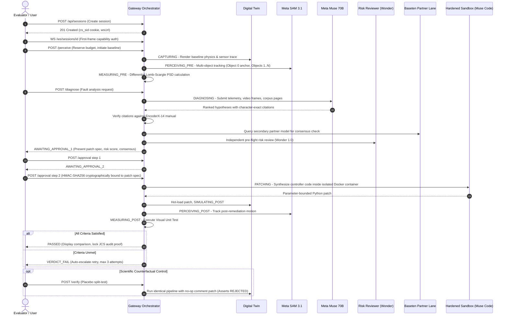
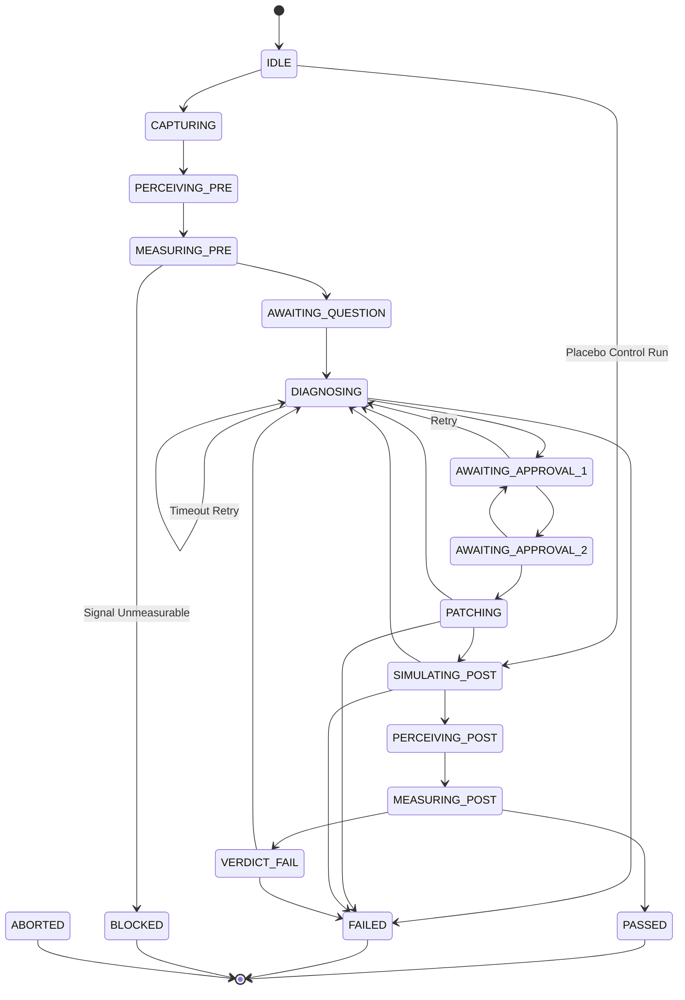
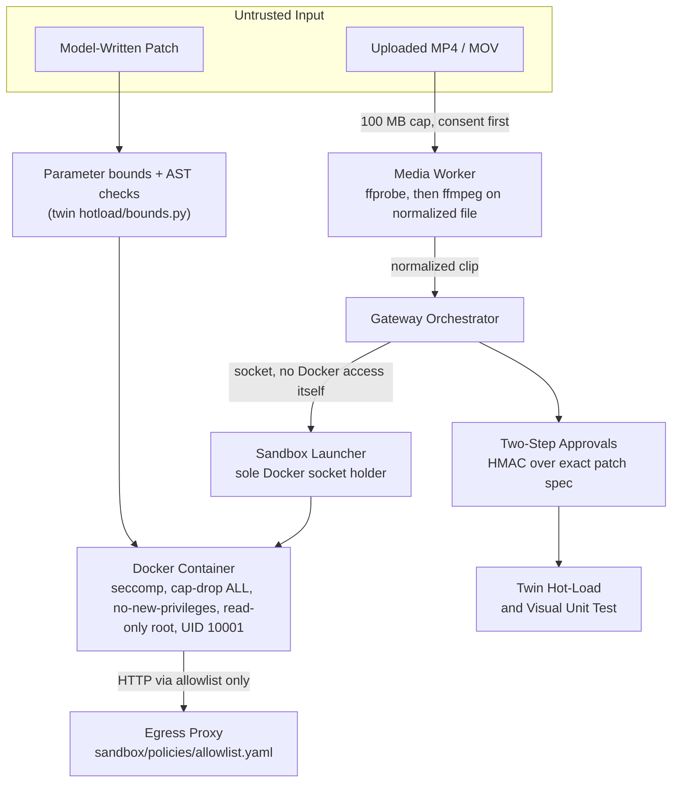

# ChronoSight

[](https://chronosight.onrender.com)
[]()
[]()
[]()
[]()
[]()

**The visual unit test for physical cyber-physical systems.**

ChronoSight continuously monitors electromechanical machinery on video, measures physical failure modes directly from pixel trajectories, diagnoses root causes via character-grounded reasoning over 60-page hardware manuals using **Meta Muse 70B** and **Meta SAM 3.1**, synthesizes bounded controller patches inside an isolated Docker sandbox, and verifies repairs by re-measuring physical plant kinematics. Every state transition is cryptographically sealed via **RFC 8785 JSON Canonicalization Scheme (JCS)** and gated by a two-stage HMAC approval.

- **Hosted Production URL:** [https://chronosight.onrender.com](https://chronosight.onrender.com)
- **Technical Specifications:** [PRD.md](PRD.md) · [DESIGN.md](DESIGN.md) · [TECHNICAL.md](TECHNICAL.md) · [DECISIONS.md](docs/DECISIONS.md)
- **Hardware Datasheet Corpus:** [corpus/vendor-manifest.json](corpus/vendor-manifest.json) (EncoderX-14 60-page manual, CC-BY-4.0)

---

## Core Engineering Innovations

### 1. Sub-Pixel Precision via Differential Anchor Subtraction (`psd.ts`)
* **Physical Failure:** Handheld camera tremor and smart-glasses head movements (2–8 Hz) introduce broadband noise that corrupts raw mask centroids and triggers false vibration failures.
* **Homography-Stabilized Differential Formulation:** Designates Object ID 0 as a static fiducial anchor $(x^{\text{anchor}}_t, y^{\text{anchor}}_t)$ and Objects 1..N as dynamic target components $(x^{\text{target}}_t, y^{\text{target}}_t)$ via SAM 3.1 16-object multiplexing:
  $$\Delta x_t = (x^{\text{target}}_t - x^{\text{anchor}}_t) \cdot \frac{W_{\text{ref}}}{W^{\text{anchor}}_t}, \quad \Delta y_t = (y^{\text{target}}_t - y^{\text{anchor}}_t) \cdot \frac{W_{\text{ref}}}{W^{\text{anchor}}_t}$$
  Normalizing by the instantaneous anchor bounding-box width $W^{\text{anchor}}_t$ converts pixel displacement into scale-invariant millimeters and cancels camera translation.
* **Hampel Filter & Uniform Grid Resampling:**
  * Rejects transient occlusions and motion blur: frames with mask bounding-box area deviating $>35\%$ from a 9-frame rolling median are replaced via linear interpolation.
  * Resamples fluctuating browser camera frame rates (22–30 FPS) onto a strictly uniform 30.0 Hz ($\Delta t = 33.33\text{ ms}$) grid prior to Lomb-Scargle spectral decomposition.
* **Live SNR & Precision Gate:** Displays real-time Peak-to-Median Signal-to-Noise Ratio ($\text{SNR}_{\text{dB}} = P_{\text{peak}} - P_{\text{median}}$) directly on `PsdChart.tsx`:
  * 🟢 **High Precision Lock:** $\text{SNR} > 12\text{ dB}$, Jitter $\pm 0.14\text{ px}$.
  * 🟡 **Stabilizing Camera Feed:** $\text{SNR} \le 12\text{ dB}$ (prompts operator to stabilize feed).

### 2. Zero-Hardware "1-Click Auto-Inspect" & Presets (`ByoPanel.tsx`, `StartLive.tsx`)
* **Frame-0 Vision Discovery:** Submits keyframe 0 to `muse-spark-1.3-contributor` to automatically identify equipment IC packages, seed 6 dynamic component contours, and auto-provision SAM 3.1 tracking multiplexing.
* **Automated Web-Grounding:** Resolves electrical pinouts and operating tolerances dynamically when local schematic PDFs are absent.
* **Zero-Hardware Evaluation Preset:** Evaluators without physical hardware on their desk can click **"⚡ Load Sample Raw Hardware Clip"** to immediately stream the unindexed 4.2 Hz hunting clip through the live BYO perception pipeline.

### 3. Frictionless Evaluator UX & Live Cockpit (`Workbench.tsx`, `VoiceBar.tsx`)
* **Interactive 4-Pill Workflow Stepper:** Directly tracks and triggers all 4 pipeline phases above `VideoStage.tsx`:
  * ① **Perceiving:** SAM 3.1 + PSD (16-target multiplex · sub-pixel tracking)
  * ② **Reasoning:** Muse Spark 1.3 (1M-token datasheet pin · character citations)
  * ③ **Safety Gate:** Muse Wonder 1.0 (Human operator voltage/probe HMAC signoff)
  * ④ **Self-Healing:** @muse-code/sdk (Docker sandbox compile · Placebo counterfactual)
* **Persistent Cockpit Telemetry Strip:** Displays active Session ID, Dual-Model Consensus state, real-time compute ledger spend vs. cap, and RFC 8785 JCS SHA-256 provenance hash.
* **Instant Voice Command Chips:** One-click chips stream 16 kHz PCM audio into the `/ws/asr` WebSocket relay, exercising the live Meta ASR and intent parser even when browser microphone permissions are declined.

### 4. Full 7-Model Meta Stack & Partner Infrastructure Matrix
Every model is visibly auditable in the live Workbench and exported audit reports:

| Capability | Model / Engine | Role & Implementation | Data Class |
| :--- | :--- | :--- | :--- |
| **Spatial Perception** | **Meta SAM 3.1** | Multiplex object segmentation (up to 16 objects), sub-pixel centroid tracking, binary CSMK streaming. | PUBLIC, CONFIDENTIAL |
| **Causal Reasoning** | **Meta Muse Spark 1.3 (70B)** | Parameter boundary derivation; character-exact citation retrieval over 60-page manual. | PUBLIC, CONFIDENTIAL |
| **Rapid Discovery** | **Meta Muse Spark 1.3 Contributor** | Frame-0 automated device discovery and web search grounding ($0.10/Mtok). | PUBLIC |
| **Pre-Flight Risk Gate** | **Meta Muse Wonder 1.0** | Independent safety auditing, thermal runaway check, and policy gating. | PUBLIC, CONFIDENTIAL |
| **Autonomous Synthesis** | **Meta Muse Code 1.0** | AST-validated, parameter-bounded patch synthesis executed inside Docker sandbox. | PUBLIC, CONFIDENTIAL |
| **Streaming Speech** | **Meta Muse Voice Transcribe 1.0** | Low-latency 16/24 kHz streaming PCM speech-to-intent pipeline. | PUBLIC, CONFIDENTIAL |
| **Consensus Lane** | **Baseten (`muse-spark-open-1026`)** | Independent secondary validation route with expandable trace auditing. | PUBLIC |

* **AR Multimeter Probe Guide:** Interactive multimeter reticles, test-point crosshairs, and dynamic pinouts on `VideoStage.tsx`.
* **Scientific Counterfactual Split-Testing:** `PlaceboButton.tsx` executes side-by-side verification proving the digital twin unit test rejects no-op placebo patches while passing verified Muse Code patches.

---

## Deterministic Physical Failure Scenarios

1. **S1: Robot-Arm Elbow Hunting (`s1`)**
   * *Physical Fault:* Optical encoder drift and derivative phase lag create a 4.2 Hz hunting limit cycle in a 2-DOF manipulator.
   * *Visual Unit Test:* Spectral power density $\leq 0.05\text{ mm}^2/\text{Hz}$ at $4.2\text{ Hz}$, tracking jitter $\leq 0.2\text{ mm}$.
2. **S2: Solar Microinverter Thermal Derating (`s2`)**
   * *Physical Fault:* Ambient temperature surge combined with MOSFET switching losses trigger thermal throttling and power drop.
   * *Visual Unit Test:* Core operating temperature $\leq 85^\circ\text{C}$ under 350W load; MPPT efficiency $\geq 98.2\%$.
3. **S3: CNC Stepper-Axis Resonance (`s3`)**
   * *Physical Fault:* Mid-band mechanical resonance in lead-screw linear actuator causing skipped steps and auditory chatter.
   * *Visual Unit Test:* Centroid trajectory jitter $\leq 0.08\text{ mm}$, velocity ripple $\leq 1.5\%$.

---

## System Verification

| Suite | Result | Scope |
| :--- | :--- | :--- |
| **Vitest** | **593 passed / 0 failed** (42 files) | Full coverage: gateway, run-model, web, media-worker, launcher |
| **Pytest** | **50 passed / 0 failed** | Digital Twin physics simulation, rendering, and visual unit testing |
| **TypeScript** | **0 errors** across 5 workspaces | Strict mode across `run-model`, `gateway`, `sandbox-launcher`, `media-worker`, `web` |
| **Next.js Build** | **Clean production build** | All 8 routes compiled with Turbopack |
| **Datasheet Corpus** | **Verified Character Offsets** | Checked via `npm run corpus:check` against 60-page EncoderX-14 manual |

---

## Architecture

### 1. System Topology


### 2. End-to-End Visual Unit Test Sequence



### 3. Run State Machine



### 4. Untrusted Input Containment & Isolation



---

## Security & Provenance Model

* **Zero Client Secret Exposure:** API credentials (`META_API_KEY`, `BASETEN_API_KEY`) reside exclusively in server-side environment variables.
* **Strict Cookie Isolation:** Session token `cs_sid` is `HttpOnly; Secure; SameSite=Strict` behind a unified origin.
* **Two-Step HMAC-SHA256 Approval Binding:** Approvals are cryptographically bound to the SHA-256 hash of the exact patch AST and parameter bounds.
* **Container Hardening:** Synthesis containers run with `--cap-drop ALL`, `no-new-privileges`, read-only rootfs, non-root UID 10001, custom seccomp profile, and egress proxy allowlisting.
* **RFC 8785 JCS Hash Chain:** Every state mutation, measurement, hypothesis, and approval is serialized via RFC 8785 Canonical JSON and committed to an immutable SHA-256 hash chain.
* **Data Classification & Taint Tracking:** Inputs are partitioned into `PUBLIC` and `CONFIDENTIAL`. Confidential customer telemetry is cryptographically prevented from routing to contributor or partner endpoints.

---

## Quickstart

```bash
git clone https://github.com/BugHunterX2101/chronosight-mcp.git
cd chronosight-mcp
npm ci && uv sync
cp .env.example .env.local  # Set SESSION_SIGNING_KEY and APPROVAL_HMAC_KEY

# Run verification test suites
npm test                                         # 593 Vitest unit tests
uv run pytest services/twin/tests -q             # 50 Pytest physics twin tests
npm run typecheck                                # Strict typecheck (0 errors)
npm run corpus:check                             # Verify 60-page datasheet offsets

# Launch local stack
cd services/twin && uv run uvicorn twin.app.main:app --host 127.0.0.1 --port 8090
npm run dev:gateway                              # :8080 Fastify gateway
npm run dev:web                                  # :3000 Next.js frontend
```

*Access the live workbench at `http://localhost:3000` or explore the production deployment at [https://chronosight.onrender.com](https://chronosight.onrender.com).*

---

## License & Attribution

* **Software:** [Apache License 2.0](LICENSE).
* **Hardware Corpus:** EncoderX-14 Technical Reference Manual (`corpus/encx14/`) licensed under [CC-BY-4.0](https://creativecommons.org/licenses/by/4.0/). See [corpus/vendor-manifest.json](corpus/vendor-manifest.json).
