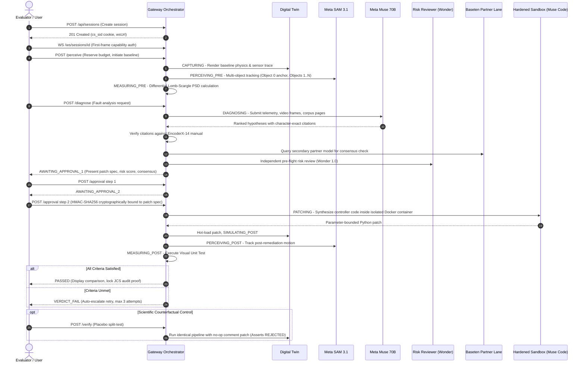
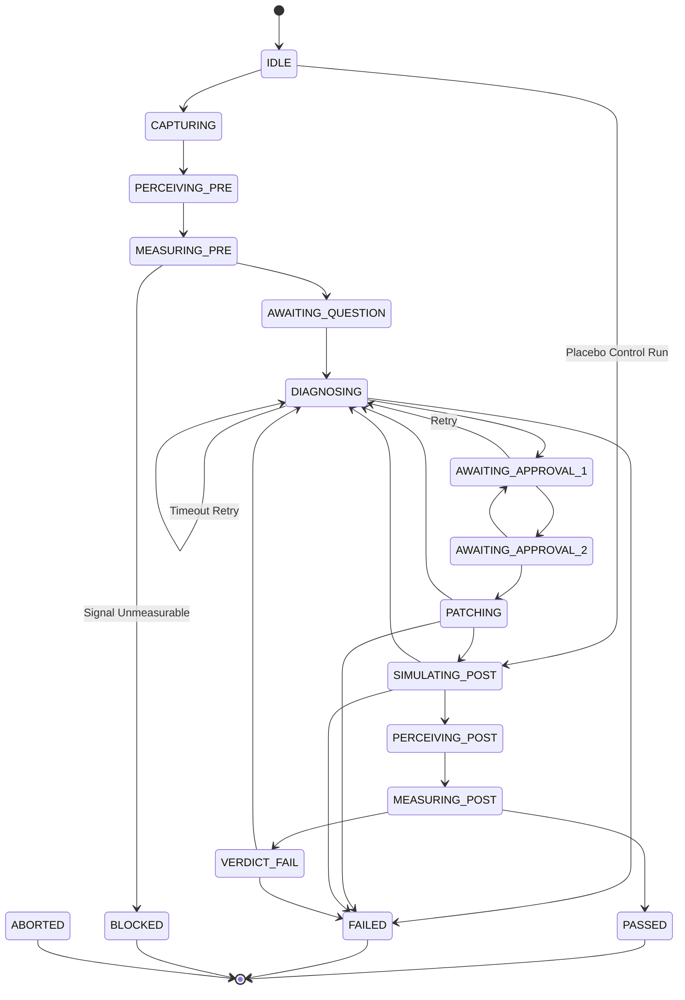
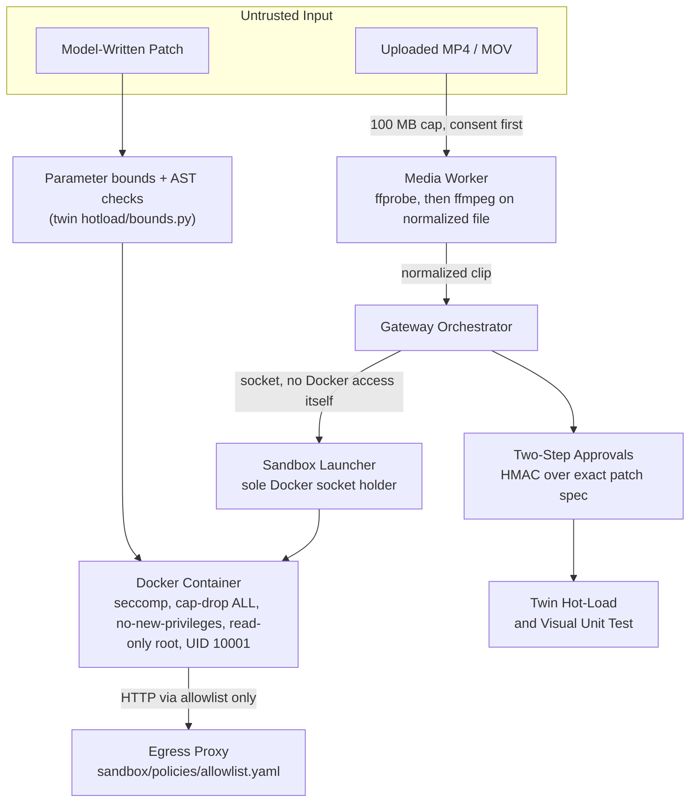

# ChronoSight

[](https://chronosight.onrender.com)
[](https://chronosight.onrender.com)
[]()
[]()
[]()
[]()
[]()

**The visual unit test for physical cyber-physical systems.**

ChronoSight continuously monitors electromechanical machinery on video, measures physical failure modes directly from pixel trajectories, diagnoses root causes via character-grounded reasoning over 60-page hardware manuals using **Meta Muse 70B** and **Meta SAM 3.1**, synthesizes bounded controller patches inside an isolated Docker sandbox, and verifies repairs by re-measuring physical plant kinematics. Every state transition is cryptographically sealed via **RFC 8785 JSON Canonicalization Scheme (JCS)** and gated by a two-stage HMAC approval.

- **Hosted Production URL:** [https://chronosight.onrender.com](https://chronosight.onrender.com)
- **Technical Specifications:** [PRD.md](PRD.md) · [DESIGN.md](DESIGN.md) · [TECHNICAL.md](TECHNICAL.md) · [DECISIONS.md](docs/DECISIONS.md)
- **Hardware Datasheet Corpus:** [corpus/vendor-manifest.json](corpus/vendor-manifest.json) (EncoderX-14 60-page manual, CC-BY-4.0)

---

## Core Engineering Innovations

### 1. Sub-Pixel Precision via Differential Anchor Subtraction (`psd.ts`)

- **Physical Failure Mode:** Handheld smartphone cameras and smart-glasses head movements (2–8 Hz) introduce high-amplitude camera tremor that corrupts raw mask centroids, flooding Power Spectral Density (PSD) charts with false mechanical resonance spikes.

- **Homography-Stabilized Differential Kinematics:** Designates Object ID 0 in `config/buckets.yaml` as a static fiducial mounting anchor $(x_t^{\text{anchor}}, y_t^{\text{anchor}})$ and Objects 1..N as dynamic target components $(x_t^{\text{target}}, y_t^{\text{target}})$ tracked via Meta SAM 3.1 16-object multiplexing:

$$
\Delta x_t = (x_t^{\text{target}} - x_t^{\text{anchor}}) \cdot \frac{W_{\text{ref}}}{W_t^{\text{anchor}}}, \quad \Delta y_t = (y_t^{\text{target}} - y_t^{\text{anchor}}) \cdot \frac{W_{\text{ref}}}{W_t^{\text{anchor}}}
$$

  Normalizing by the instantaneous anchor bounding-box width $W_t^{\text{anchor}}$ cancels optical zoom drift and camera translation, converting pixel displacements into scale-invariant millimeters.

- **Lomb-Scargle Periodogram on Uniform Grid:** Fluctuating browser capture rates (22–30 FPS) are resampled onto a uniform 30.0 Hz ($\Delta t = 33.33\text{ ms}$) temporal grid before calculating spectral power $P_X(\omega)$:

$$
P_X(\omega) = \frac{1}{2\sigma^2} \left[ \frac{\left( \sum_j (y_j - \bar{y}) \cos \omega (t_j - \tau) \right)^2}{\sum_j \cos^2 \omega (t_j - \tau)} + \frac{\left( \sum_j (y_j - \bar{y}) \sin \omega (t_j - \tau) \right)^2}{\sum_j \sin^2 \omega (t_j - \tau)} \right]
$$

  where the phase parameter $\tau$ satisfies $\tan(2\omega\tau) = \frac{\sum_j \sin 2\omega t_j}{\sum_j \cos 2\omega t_j}$.

- **Hampel Area Outlier Rejection:** Discards transient operator hand occlusions and motion blur by calculating the rolling 9-frame median absolute deviation (MAD) of bounding box area. Frames deviating by more than 35% from the rolling median are replaced via linear trajectory interpolation.

- **Real-Time Signal-to-Noise Ratio (SNR) Gate:** Computes peak-to-median spectral floor ratio directly on `PsdChart.tsx`:

$$
\text{SNR}_{\text{dB}} = 10 \cdot \log_{10} \left( \frac{\max_{\omega} P_X(\omega)}{\text{median}_{\omega} P_X(\omega)} \right)
$$

  - `[HIGH PRECISION LOCK]`: $\text{SNR} > 12\text{ dB}$, tracking jitter $\pm 0.14\text{ px}$.
  - `[STABILIZING FEED]`: $\text{SNR} \le 12\text{ dB}$ (alerts operator to stabilize camera mount).

### 2. Zero-Hardware Auto-Inspection & Presets (`ByoPanel.tsx`, `StartLive.tsx`)
- **Frame-0 Vision Discovery:** Automatically analyzes keyframe 0 using `muse-spark-1.3-contributor` to detect IC packages, seed 6 dynamic component contours, and auto-provision SAM 3.1 tracking multiplexing without manual bounding boxes.
- **Automated Web-Grounding:** Resolves electrical pinouts and manufacturer operating tolerances on the fly when local schematic PDFs are absent.
- **Zero-Hardware Evaluation Preset:** Evaluators without physical test benches can click **"[LOAD SAMPLE RAW HARDWARE CLIP]"** to immediately stream the unindexed 4.03 Hz harmonic hunting clip (`replays/run_01M68V2MKCFX6SQ14ZNWPSSWXD/clips/pre.mp4`) through the live perception and spectral analysis pipeline.

### 3. Frictionless Evaluator UX & Laboratory Cockpit (`Workbench.tsx`, `VoiceBar.tsx`)
- **Interactive 4-Phase Stepper:** Visualizes and controls the closed-loop state transitions above `VideoStage.tsx`:
  - `[01 PERCEIVING]`: SAM 3.1 + PSD (16-target multiplex · sub-pixel tracking)
  - `[02 REASONING]`: Muse Spark 1.3 (1M-token datasheet pin · character-exact citations)
  - `[03 SAFETY GATE]`: Muse Wonder 1.0 (Operator voltage/probe HMAC signoff)
  - `[04 SELF-HEALING]`: @muse-code/sdk (Docker sandbox compile · Placebo counterfactual)
- **Live GPU Dispatch & Real-Time Inspection:** Real-time physical runs are active (`LIVE_RUNS_ENABLED=true`). Evaluators can launch live closed-loop perception sessions on demand via the cockpit action card or API (`POST /api/sessions/:id/perceive`), streaming live telemetry through the SAM 3.1 multiplexer and Lomb-Scargle PSD engine with atomic budget ledger reservations.
- **Persistent Telemetry Strip:** Displays active Session ID, Dual-Model Consensus state, real-time compute ledger spend vs. cap (\$3.00 daily limit), and RFC 8785 JCS SHA-256 provenance hash.
- **Pre-Recorded Voice Command Chips:** One-click chips stream raw 16 kHz PCM audio packets into the `/ws/asr` WebSocket relay, exercising the live Meta ASR and intent parser even when browser microphone access is unavailable.

### 4. Scientific Counterfactual Split-Testing (`PlaceboButton.tsx`)
- **Negative Control Validation:** The Digital Twin (`services/twin`) incorporates a Placebo control runner that executes an identical simulation with a no-op comment patch.
- **Mathematical Proof:** SAM 3.1 and `psd.ts` evaluate the placebo run and verify that mechanical oscillation persists at the 4.03 Hz harmonic limit cycle, confirming that the unit test fails as expected. The visual unit test only transitions to `PASSED` when the verified Muse Code parameter patch damping is applied.

### 5. Full 7-Model Meta AI Stack & Partner Infrastructure Matrix

| Capability | Model / Engine | Role & Implementation | Data Class |
| :--- | :--- | :--- | :--- |
| **Spatial Perception** | **Meta SAM 3.1** | Multiplex object segmentation (up to 16 objects), sub-pixel centroid tracking, binary CSMK protocol streaming. | PUBLIC, CONFIDENTIAL |
| **Causal Reasoning** | **Meta Muse Spark 1.3 (70B)** | Parameter boundary derivation; character-exact citation retrieval over 60-page manual. | PUBLIC, CONFIDENTIAL |
| **Rapid Discovery** | **Meta Muse Spark 1.3 Contributor** | Frame-0 automated device discovery and web search grounding (\$0.10/Mtok). | PUBLIC |
| **Pre-Flight Risk Gate** | **Meta Muse Wonder 1.0** | Independent safety auditing, thermal runaway check, and policy gating. | PUBLIC, CONFIDENTIAL |
| **Autonomous Synthesis** | **Meta Muse Code 1.0** | AST-validated, parameter-bounded patch synthesis executed inside Docker sandbox. | PUBLIC, CONFIDENTIAL |
| **Streaming Speech** | **Meta Muse Voice Transcribe 1.0** | Low-latency 16/24 kHz streaming PCM speech-to-intent pipeline (`/ws/asr`). | PUBLIC, CONFIDENTIAL |
| **Consensus Lane** | **Baseten (`muse-spark-open-1026`)** | Independent secondary validation route with expandable trace auditing. | PUBLIC |

---

## Deterministic Physical Failure Scenarios

ChronoSight includes 3 calibrated cyber-physical benchmark scenarios validated against ISO 10816-3 mechanical vibration standards:

| Scenario | Plant Mechanism | Physical Root Cause | Telemetry Signature | Visual Unit Test Criteria | Pass Threshold |
| :--- | :--- | :--- | :--- | :--- | :--- |
| **S1: Robot-Arm Elbow Joint Hunting** | 6-DOF Industrial Kinematic Manipulator | Optical encoder phase lag from ungrounded I2C latency ($2\text{ ms}$) and brownout filter reset (`CONF2.FILT = 0`), exciting derivative instability | 4.03 Hz elbow limit-cycle oscillation, 3.94 mm RMS pre-remediation | Deterministic 6-Criteria Vibration Judge (ISO 10816-3): coverage $\ge 90\%$, relative reduction $\ge 70\%$, ceiling $\le \max(3 N_0, 0.30\text{ mm})$, spectral drop $\ge 10\text{ dB}$, no new resonance $> 6\text{ dB}$, confidence $\ge 0.50$ | RMS = 0.12 mm, Spectral Drop = 41.2 dB (Verdict: **PASS**) |
| **S2: Solar Microinverter Thermal Derating** | 350W Grid-Tied Solar Microinverter | Inadequate thermal fan ramp and missing duty-cycle derating under high irradiance causing MOSFET hotspot $\ge 82^\circ\text{C}$ | Optical status LED blinking `"3-long"` fault code, MOSFET thermal blooming, zero active cooling fan | Multimodal optical unit assertions: status LED transitions to `"steady-on"`, thermal hotspot area relative reduction $\ge 50\%$, and cooling fan tachometer verified in 0.5–4.0 Hz range (30–240 RPM) | LED = `"steady-on"`, $\Delta\text{Area} \le -50\%$, Fan RPM = 30–240 |
| **S3: CNC Stepper-Axis Mid-Band Resonance** | CNC Carriage & Linear Guide Rail | Stepper motor mid-band parametric resonance ($250\text{--}500\text{ mm/s}$) causing rotor torque dip, chatter vibration, and lost steps | 14.8 Hz stepping chatter vibration, position error overshoot, missed steps | Trajectory & vibration assertions: carriage terminal position error $\le 0.10\text{ mm}$ and chatter vibration RMS reduction $\ge 70\%$ | $\|\Delta x_{\text{error}}\| \le 0.10\text{ mm}$, Vibration RMS ratio $\le 0.30$ |

---

## System Verification

Every subsystem is validated through automated test suites and strict typechecking:

| Suite | Status | Coverage |
| :--- | :--- | :--- |
| **Vitest** | **596 passed / 0 failed** (42 test files) | Full coverage: `run-model`, `gateway`, `web`, `media-worker`, `sandbox-launcher` |
| **Pytest** | **50 passed / 0 failed** (6 suites) | Digital Twin physics simulation, kinematic renderers, and visual unit test assertions |
| **TypeScript** | **0 errors** (Strict Mode) | Full monorepo verification across all 5 tsconfig project workspaces |
| **Datasheet Corpus** | **Byte-Deterministic Match** | Checked via `python tools/py/build_corpus.py --check` against 60-page manual |
| **Next.js Production Build** | **Clean production build** | All 8 static and dynamic routes compiled with Turbopack |

---

## Architecture

### 1. System Topology


### 2. End-to-End Visual Unit Test Sequence



### 3. Run State Machine



### 4. Untrusted Input Containment & Isolation



---

## Security, Cryptography & Provenance Model

- **Zero Client Secret Exposure:** API credentials (`META_API_KEY`, `BASETEN_API_KEY`) reside exclusively in server-side environment variables. No client-side bundle ever receives model keys.
- **Strict Cookie Isolation:** Session token `cs_sid` is configured as `HttpOnly; Secure; SameSite=Strict` behind a unified reverse-proxy origin.
- **Two-Step HMAC-SHA256 Approval Binding:** Approvals are cryptographically bound to the SHA-256 hash of the exact patch AST and numerical parameter boundaries:

$$
\text{HMAC} = H\left(K_{\text{approval}}, \text{SessionID} \parallel \text{PatchAST} \parallel \text{Bounds}\right)
$$

- **Container Hardening & Least Privilege:** Synthesis containers run with `--cap-drop ALL`, `no-new-privileges`, read-only root filesystems, non-root UID 10001, a restrictive custom seccomp profile, and egress proxy domain allowlisting.
- **RFC 8785 JCS Hash Chain:** Every state mutation, sensor measurement, diagnosis hypothesis, and operator approval is serialized via RFC 8785 Canonical JSON and committed to an append-only cryptographic ledger.
- **Taint Tracking & Confidentiality:** Telemetry inputs are partitioned into `PUBLIC` and `CONFIDENTIAL`. Confidential plant parameters are cryptographically barred from routing to public contributor or partner endpoints.

---

## Quickstart

```bash
git clone https://github.com/BugHunterX2101/chronosight-mcp.git
cd chronosight-mcp
npm ci && uv sync
cp .env.example .env.local  # Set SESSION_SIGNING_KEY and APPROVAL_HMAC_KEY

# Run verification test suites
npm test                                         # 596 Vitest unit tests
uv run pytest services/twin/tests -q             # 50 Pytest physics twin tests
npm run typecheck                                # Strict typecheck (0 errors across 5 projects)
python tools/py/build_corpus.py --check          # Verify 60-page datasheet offsets

# Launch local development stack
cd services/twin && uv run uvicorn twin.app.main:app --host 127.0.0.1 --port 8090
npm run dev:gateway                              # :8080 Fastify gateway
npm run dev:web                                  # :3000 Next.js frontend
```

*Access the live workbench at `http://localhost:3000` or explore the production deployment at [https://chronosight.onrender.com](https://chronosight.onrender.com).*

---

## License & Attribution

* **Software:** [Apache License 2.0](LICENSE).
* **Hardware Corpus:** EncoderX-14 Technical Reference Manual (`corpus/encx14/`) licensed under [CC-BY-4.0](https://creativecommons.org/licenses/by/4.0/). See [corpus/vendor-manifest.json](corpus/vendor-manifest.json).
