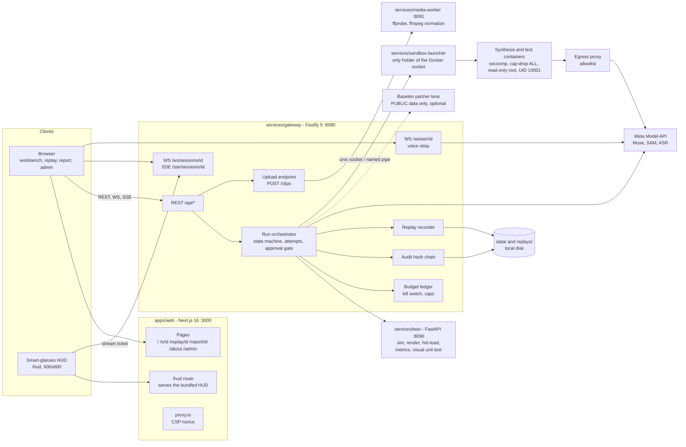
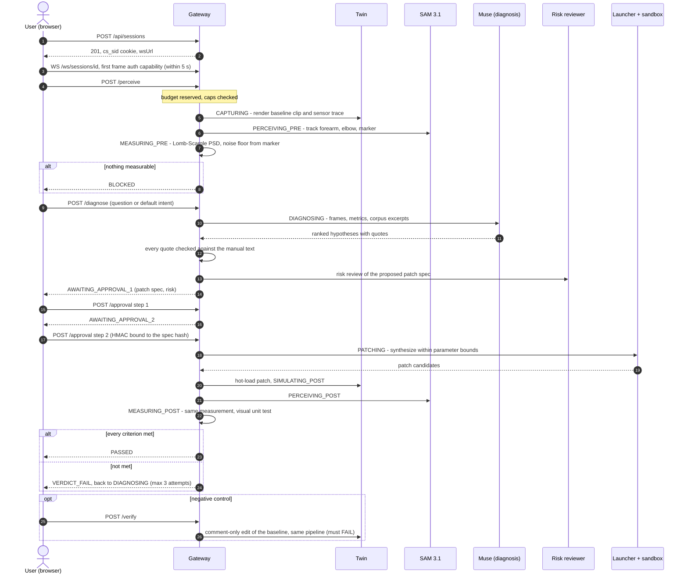
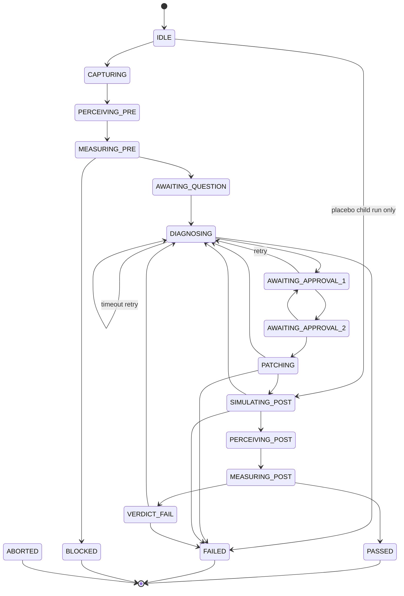
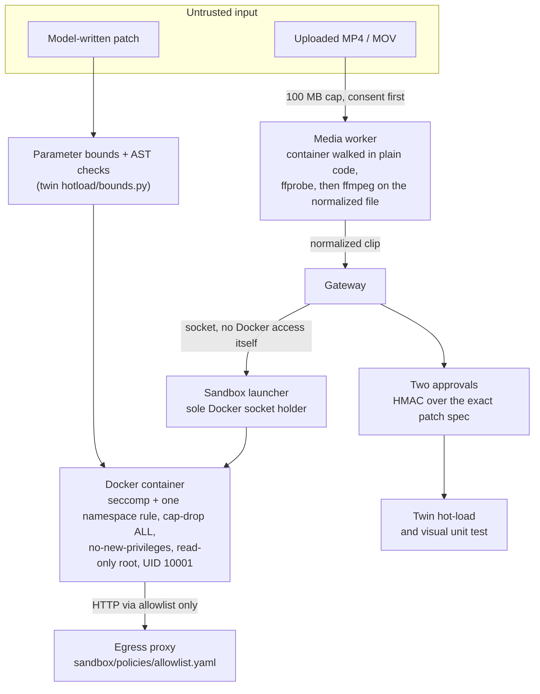
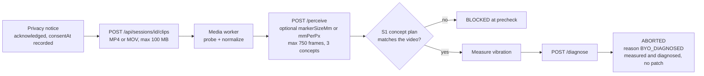
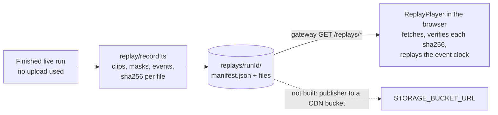
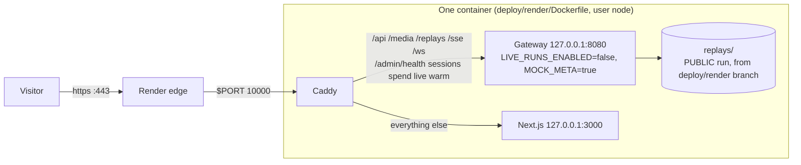

# ChronoSight

**The visual unit test for physical systems.** ChronoSight watches a (simulated) machine misbehave on video, measures the fault from pixels, asks a reasoning model why, has a coding model write a bounded patch, runs the patch in an isolated sandbox, then films the machine again and measures the same signal to check the repair. Nothing is applied without two separate human approvals.

Specs: [PRD.md](PRD.md) (what), [DESIGN.md](DESIGN.md) (how), [TECHNICAL.md](TECHNICAL.md) (stack and contracts). Deviations made while building are listed in [docs/DECISIONS.md](docs/DECISIONS.md) (D-1 to D-11). Hand-off notes for the next developer: [HANDOFF.md](HANDOFF.md).

## What it does today

Three deterministic digital-twin scenarios are now present: **S1** robot-arm elbow
hunting, **S2** solar microinverter thermal derating, and **S3** CNC stepper-axis
resonance (`services/twin/twin/scenarios/s1`, `s2`, and `s3`). The loop:

1. **Capture**: the twin renders a clip and records a sensor trace. Or you upload your own MP4/MOV (see *Bring your own clip*).
2. **Perceive**: SAM 3.1 finds and tracks named parts (forearm, elbow, marker); vibration of the fault part is measured from the tracks (Lomb-Scargle spectrum, noise floor from a reference marker).
3. **Diagnose**: a Meta Muse model returns ranked hypotheses; every quote it cites is checked against the source text of a bundled manual (EncoderX-14, 60 pages, `corpus/`).
4. **Review**: a second model reviews the proposed change for risk. The user approves in two steps; the approval is HMAC-bound to the exact patch spec shown.
5. **Patch**: Muse Code writes the patch inside hard parameter bounds, inside a hardened Docker sandbox.
6. **Verify**: the twin hot-loads the patch, renders again, and the same measurement runs on the new clip. The visual test lists every criterion with value and threshold. A placebo (negative control) run can be started to show the test is not trivially passable.

Other surfaces: replay player for recorded runs (each file sha256-verified in the browser), audit report per run (hash-chained log), voice control (24 kHz capture, `/ws/asr` relay, intent grammar), smart-glasses HUD (`/hud`, 600x600, pairing by code or QR), WebMCP tools for in-browser agents, admin console.

## Status

| Area | State |
| :-- | :-- |
| Twin (sim, render, metrics, hot-load, visual unit test), S1-S3 | Built; 50 pytest tests pass, including deterministic S2/S3 fixtures and typed assertions |
| Gateway (run orchestrator, approval gate, diagnosis, SAM client, budget ledger, audit chain, replay recorder, HUD, ASR relay, beacons, admin) | Built |
| Sandbox launcher + egress proxy + Muse synthesis | Built (local Docker only) |
| Media worker (probe + normalize untrusted uploads) | Built |
| Web (home, `/s/[id]` workbench, `/replay/[id]`, `/report/[id]`, `/about`, `/admin`, `/hud`, PsdChart, PlaceboButton, GlassesPreview, WebMCP, voice) | Built |
| Bring-your-own clip (gateway + web) | Built; needs a media worker; see limits below |
| Replay **publisher** (push bundles to a CDN) | Built as an opt-in immutable HTTP PUT publisher; local recording remains the default |
| Hosted demo on Render | Replay-only, see *Deploy on Render* |
| Provider-neutral live stack | Docker Compose under `deploy/live`; fixture/mock mode is the safe default |
| Whole-product sweep and video readiness | Not finished; see HANDOFF.md |

Test totals at the last full run: `npx vitest run` = **569 tests in 39 files, all pass**; `pytest services/twin/tests` = **50 pass**. Typechecks (`tsc -p` on gateway, web, media-worker, run-model) are clean.

## Architecture

### System components

The browser talks to one origin. Locally that is two ports (web `:3000`, gateway `:8080`, allowed by the browser's localhost exception); on Render, Caddy puts both behind one origin.



Modal is not a runtime component: it is only a place to run tests (token names are in `.env.example`), and synthesis always runs on local Docker.

### One live run, end to end

Each arrow is an HTTP call from the browser or an internal call. State names are the run states in the next diagram.



### Run state machine

Source of truth: `packages/run-model/src/state-machine.ts`. Entering `DIAGNOSING` spends one of 3 attempts; any non-terminal state can go to `ABORTED` (cancel, kill switch, bring-your-own run ending after diagnosis).



### Where untrusted code and data are contained



### Bring-your-own clip



### Replay recording and playback



### Hosted demo on Render



No twin, media worker, sandbox or model key exists on Render; it plays recorded runs only.

## File structure

Tracked files only. `data/`, `replays/`, `graphify-out/`, `node_modules/`, `.venv/`, `.next/` and `.env.local` are gitignored. `replays/` exists only in the `deploy/render` branch.

```text
chronosight/
├── PRD.md  DESIGN.md  TECHNICAL.md      specs: what, how, stack and contracts
├── README.md  HANDOFF.md                this file; what the next developer needs
├── package.json  package-lock.json      npm workspaces: packages/*, gateway, sandbox-launcher, media-worker, apps/web
├── pyproject.toml  uv.lock              Python env for the twin
├── tsconfig.base.json  vitest.config.ts
├── .env.example                         variable names only
├── .dockerignore  .gitattributes  .gitignore
│
├── apps/web/                            Next.js 16.4 + React 19
│   ├── app/                             App Router
│   │   ├── page.tsx                     home
│   │   ├── s/[sessionId]/page.tsx       live workbench
│   │   ├── replay/[runId]/page.tsx      replay player
│   │   ├── report/[sessionId]/page.tsx  audit report
│   │   ├── about/  admin/               about page, admin console
│   │   ├── hud/route.ts                 serves the glasses HUD
│   │   └── layout.tsx  globals.css  icon.svg
│   ├── components/                      Workbench, panels, ByoPanel, PsdChart, PlaceboButton,
│   │                                    ApprovalDialog, ReplayPlayer, TwinScene, VideoStage,
│   │                                    VoiceBar, GlassesPanel, WebMcpTools, AdminConsole, ...
│   ├── lib/
│   │   ├── session/                     REST client, WebSocket, runs reducer, PSD, BYO helpers
│   │   ├── replay/                      bundle loader, sha256 check, clock, featured list
│   │   ├── hud/                         HUD model, pairing, navigation, speech, transport
│   │   ├── voice/                       capture (24 kHz PCM), intents, narration, client
│   │   ├── scene/                       WebGL2 arm scene for the home page (no library)
│   │   ├── webmcp/                      tools exposed to in-browser agents
│   │   ├── glasses/qr.ts  beacon.ts  config.ts
│   ├── public/hud/  public/voice/       HUD css and icons; PCM worklet
│   ├── scripts/                         build-hud.mjs (runs before dev/build), icon generator
│   └── proxy.ts  next.config.ts         CSP nonce proxy, Next config
│
├── packages/run-model/src/              zod contracts shared by every TypeScript package
│   ├── state-machine.ts  reducer.ts     run states and transitions
│   ├── envelope.ts  jcs.ts  taint.ts    event envelope, canonical JSON, data-class taint
│   └── schemas/diagnosis.ts  schemas/visual-test.ts
│
├── services/
│   ├── gateway/                         Fastify 5, Node 24 runs TS directly
│   │   ├── src/
│   │   │   ├── server.ts  app.ts        boot and all routes
│   │   │   ├── orchestrator/run.ts      drives one run through the states
│   │   │   ├── gate/                    approval.ts (HMAC two-step), risk.ts
│   │   │   ├── diagnosis.ts  citations.ts  router.ts  meta.ts   model calls, quote checking, routing
│   │   │   ├── sam/client.ts  csmk.ts   perception client, track format
│   │   │   ├── muse/                    synthesizer, sandbox attach, launcher client, policy
│   │   │   ├── hud/                     pairing, capability, projection to the 600x600 view
│   │   │   ├── asr/                     voice relay, intent grammar, lifecycle
│   │   │   ├── replay/record.ts         replay bundle writer
│   │   │   ├── upload.ts  byo.ts        bring-your-own clip
│   │   │   ├── budget.ts  ledger.ts     spend caps and kill switch
│   │   │   ├── audit.ts  report.ts  session.ts  twin.ts  warmer.ts  telemetry.ts  ...
│   │   ├── prompts/                     p0.v1/v2 diagnosis, risk.v1
│   │   ├── scripts/                     record-diagnosis, record-replay, run-s1
│   │   └── test/                        vitest suites
│   ├── sandbox-launcher/src/            launcher.ts, docker.ts, tar.ts, server.ts
│   ├── media-worker/src/                media.ts (probe, normalize), server.ts
│   └── twin/                            Python 3.12, FastAPI
│       ├── twin/app/main.py             HTTP API
│       ├── twin/sim/                    plant stepping and run loader
│       ├── twin/render/                 frame rendering and encoding
│       ├── twin/metrics/                spectrum (Lomb-Scargle), telemetry, SAM-track metrics
│       ├── twin/hotload/                bounds, child process runner
│       ├── twin/vut/                    visual unit test: evaluate.py, schema
│       ├── twin/mutation/               mutation suite and patch variants v1..v5
│       ├── twin/scenarios/s1/           elbow-hunting arm: plant, faults, baseline controller
│       └── tests/                       pytest (46)
│
├── config/                              routing.yaml, prices.json, buckets.yaml
├── corpus/encx14/                       EncoderX-14 manual (pdf, per-page text, manifest)
├── sandbox/                             Dockerfile, compose.yaml, egress-proxy/, policies/
│   └── policies/                        allowlist.yaml, seccomp-default.json
├── deploy/render/                       Dockerfile, Caddyfile, start.sh (hosted demo)
├── fixtures/                            recorded Meta and SAM responses used by mock mode and tests
├── tools/py/                            build_corpus.py, record_sam.py
└── docs/DECISIONS.md                    deviations D-1 to D-11
```

| Workspace | Path | Notes |
| :-- | :-- | :-- |
| Run model | `packages/run-model` | zod contracts shared by gateway, launcher and browser (`./browser` entry) |
| Gateway | `services/gateway` | Node 24, runs TypeScript directly (type stripping, so no TS parameter properties) |
| Sandbox launcher | `services/sandbox-launcher` | alone talks to Docker; gateway talks to it over a socket |
| Media worker | `services/media-worker` | container walked in plain code first, ffprobe second, ffmpeg only on a normalized file |
| Twin | `services/twin` (Python 3.12) | `uvicorn twin.app.main:app --port 8090` |
| Web | `apps/web` | Next 16.4, React 19; `scripts/build-hud.mjs` bundles the HUD before dev/build |
| Config | `config/routing.yaml`, `prices.json`, `buckets.yaml` | model routing, price table, data-class buckets |
| Corpus | `corpus/encx14` | manual, manifests, built by `tools/py/build_corpus.py` (`npm run corpus:check`) |

### Model routing (`config/routing.yaml`)

| Task | Primary | Effort | Data classes |
| :-- | :-- | :-- | :-- |
| diagnosis.routine | muse-spark-1.3-contributor (falls back to muse-spark-1.3 high) | xhigh | PUBLIC |
| diagnosis.escalated | muse-spark-1.3 | max | PUBLIC, CONFIDENTIAL |
| diagnosis.user | muse-spark-1.3 | high | CONFIDENTIAL |
| risk.review | muse-wonder-1.0 | high | PUBLIC, CONFIDENTIAL |
| perception | sam-3.1 | n/a | PUBLIC, CONFIDENTIAL |
| device.sound / overlay.image / errata.search | muse-spark-1.2 / muse-image-1.0 / muse-spark-1.3-contributor | n/a / n/a / low | see file |

A Contributor model is never returned for CONFIDENTIAL data; the router throws. Raw audio is never sent to muse-spark-1.3 (FR-VOI-4).

## Run it locally

Requirements: Node >=24 <25, Python 3.12 with `uv`, Docker (only for synthesis/sandbox), ffmpeg + ffprobe on PATH (only for the media worker).

```bash
npm ci
uv sync                                  # python env for the twin (or: python -m venv .venv && pip install -e . pytest hypothesis)
cp .env.example .env.local               # then fill in values; the file is gitignored
```

Start each service in its own terminal:

```bash
cd services/twin && uvicorn twin.app.main:app --host 127.0.0.1 --port 8090
npm run dev:gateway                       # :8080, loads ../../.env.local
npm run start -w services/media-worker    # :8091 (optional; enables uploads)
npm run start -w services/sandbox-launcher   # only for live patch synthesis
npm run dev:web                           # :3000
```

With `MOCK_META=true` the gateway boots without a Meta key (no real model calls). Live runs need `META_API_KEY`.

### Environment variables (names; set values in `.env.local`, never commit them)

| Variable | Used by | Default / note |
| :-- | :-- | :-- |
| `META_API_KEY`, `META_API_BASE` | gateway | required unless `MOCK_META=true` |
| `MOCK_META` | gateway | `true` boots without a key |
| `SESSION_SIGNING_KEY`, `APPROVAL_HMAC_KEY` | gateway | each >= 32 chars; required |
| `PUBLIC_ORIGINS` | gateway | origins allowed to make state-changing requests; required |
| `ADMIN_TOKEN` | gateway | unset turns the admin API off (404) |
| `LIVE_RUNS_ENABLED` | gateway | **defaults to true when unset**; set `false` to pause live runs |
| `BUDGET_GLOBAL_DAILY_USD` | gateway | default 3 |
| `BUDGET_PER_VISITOR_RUNS_PER_HOUR` | gateway | default 2 |
| `SESSION_TTL_HOURS`, `HUD_PAIRING_TTL_S`, `CACHE_WARMER_INTERVAL_H` | gateway | see `server.ts` |
| `TWIN_URL` | gateway | default `http://127.0.0.1:8090` |
| `MEDIA_WORKER_URL` | gateway | empty disables uploads (`/api/scenarios` then reports `uploads:false`) |
| `MEDIA_WORKER_PORT`, `FFMPEG_PATH`, `FFPROBE_PATH` | media worker | default 8091, `ffmpeg`, `ffprobe` |
| `LAUNCHER_SOCKET` | gateway, launcher | unix socket path, or a named pipe on Windows |
| `SANDBOX_IMAGE`, `EGRESS_PROXY_URL` | launcher | synthesis image and proxy |
| `PARTNER_ENDPOINTS_ENABLED`, `BASETEN_API_KEY`, `BASETEN_MODEL_ID` | gateway | optional partner lane (PUBLIC data only) |
| `MODAL_TOKEN_ID`, `MODAL_TOKEN_SECRET` | tests | Modal is used for tests only |
| `STORAGE_BUCKET_URL`, `STORAGE_KEY` | replay publisher; both are required together and are never exposed to the browser |
| `NEXT_PUBLIC_GATEWAY_ORIGIN`, `NEXT_PUBLIC_CDN_ORIGIN` | web | the only two values the browser sees; **empty = same origin** |
| `DATA_DIR` | gateway | session and audit storage |

## Tests

```bash
npx vitest run                                                  # 563 tests, 38 files
npm run typecheck                                               # run-model, gateway, launcher, media-worker
npx tsc -p apps/web --noEmit
cd services/twin && python -m pytest tests -q                   # 46 tests
npm run corpus:check                                            # corpus manifest matches the manual
```

The sandbox hardening tests need Docker. Modal is used for tests only; synthesis always runs on local Docker.

## Bring your own clip

The workbench offers "Analyse your own clip" when `/api/scenarios` reports `uploads:true`. Flow: acknowledge the privacy notice (PRD 17.4; the gateway records `consentAt`) -> `POST /api/sessions/:id/clips` (MP4/MOV, <= 100 MB) -> optional scale (marker width in mm or mm/px) -> `perceive` -> `diagnose`. The run ends **ABORTED with reason `BYO_DIAGNOSED`**: measured and diagnosed, no patch.

Limits, stated plainly:
- Uploads are processed inline by the media worker, not through the Files API; a run is capped at 750 frames (25 s) for three concepts.
- The tracker uses **S1's concept plan** (orange arm segment, round joint, checkered square). A generic video is stopped at the precheck (BLOCKED).
- Without a scale the run reports pixels and says so.
- The uploaded file's name is never stored or logged. A run that used an upload is never recorded as a replay (`clip.used` refusal in `replay/record.ts`).
- Webcam capture is implemented in the BYO panel with MP4/WebM capability detection; it still needs a real Chrome/Safari click-through against a running media worker. Audio extraction from uploads and D1 logs remain unbuilt.

## Safety model

- Keys exist only in `.env.local` (gitignored) or the host's secret store. The browser never holds a model key (TH-7).
- Cookie `cs_sid` is `HttpOnly; Secure; SameSite=Strict`, so web and API must share a site. Local dev uses the browser's localhost exception; hosted deployments serve both from one origin.
- State-changing requests are accepted only from `PUBLIC_ORIGINS`.
- Live runs are gated by a kill switch, a per-visitor hourly cap, and a daily USD cap (`ledger.ts`; rejections `LIVE_PAUSED`, `VISITOR_CAP`, `DAILY_CAP`).
- Synthesis containers: Docker default seccomp plus one narrow rule for the namespace syscalls Muse's bubblewrap needs (D-10), `--cap-drop ALL`, `no-new-privileges`, read-only root, UID 10001, egress via an allowlist proxy. Only the launcher touches the Docker socket.
- CONFIDENTIAL data never goes to a Contributor or partner endpoint and never to Modal.
- The audit log is a hash chain; replay files carry sha256 digests checked in the browser.

## Deploy on Render (hosted demo)

Files: `deploy/render/Dockerfile`, `deploy/render/Caddyfile`, `deploy/render/start.sh`, `.dockerignore`. One container runs the gateway (127.0.0.1:8080), Next (127.0.0.1:3000) and Caddy on `$PORT`. Caddy sends `/api/* /media/* /replays/* /sse/* /ws/*` and the gateway's JSON `/admin/*` endpoints to the gateway and everything else to Next. One origin keeps the SameSite=Strict cookie working, and `NEXT_PUBLIC_*` are left empty.

What the hosted demo is: **replay-only**. There is no twin, media worker, sandbox, Docker socket or model key on Render, so live runs, uploads and verify are unavailable and the app boots with `LIVE_RUNS_ENABLED=false` and `MOCK_META=true`. Recorded runs play from `replays/`.

- The replay bundle (`replays/`, about 18 MB, a PUBLIC run) is gitignored on `build/wip`. It is force-committed only on the branch **`deploy/render`**, which is what Render builds. Do not merge that branch into main.
- Service: Render team `chronosight-mcp`, Docker runtime, free plan, Oregon, health check `/api/healthz`, auto-deploy off (trigger a deploy from the dashboard or `POST /v1/services/{id}/deploys`).
- Env set on the service: `LIVE_RUNS_ENABLED`, `MOCK_META`, `SESSION_SIGNING_KEY`, `APPROVAL_HMAC_KEY`, `ADMIN_TOKEN` (generated at creation; read it in the Render dashboard).
- Free plan: the instance sleeps when idle (first request is slow) and its disk is ephemeral, so sessions do not survive a restart.
- `/api/readyz` reports problems on Render because it checks the twin and launcher; use `/api/healthz`.
- Deploy gotcha already fixed: the official Caddy binary has a file capability that a non-root user cannot exec in Render's container; the Dockerfile rewrites it as a plain file.

To go live (real runs) you need a host that can run the twin, the launcher and Docker, and one registrable domain for web and gateway (TR-2). Do not enable `LIVE_RUNS_ENABLED` on a public host without reviewing the caps.

## Provider-neutral live Docker stack

`deploy/live/compose.yaml` is the production-shaped composition for a Docker-capable host. It keeps the web and gateway behind one Caddy origin, places the twin and media worker on an internal network, and gives the sandbox launcher the only Docker-socket mount. Replay/session data is stored in the named `chronosight-data` volume.

Start it with:

```sh
cp .env.example .env
# Set PUBLIC_ORIGINS, SESSION_SIGNING_KEY, and APPROVAL_HMAC_KEY in .env.
docker compose -f deploy/live/compose.yaml up --build
```

The default is fixture/mock mode (`LIVE_RUNS_ENABLED=false`, `MOCK_META=true`). Keep that mode until the host, storage retention, sandbox image, egress allowlist, readiness checks, and budget caps have been reviewed. The composition is deployment preparation; it is not live-run acceptance evidence.

## Known gaps and deviations

- Diagnosis uses the deepest reasoning setting; the per-attempt cap is **240 s**. The <= 30 s target in the spec is **not met**.
- HUD live states H4/H5/HE have not been observed from a real run. WebMCP was verified against a recording shim, not a real agent.
- The placebo control and BYO verification have not been exercised live, to avoid spend.
- `/about` carries no validation tables, on purpose. There are no judge-tuning or mutation-run documents; the twin's mutation code is kept.
- The repository is MIT-licensed; see [LICENSE](LICENSE).

## Security reminders for the repo owner

The repository is public. Revoke the GitHub tokens that were pasted during development, revoke or rotate the Render API key that was used to create the service, and rotate the Baseten and Meta keys.
