# ChronoSight — Technical Specification

> **In one line:** the build-level blueprint for ChronoSight. It covers the exact stack and version pins, every architecture view, the full repository tree, module interfaces, APIs, configuration, CI/CD, operations and test strategy. Engineers can open files on D1 from this document and know what goes in each one.

| Field | Value |
| :--- | :--- |
| Document | `TECHNICAL.md` v1.1 (Technical Specification). v1.0 proposed DL-20 to DL-23; v1.1 records that they were adopted. |
| Derived from | `PRD.md` v1.4 (**what** and **why**) and `DESIGN.md` v1.1 (**how**, at the design level) |
| Precedence | The PRD wins on *what*. DESIGN wins on *how*. This document wins only on *where in the code* and *with which pinned tool*. Its deltas DL-20 to DL-23 (§2.3) are **adopted**: they are back-ported into DESIGN v1.1 §3.2 and PRD v1.4. Any new delta follows the same path before it binds. |
| Date | 2026-10-27 (D1) |
| Status | Draft for build. Version pins were checked against the npm, PyPI and GitHub registries on 2026-10-27. |
| Provenance | Interfaces, schemas, tables, signature sketches and Mermaid diagrams only. **No implementation code**, and no Dockerfile, Compose, Caddyfile, workflow or `.env` bodies (C-2, E16). Everything in the repository is written after kickoff. |
| Audience | Build roles A–D (PRD §19). Technical judges, via `docs/architecture.md`, which is generated from §3 and §4 of this document. |

### Conventions

- Every DESIGN convention applies: ⚠️ for unverified behaviour, RFC 2119 keywords, the ID prefixes, UTC logs, JCS for canonical JSON, and `sha256:<hex>` hashes.
- **New ID prefixes in this document:**
  - **TD-** is a technical decision made here, within the latitude DESIGN leaves.
  - **TQ-** is an open technical question.
  - **TR-** is an implementation risk.
  - **DL-20+** continues DESIGN's delta numbering (DESIGN §3, §36) for changes to something DESIGN states. DL-20 to DL-23 are adopted; the next one is DL-24.
- **"(introduced here)"** marks a path, endpoint or file that neither the PRD nor DESIGN names.
- Signature sketches use a neutral `name(arg: Type) -> Result` notation. They state contracts, not code.
- "Checked" in the version tables means the registry's `latest` tag was read on 2026-10-27. A pin's lockfile is committed on D0-4 or the day the package is first used.

---

## Table of contents

1. [Executive technical summary](#1-executive-technical-summary)
2. [Technology stack and version pins](#2-technology-stack-and-version-pins)
3. [Architecture views](#3-architecture-views)
4. [Repository file structure](#4-repository-file-structure)
5. [Module specifications](#5-module-specifications)
6. [Core interfaces and algorithms](#6-core-interfaces-and-algorithms)
7. [API reference](#7-api-reference)
8. [Data, schemas and storage](#8-data-schemas-and-storage)
9. [Configuration](#9-configuration)
10. [Local development](#10-local-development)
11. [Build, CI/CD and release](#11-build-cicd-and-release)
12. [Operations runbook](#12-operations-runbook)
13. [Security implementation](#13-security-implementation)
14. [Observability implementation](#14-observability-implementation)
15. [Test implementation](#15-test-implementation)
16. [Performance budget by module](#16-performance-budget-by-module)
17. [Build sequencing by day and file](#17-build-sequencing-by-day-and-file)
18. [Risks, open questions and deltas](#18-risks-open-questions-and-deltas)
19. [Traceability: requirement to code](#19-traceability-requirement-to-code)
20. [Sources](#20-sources)

---

## 1. Executive technical summary

ChronoSight is a closed **perceive → measure → diagnose → approve → patch → re-perceive → verdict** loop (DESIGN §2). Technically it consists of five deployables and one shared package:

| Deployable | Runtime | Lives in | Holds secrets? |
| :--- | :--- | :--- | :--- |
| Web app (workbench, replay, HUD, report, about, admin) | Next.js 16 on Vercel | `apps/web` | No |
| Gateway (orchestrator, router, SAM/ASR/Spark/Muse Code clients, gate, budget, audit) | Node 24, Fastify 5 | `services/gateway` | `META_API_KEY`, HMAC keys |
| Twin (simulation, rendering, telemetry engine, visual unit test, patch hot-load) | Python 3.12, FastAPI | `services/twin` | No |
| Media worker (probe and normalize untrusted uploads) | ffmpeg and ffprobe | `services/media-worker` | No |
| Sandbox stack (Muse Code container, egress proxy, sandbox launcher) | Docker | `sandbox/`, `services/egress-proxy`, `services/sandbox-launcher` | A Meta key inside the sandbox only (TH-8) |
| Shared run model (events, reducer, schemas, canonical hashing) | TypeScript | `packages/run-model` | — |

**The three engineering bets that carry the product.**

1. **Deterministic judge, model witnesses** (T1). The verdict comes from `services/twin/vut`. It is pure numpy and scipy over SAM masks and is property-tested. No model output reaches the verdict path.
2. **One event log, one reducer** (ADR-008). Live runs, replays, the HUD and the report all fold the same envelopes through `packages/run-model`. A replay is a recorded event stream, so it can't drift from live behaviour.
3. **Capabilities, not trust** (T2, ADR-010). Every action that changes code runs through capabilities: a JCS-hashed, HMAC-bound, single-use, two-step token, a deterministic argv policy engine, and a hardened container that only a fixed-parameter launcher can create.

### 1.1 Why this architecture wins, mapped to the targets

| Architectural choice | Mechanism | Moves | Evidence a judge can open |
| :--- | :--- | :--- | :--- |
| Cached pre-patch baselines (FR-PER-7) | Baseline key over scenario, seed, controller, renderer and SAM model (DESIGN §20.5) | K5 (−15 s), K6 (−$0.09 per run) | `public/baselines/` and the span tree in the report |
| Byte-identical prompt prefix plus `prompt_cache_key` | `gateway/diagnosis/prefix` serializes P0–P4 deterministically (DESIGN §16.3) | K6 (corpus input at the cached rate), K5 (first token ≤ 4 s) | The "cache hit %" chip and `cs_cache_hit_ratio` |
| Static replay bundles on a CDN (ADR-009) | `.csmk` range fetch plus `+faststart` MP4 | K7 (≤ 5 s to first mask), K9 (replays survive a host outage) | `replays/index.json` and the manifest hashes |
| Two markers and Lomb–Scargle on gapped timestamps (ADR-006, ADR-007) | `twin/metrics` never interpolates a missing frame for a metric | K2 (amplitude and frequency error) | The ground-truth badge and `docs/validation/*.md` |
| Placebo AST identity plus the mutation suite V1–V5 in CI | `twin/mutation`, where one V2 PASS fails the build | K3, K4 | The confusion tables on `/about` |
| HMAC-bound two-step gate with debounce | `gateway/gate/token` (§6.4) | FR-SAF-1/2, safety story | `ApprovalRecord`s in the hash-chained audit log |
| Keys only in Z2, ASR relay, gitleaks | `gateway/asr`, `obs/redact`, CI | K8 = 0, TH-7 | CI badge, CSP header |
| Reservation-based budget guard | One synchronous critical section in `gateway/budget` (§6.8) | K6, TH-11 | The `/admin/spend` load-test report |

### 1.2 The critical path in one picture

The machine time on the cached path is about 106 s at p50 and 157 s at p90 (DESIGN §30.1). That budget is divided across modules in §16. The two stages that dominate are **Muse Code synthesis** (60–90 s) and **diagnosis** (20–30 s). That's why the warm container and the cached prefix are P0 work, not optimizations.

---

## 2. Technology stack and version pins

### 2.1 Runtime and framework pins

| Layer | Package / runtime | Pin | Checked 2026-10-27 via | Why this pin | Notes |
| :--- | :--- | :--- | :--- | :--- | :--- |
| Gateway runtime | Node.js | **24.x "Krypton"** (DL-20) | nodejs.org release schedule | It is LTS until **2028-04-30**. It entered Maintenance LTS on 2026-10-20. | **Node 26** becomes Active LTS on **2026-10-28** (EOL 2029-04-30). It is the upgrade path after Nov 9. Node 22 is still supported until 2027-04-30, but it is superseded. |
| Web framework | `next` | **16.4.x** (latest 16.4.3, 2026-10-23), never below **16.2.6** (DL-21) | npm `latest` tag, nextjs.org support policy | 16.x is the **Active LTS** major and 15.x is Maintenance LTS (support policy page) | Next 16 requires Node ≥ 20.9, TS ≥ 5.1 and React 19.2+. Migration notes are in §2.4. |
| UI library | `react`, `react-dom` | **19.3.x** (latest 19.3.1) | npm | Satisfies the Next 16 peer requirement | — |
| Language | `typescript` | **6.0.x** (latest 6.0.3) | npm, `typescript-eslint` peer range | `typescript-eslint` 8.72.1 declares `typescript >=4.8.4 <6.1.0`, so TS 7 would break linting | TS 7.0 (the native compiler) is the upgrade path once typescript-eslint supports it |
| HTTP server | `fastify` | **5.12.x** | npm | Fastify v5 needs Node ≥ 20 | Plugins: `@fastify/websocket` 11.3.x (wraps `ws`) |
| WebSocket | `ws` | **8.22.x** | npm | Server sockets with `bufferedAmount` for back-pressure (DESIGN §9.3), plus the upstream ASR client | The gateway uses one library for both directions (TD-3) |
| Validation | `zod` | **4.6.x** | npm | The schemas in `packages/run-model` and JSON Schema export | DESIGN §6 |
| IDs | `ulid` | **3.0.x** | npm | `prefix_<ULID>` IDs (DESIGN §7) | — |
| Canonical JSON (TS) | `canonicalize` | **5.1.x** | npm | RFC 8785 JCS. Apache-2.0. ESM with bundled types. `engines: node >=22`. | It returns a string, which is UTF-8 encoded before hashing (§6.3) |
| Model API client | `openai` | **7.45.x** | npm | Responses and Files calls with `baseURL` set to `META_API_BASE` (PRD §13.3) | Used for Spark, Wonder, Image and Files. **Not used for SAM streaming** (TD-2). |
| SAM parser (TS) | `@meta-sam/parser` | **0.1.x** | npm | The official parser (ADR-005) | Meta's licence. Listed under "Not ours". |
| SAM graphics/video | `@meta-sam/graphics`, `@meta-sam/video` | **0.1.13**, **0.1.5** | npm | Compositor layers 0 and 1 (DESIGN §25.3), subject to SP-9 | "SEE LICENSE IN LICENSE", so the licence audit allowlists the SAM Licence explicitly |
| Muse Code | `@muse-code/sdk` | **1.4.x** (latest 1.4.13) | npm | Typed sessions, approvals and cancellation (DESIGN §18.1) | Pinned to the 1.4 guide that DESIGN cites |
| Logging | `pino` | **10.4.x** | npm | Structured JSON logs with redaction paths (DESIGN §29.1) | — |
| Tracing | `@opentelemetry/sdk-node` | **0.300.x** | npm | Run span tree (DESIGN §29.1) | Spans export to the run report, not to a vendor |
| Twin runtime | CPython | **3.12.x** (floor and pin) | python.org, PyPI `requires_python` | **numpy 2.5.4 and scipy 1.18.1 both require ≥ 3.12**, and 3.12 gets security fixes until 2028-10 | 3.13 and 3.14 are not adopted (no gain for the twin, and more wheel risk). 3.15.0 shipped 2026-10-09. |
| Numerics | `numpy`, `scipy` | **2.5.x**, **1.18.x** | PyPI | `scipy.signal.lombscargle` with `floating_mean` and amplitude normalization (§6.10) | `precenter` is deprecated, so we never pass it |
| Imaging | `opencv-python-headless` | **4.14.x** (4.14.0.94, 2026-07-29) | PyPI | abi3 wheels cover 3.12. Mature drawing API. | **5.0.0.93 is a new major and is deferred** |
| Web service (Python) | `fastapi`, `uvicorn`, `pydantic` | **0.162.x**, **0.54.x**, **2.14.x** | PyPI | Twin internal API (DESIGN §20.6) | — |
| IPC | `msgpack` | **1.2.x** | PyPI | Length-prefixed frames to the patch child process (DESIGN §20.4) | — |
| Canonical JSON (Py) | `rfc8785` | **0.1.4** | PyPI | Trail of Bits, Apache-2.0, pure Python. `dumps()` returns bytes. | Cross-language parity vectors (§6.3) |
| SAM parser (Py) | `meta-sam-parser` | **0.1.x** | PyPI | `decode_mask_to_raster` (DESIGN §10) | SAM Licence |
| Logging (Py) | `structlog` | **26.1.x** | PyPI | DESIGN §29.1 | — |
| Config | `PyYAML` | **6.0.x** | PyPI | `scenario.yaml` | Only `safe_load` is allowed (lint rule) |
| Media | ffmpeg / ffprobe | The distribution build inside the digest-pinned media-worker and twin images | — | The DESIGN §11.3 profile with `libx264` | `/healthz` reports the version (DESIGN §20.6) |
| TLS edge | Caddy | **2.11.x** (v2.11.7, 2026-10-03) | GitHub releases | Automatic TLS and transparent WebSocket proxying | — |

### 2.2 Tooling pins

| Purpose | Tool | Pin | Notes |
| :--- | :--- | :--- | :--- |
| JS package manager | npm workspaces (ships with Node 24) | The lockfile is committed | Keeps DESIGN TH-15's `npm ci` literally true (TD-1). pnpm 12 was considered and rejected so as not to add a delta. |
| Python env and lock | `uv` | **0.13.x** | `uv.lock` committed. Docker builds install from `uv export` with hashes, which satisfies TH-15's "pinned pip hashes". |
| Lint (TS) | `eslint` 10.13.x + `typescript-eslint` 8.72.x, flat config | — | Next 16 removed `next lint`, so we use the ESLint CLI |
| Lint and format (Py) | `ruff` | **0.17.x** | — |
| Type-check (Py) | `mypy` | **2.4.x** | strict for `metrics/`, `vut/` and `hotload/` |
| Unit tests (TS) | `vitest` | **5.0.x** | `engines: ^22.12 \|\| ^24 \|\| >=26`, so Node 24 is fine |
| Unit tests (Py) | `pytest` | **9.1.x** | — |
| Property tests | `hypothesis` | **6.170.x** | DESIGN §33 |
| E2E | `@playwright/test` | **1.64.x** | Chromium and WebKit projects (PRD §17.5) |
| Load | k6 | **v2.3.x** | DESIGN §33 |
| Secrets scan | gitleaks | Pinned action SHA | PRD §18.4 |
| Mermaid validation | `mermaid` | **11.17.x** for CI parsing | GitHub and IDE renderers bundle 11.x. 12.2.0 is 14 days old. Diagrams use only the classic syntax that renders on both. |

### 2.3 Deltas from DESIGN v1.0 (adopted in DESIGN v1.1 and PRD v1.4)

These were proposed in v1.0 of this document and back-ported on 2026-10-27, as DESIGN v1.1 §3.2 (with matching edits in §5, §6, §9.3, §18.2, §19, §27, §34.1 and §36) and PRD v1.4 (§13.3, §13.4, FR-PAT-2). The table is kept as the record of the proposal.

| ID | Area | DESIGN v1.0 says | Proposal | Why (source) | Back-port to |
| :--- | :--- | :--- | :--- | :--- | :--- |
| **DL-20** | Gateway runtime | §6: "Node 22" (PRD §13.3 too) | **Node 24 LTS.** Upgrade to Node 26 after judging. | Node 22 is in Maintenance and superseded. Node 24 is LTS to 2028-04-30. `vitest` 5, `eslint` 10, `canonicalize` 5 and `@opentelemetry/sdk-node` 0.300 all declare Node ≥ 22 or support 24 explicitly. (nodejs/Release schedule) | DESIGN §6, PRD §13.3 |
| **DL-21** | Web framework | §6: "Next.js 15" (PRD §13.3 too) | **Next.js 16.4.x**, never below 16.2.6. Add `apps/web/proxy.ts`. | 16.x is the Active LTS major (nextjs.org support policy). The CSP nonces of DESIGN §27.2 need a request-time hook, which Next 16 names `proxy.ts`. | DESIGN §6, §27.2; PRD §13.3 |
| **DL-22** | Sandbox control | §5 and §18.2: the gateway spawns `muse serve` through the SDK's stdio connection. It does not say who creates the containers. | A **`services/sandbox-launcher`** (introduced here) is the **only** holder of the Docker socket. It creates containers with the §19 flags hard-coded and exposes just four operations to the gateway (§5.6). The SDK's spawn command is a launcher shim that pipes stdio. | Whatever can call the Docker API can mount the host filesystem, which is root on the host. If the gateway held the socket, one gateway bug would void TH-14. | DESIGN §5, §18.2, §19, TH-14 |
| **DL-23** | Domains | §5: the web app is on Vercel and the gateway is behind Caddy. §9.3: `cs_sid` is `SameSite=Strict`. | **Serve the web app and the gateway from one registrable domain**, for example `app.<domain>` (Vercel custom domain) and `api.<domain>` (Caddy). Never use `*.vercel.app` in production. | `SameSite` is evaluated per *site* (eTLD+1). `vercel.app` is on the Public Suffix List, so a `*.vercel.app` page and our API are always cross-site, and a `SameSite=Strict` cookie would never be sent with fetch or WebSocket calls. | DESIGN §5, §9.3, §27.2; PRD §13.3 hosting |

### 2.4 Next.js 16 migration notes (applies DL-21)

| Change in Next 16 | What `apps/web` does |
| :--- | :--- |
| `middleware.ts` is renamed **`proxy.ts`** (export `proxy`). It runs on the Node.js runtime only, with no edge runtime. | `apps/web/proxy.ts` generates a per-request nonce and sets CSP and the other security headers (§13.3) |
| Turbopack is the default bundler, and `turbopack` is a top-level config key | No webpack customizations. The HUD's separate bundle is a route with its own minimal client tree (DESIGN §25.7). |
| `params`, `searchParams`, `cookies()` and `headers()` are async | Route components await them. This is enforced by types, so it's a compile error if missed. |
| `next lint` is removed | `npm run lint` calls the ESLint CLI with a flat config |
| Parallel routes require `default.js` | Not used. If they're ever added, a lint rule requires the file. |
| `serverRuntimeConfig` and `publicRuntimeConfig` are removed | Only `NEXT_PUBLIC_GATEWAY_ORIGIN` and `NEXT_PUBLIC_CDN_ORIGIN` are exposed to the client (§9.1). There are no server secrets in the web app at all. |
| `next dev` writes to `.next/dev` | `.gitignore` covers `.next/` |
| The `images` defaults changed | `next/image` isn't on any critical path (the media is video and canvas) |

**TQ-1 · Nonce CSP and static pages.** A nonce must be unique per response, so pages that carry one are rendered dynamically. That conflicts with `/` being SSG and `/replay/:runId` being a static shell (DESIGN §25.1, K7). The proposed resolution:
- Dynamic routes (`/s`, `/report`, `/admin`, `/hud`) use nonce CSP.
- Static routes (`/`, `/replay`, `/about`) use a hash-based CSP through Next's Subresource Integrity support, if SP-12 (introduced here, D6) confirms it works with the App Router on 16.4.
- Fallback: render `/replay` dynamically with Vercel caching of the shell, and measure K7 again.

---

## 3. Architecture views

All diagrams are parsed with `mermaid` 11.17 in CI (§11).

### 3.1 System context

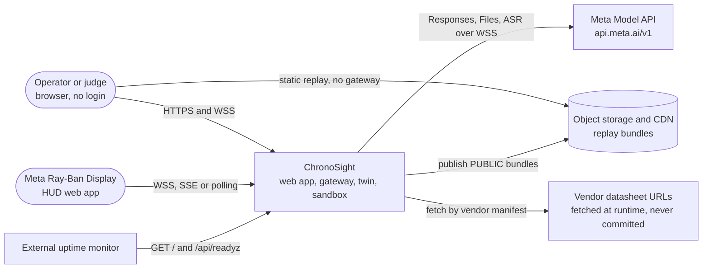

### 3.2 Container view (the architecture diagram)

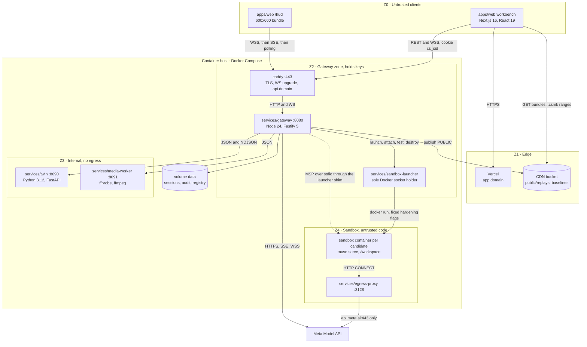

**Reading it.** Solid arrows are network calls, and the dotted arrow is a stdio stream. Each zone's trust level and the things it may never hold are listed in DESIGN §5. This view adds three things: the launcher (DL-22), the media worker's port, and the domain split (DL-23).

### 3.3 Networks, ports and volumes

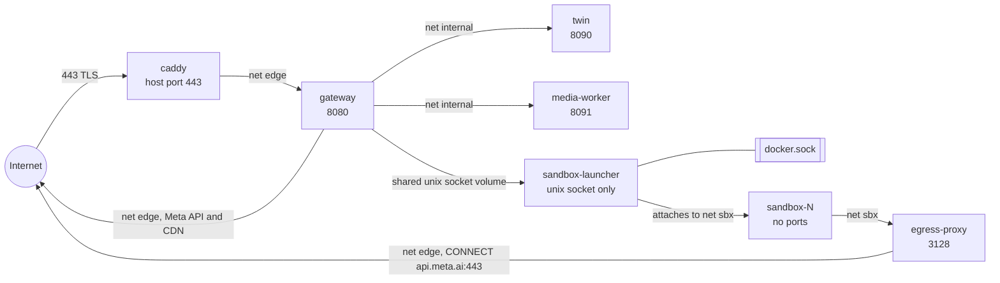

| Network | Driver flags | Members | Has a default route? | Source |
| :--- | :--- | :--- | :--- | :--- |
| `edge` | bridge | caddy, gateway, egress-proxy | Yes | DESIGN §5 |
| `internal` | bridge, **`internal: true`** (TD-4) | gateway, twin, media-worker | **No.** This is how Z3's "Nothing outside the host" is enforced (DESIGN §5 zone table). | DESIGN §5, refined here |
| `sbx` | bridge, `internal: true` | sandbox-N, egress-proxy | No | DESIGN §5, §19 |

| Volume | Mounted by | Mode | Contents |
| :--- | :--- | :--- | :--- |
| `data` | gateway | rw | `public/`, `confidential/`, `audit/`, `registry/` (DESIGN §23.1), `budget/ledger.jsonl` (introduced here) |
| `media-scratch` | gateway rw, media-worker rw, twin ro | rw/ro | Uploads in, normalized MP4s out. Swept with the session. |
| `clips` | twin rw, gateway ro | rw/ro | Rendered clips and ground truth |
| `launcher-sock` | gateway, sandbox-launcher | rw | The single unix socket for the launcher API |
| `ws-<candidate>` | sandbox-N | rw | `/workspace`, created and destroyed per candidate (DESIGN §18.7) |

Only Caddy publishes a host port. The Docker socket is bind-mounted into **one** container, the launcher, which has no network at all (DL-22).

### 3.4 End-to-end live loop (S1, cached baseline)

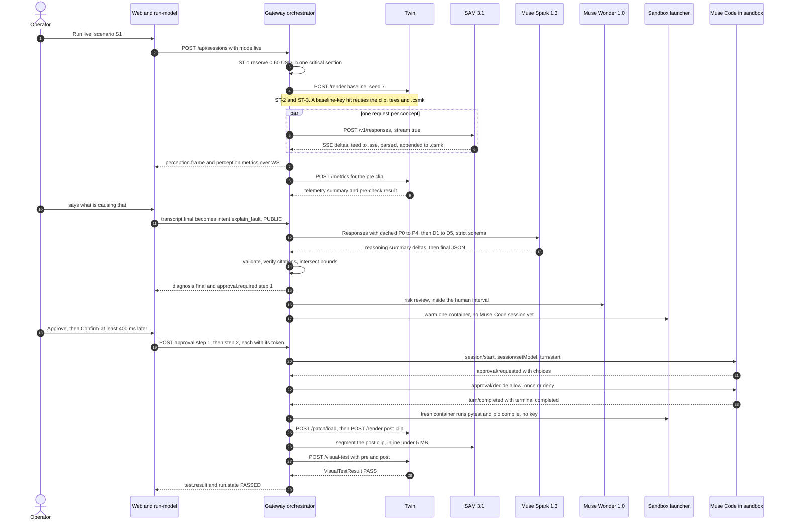

### 3.5 Data-class taint and where data may go

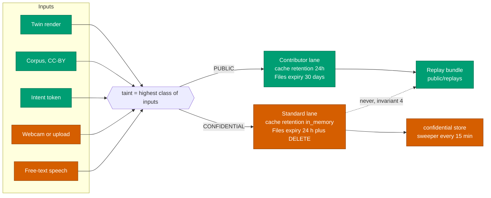

The taint function lives in `packages/run-model/src/taint` (DESIGN §21.4). The router's refusal invariant (DESIGN §21.2) is the second, independent line of defence. Both have unit tests.

### 3.6 Module dependency graph

An arrow means "depends on". `packages/run-model` is the only module shared across languages and deployables.

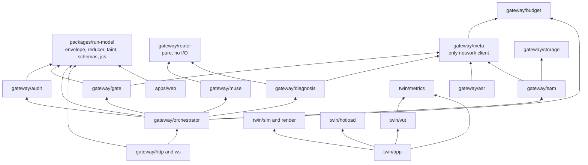

**Dependency rules** (enforced by lint import boundaries in TS and by an import-linter contract in Python, both introduced here):

1. `gateway/router` and `packages/run-model` perform no I/O.
2. Only `gateway/meta` opens connections to `api.meta.ai`, and every call passes through `gateway/budget` metering.
3. `twin/metrics` and `twin/vut` never import `twin/sim`. Ground truth arrives as data, so the evaluator can't peek at the simulation.
4. Nothing imports `gateway/http`. The transport layer depends on the core, never the reverse.
5. `apps/web` imports nothing from `services/`. It speaks only the public API and the run-model types.

### 3.7 Run phases (the five `LoopStepper` steps)

The full fifteen-state machine is DESIGN §8. This view groups it into the five phases the `LoopStepper` shows, with the module that owns each phase.

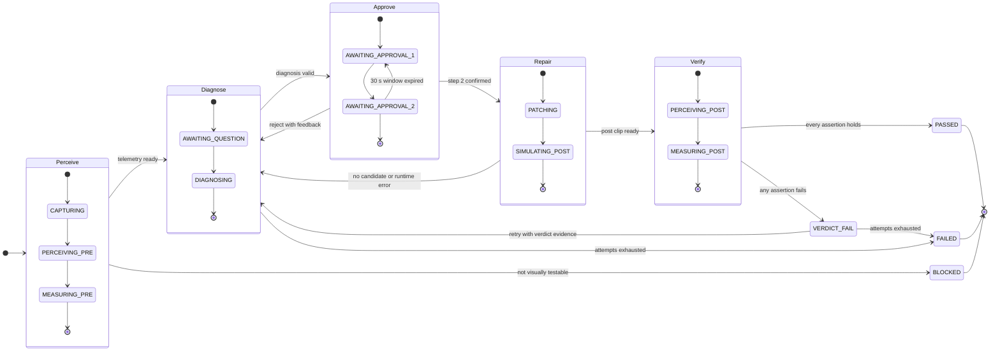

| Phase | States | Owning module | Wall-clock guard | Notes |
| :--- | :--- | :--- | :--- | :--- |
| Perceive | ST-2 to ST-4 | `gateway/orchestrator/stages/perceive` | 60 s capture, 60 s SAM, 10 s measure | Baseline cache short-circuit (FR-PER-7) |
| Diagnose | ST-5, ST-6 | `.../stages/diagnose` | 15 min idle, 90 s per attempt | `attempt` only increases (invariant 3) |
| Approve | ST-7, ST-8 | `gateway/gate` | 15 min step 1, 30 s step 2 | The human interval excluded from K5 |
| Repair | ST-9, ST-10 | `gateway/muse` and `twin/hotload` | 120 s per candidate, 30 s sim | Container warmed at ST-7. Session starts at ST-9 only. |
| Verify | ST-11, ST-12 | `.../stages/verify` and `twin/vut` | 60 s SAM, 10 s verdict | Only the winning candidate is segmented |

Any non-terminal state can go to `ABORTED` (DESIGN §8). The orchestrator implements that as one cancellation path shared by every stage (§5.2).

### 3.8 Domain model with storage keys

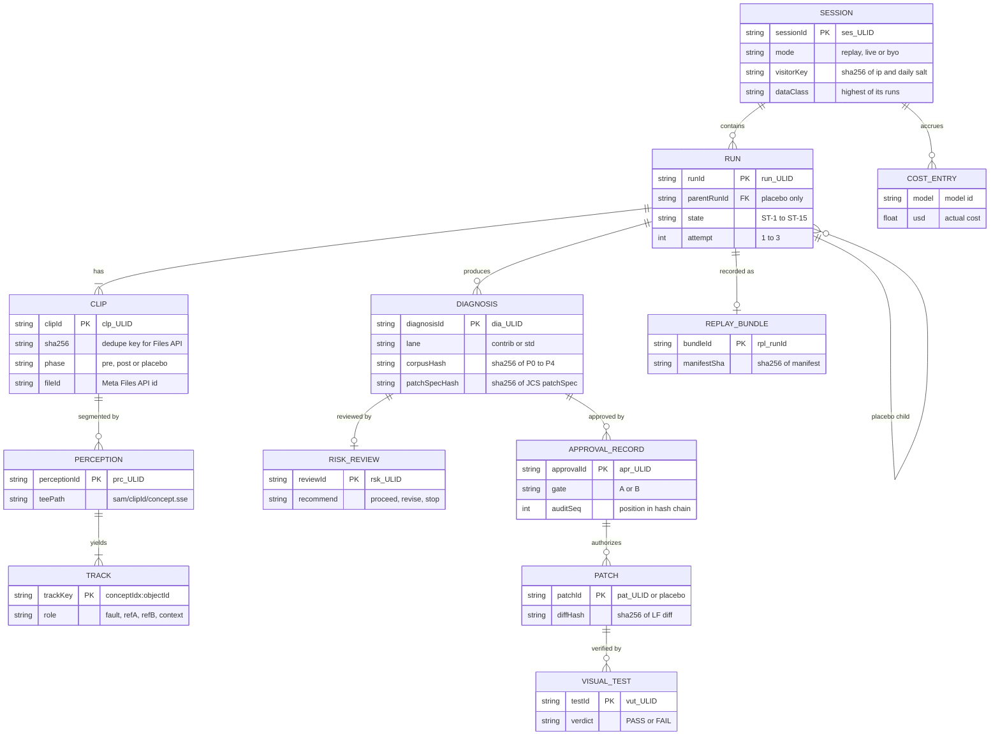

### 3.9 CI/CD pipeline

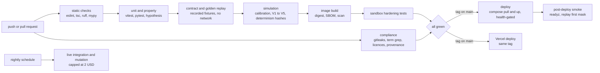

---

## 4. Repository file structure

### 4.1 The tree

The tags in the right-hand column say which document first names each path: **[PRD]** for PRD §13.4, **[DES]** for DESIGN, **[here]** for introduced here. Owners are roles A to D (PRD §19). Nothing in this tree exists before kickoff.

```text
chronosight/
├── README.md                              Pitch, "Built during the Hackathon" and "Not ours" tables   [PRD §18.2]
├── HACKATHON_PROVENANCE.md                Module → first commit → date. Third-party list.            [PRD]
├── PRD.md · DESIGN.md · TECHNICAL.md      Planning documents (predate code, contain none)             [PRD] [DES] [here]
├── LICENSE                                MIT                                                         [PRD §18.3]
├── .env.example                           Every variable name, no values (§9.1)                       [PRD]
├── .gitignore · .gitleaks.toml            .env, .next/, data/, fixtures/raw/                          [here]
├── package.json                           npm workspaces: apps/*, packages/*, services/gateway,
│                                          services/sandbox-launcher. "engines": node 24 (DL-20)       [here]
├── package-lock.json                                                                                  [here]
├── pyproject.toml · uv.lock               Python workspace: services/twin, tools/py                   [here]
├── eslint.config.mjs · tsconfig.base.json Flat ESLint config, TS strict, import boundaries (§3.6)     [here]
│
├── apps/
│   └── web/                               Next.js 16 app, owner D                                     [PRD]
│       ├── next.config.ts                 turbopack key, headers off (proxy.ts owns them)             [here]
│       ├── proxy.ts                       Nonce CSP and security headers (DL-21, TQ-1)                [here]
│       ├── app/
│       │   ├── layout.tsx · globals.css   Token import, ProvenanceFooter                              [here]
│       │   ├── page.tsx                   /  SSG home, featured replays from CDN index                [DES §25.1]
│       │   ├── s/[sessionId]/page.tsx     Live workbench (client)                                     [DES §25.1]
│       │   ├── replay/[runId]/page.tsx    Replay player, static shell                                 [DES §25.1]
│       │   ├── report/[sessionId]/page.tsx  Server-rendered audit report, print CSS                   [DES §25.1]
│       │   ├── about/page.tsx             Validation tables built from docs/validation/*.md           [DES §25.1]
│       │   ├── hud/page.tsx               600×600 HUD, own minimal client tree                        [DES §25.1]
│       │   ├── hud/probe/page.tsx         SP-10 runtime probe (WS, SSE, audio-busy, history)          [DES §31 SP-10]
│       │   └── admin/page.tsx             Token-gated admin UI                                        [DES §25.1]
│       ├── components/                    LoopStepper, MaskCompositor, PsdChart, ApprovalDialog, …    [DES §25.5]
│       ├── lib/
│       │   ├── transport/                 WS → SSE → polling client, lastSeq resume, resync           [DES §9.3]
│       │   ├── store/                     Per-run store = events.reduce(runReducer)                   [DES §25.2]
│       │   ├── compositor/                Layers 0–4, raster LRU(600), rVFC frame index               [DES §25.3]
│       │   ├── audio/pcm-worklet.ts       24 kHz s16le mono, 80 ms frames                             [DES §15.2]
│       │   ├── capture/                   MediaRecorder mp4/avc1, WebM fallback                       [DES §11.1]
│       │   ├── replay/                    Manifest fetch, SubtleCrypto verify, offset scheduler       [DES §24.3]
│       │   ├── webmcp/                    Feature-detected tool registration, no tokens               [DES §25.8]
│       │   └── workers/mask-decode.worker.ts  Off-main-thread decode                                  [DES §25.7]
│       ├── styles/tokens.css              Okabe–Ito tokens, dark default                              [DES §25.4]
│       └── e2e/                           Playwright: judge path, HUD keyboard-only                   [DES §33]
│
├── packages/
│   └── run-model/                         Shared TS, owner C (reviewed by D)                          [DES §6]
│       ├── src/envelope.ts                Envelope v1 and EventType union                             [DES §9.1]
│       ├── src/events/                    One Zod schema per event type                               [DES §9.2]
│       ├── src/reducer.ts                 runReducer, pure and total                                  [DES §8]
│       ├── src/invariants.ts              §8.2 invariants 1–6 as checkable predicates                 [DES §8.2]
│       ├── src/taint.ts                   Highest-class propagation                                   [DES §21.4]
│       ├── src/k5clock.ts                 Machine time minus the human interval                       [DES §29.3]
│       ├── src/hash.ts                    JCS + sha256 helpers                                        [DES §7]
│       ├── src/schemas/                   Diagnosis, DiagnosisModelOutput, VisualTestResult, …        [DES §14.3, §16.6]
│       └── test/vectors/                  JCS and hash parity vectors shared with Python              [here]
│
├── services/
│   ├── gateway/                           Node 24 + Fastify 5, owner C. Subfolders [here].            [PRD]
│   │   ├── src/server.ts                  Bootstrap, plugin order, graceful shutdown
│   │   ├── src/http/                      REST routes (§7.1), masks data plane, report
│   │   ├── src/ws/                        Session WS, SSE, polling, ring buffer(1,000), coalescer
│   │   ├── src/orchestrator/              Run driver, stage runners, timers, cancellation
│   │   ├── src/router/                    route() pure function, refusal invariant
│   │   ├── src/limits/                    Token buckets, backoff, breakers
│   │   ├── src/meta/                      Responses, Files, raw-fetch SAM stream, fixture mode
│   │   ├── src/sam/                       Request builder, tee, parser adapter, .csmk writer, placeRaster
│   │   ├── src/asr/                       Relay, handshake, rotation, intent grammar
│   │   ├── src/diagnosis/                 Prefix builder, lane selection, validator, citation verifier
│   │   ├── src/gate/                      Token codec, approval service, risk review, bounds check
│   │   ├── src/muse/                      SDK client, warm pool, policy engine, supervisor, harness
│   │   ├── src/budget/                    Cost meter, reservation ledger, kill switch
│   │   ├── src/audit/                     Hash-chained JSONL writer, verifier, report builder
│   │   ├── src/storage/                   Public and confidential stores, Files registry, sweeper
│   │   ├── src/replay/                    Recorder, scrubber, publisher
│   │   ├── src/hud/                       Pairing codes, capability tokens, stream tickets
│   │   ├── src/admin/                     Admin routes, constant-time token check
│   │   ├── src/obs/                       pino + redaction, OTel spans, metrics registry
│   │   ├── src/chaos/                     CHAOS_* injection, inert when NODE_ENV=production
│   │   └── test/                          vitest: unit, contract, golden Muse Code sessions
│   │
│   ├── twin/                              Python 3.12 + FastAPI, owners A and B                       [PRD]
│   │   ├── app/main.py                    Internal API (DESIGN §20.6), Z3 only                        [here]
│   │   ├── sim/                           1 kHz semi-implicit Euler, PCG64 seed tree, encoder model   [PRD]
│   │   ├── render/                        OpenCV drawing, markers A/B, ffmpeg pipe (threads=1)        [PRD]
│   │   ├── metrics/                       measure(), lombscargle wrapper, Welch check, signals        [PRD]
│   │   ├── vut/                           Pre-check, assertion types, evaluator                       [here]
│   │   ├── hotload/                       Child-process runner, msgpack framing, rlimits              [here]
│   │   ├── mutation/                      V1–V5 patches per scenario, harness                         [DES §14.4]
│   │   ├── scenarios/
│   │   │   ├── s1/                        Robot arm, P0                                               [PRD]
│   │   │   │   ├── scenario.yaml          Concepts, roles, assertions, bounds, seeds, camera          [DES §20.1]
│   │   │   │   ├── plant.py · faults.yaml                                                             [DES §20.1]
│   │   │   │   ├── baseline/              controller.py, params.py, controller.cpp, params.h          [DES §20.1]
│   │   │   │   ├── render/                Textures, lighting presets                                  [DES §20.1]
│   │   │   │   ├── tests/                 Numeric step-response tests, mounted read-only              [DES §20.1]
│   │   │   │   └── corpus → ../../../../corpus/encx14   Symlink                                       [DES §20.1]
│   │   │   ├── s2/                        Microinverter, P1 (same layout)                             [PRD]
│   │   │   └── s3/                        CNC stepper, P1 (same layout)                               [PRD]
│   │   └── tests/                         pytest + hypothesis: property, calibration, determinism     [here]
│   │
│   ├── media-worker/                      ffprobe/ffmpeg, owner A                                     [DES §6]
│   │   ├── app/                           Two endpoints: /probe, /normalize (§7.5)                    [here]
│   │   └── profiles/normalize.json        The DESIGN §11.3 parameters as data                         [here]
│   │
│   ├── egress-proxy/                      CONNECT allowlist api.meta.ai:443, owner C                  [DES §6]
│   │   └── allowlist.txt                  One line                                                    [here]
│   │
│   └── sandbox-launcher/                  Sole Docker socket holder (DL-22), owner C                  [here]
│       ├── src/                           launch, attach, runTests, destroy (§5.6)
│       └── shim/                          The command the SDK spawns. Pipes stdio to the launcher.
│
├── sandbox/                               Muse Code image definition, owner C                         [PRD]
│   ├── Dockerfile                         Written on D4. muse CLI, Python, PlatformIO toolchains.     [PRD]
│   ├── muse-settings.json                 Ask me profile, untrusted policy, no judge (SP-4)           [DES §18.11]
│   └── policies/allowlist.yaml            The DESIGN §18.4 table as data                              [PRD "policies"]
│
├── corpus/                                Original CC-BY documents, owner B                           [PRD]
│   ├── encx14/manifest.json               docId, title, version, licence, pages, sha256               [DES §16.2]
│   ├── encx14/pages/001.md … 060.md       Page-delimited source of truth                              [DES §16.2]
│   ├── encx14/encx14.pdf                  Rendered for #page=N viewing                                [DES §16.2]
│   └── vendor-manifest.json               Runtime-fetched vendor URLs and expected sha256             [DES §16.2]
│
├── replays/                               Featured bundles (small) and index.json, owner D            [PRD]
│   └── index.json                         Featured run per scenario                                   [DES §24.1]
│
├── fixtures/                              Recorded Meta responses, headers redacted, owner C          [DES §33]
│   ├── sam/*.sse · responses/*.json · files/*.json · asr/*.jsonl · muse/*.session.jsonl              [here: layout]
│   └── README.md                          How to record (MOCK_META=record) and re-baseline            [here]
│
├── config/
│   ├── routing.yaml                       PRD §14.1 as data (keys in §9.2)                            [DES §21.1]
│   ├── prices.json                        PRD §16.1 with verifiedOn                                   [DES §22.1]
│   └── buckets.yaml                       DESIGN §21.3 bucket sizes                                   [here]
│
├── deploy/                                Written on D6, owner C                                      [here]
│   ├── docker-compose.yml                 Services, networks edge/internal/sbx, volumes (§3.3)
│   ├── Caddyfile                          api.<domain> TLS, reverse proxy to gateway:8080
│   └── host-bootstrap.md                  Host hardening checklist, uptime monitor setup
│
├── docs/
│   ├── architecture.md                    Generated from TECHNICAL §3–§4 for judges                   [PRD]
│   ├── sam-format.md                      SP-1 result: placement mode, nesting, sizes                 [PRD]
│   ├── calibration/                       Notebooks and outputs (PRD §10.5)                           [PRD]
│   ├── validation/s1.md · s2.md · s3.md   Mutation confusion tables (K3, K4)                          [DES §14.4]
│   ├── adr/001-*.md … 014-*.md            Full ADRs                                                   [DES §32]
│   ├── spikes/SP-1.md … SP-12.md          Spike logs with exit evidence                               [here]
│   └── ops/j-log.md                       Daily J-period log and P0 fix record (§12.5)                [here]
│
├── tools/                                 CI scripts, owner D                                         [here]
│   ├── term-grep · licence-audit · provenance-check · mermaid-parse · md-tables
│   └── verify-bundle                      Offline replay bundle hash verifier (Python, rfc8785)
│
└── .github/
    ├── workflows/                         ci, nightly, deploy (described in §11, no bodies here)     [here]
    ├── CODEOWNERS                         Role A–D ownership per path                                [here]
    └── pull_request_template.md           Provenance and "built during" checkbox                     [here]
```

### 4.2 What the tree adds to the PRD and DESIGN layouts

| Path | Status | Reason |
| :--- | :--- | :--- |
| `packages/run-model`, `services/media-worker`, `services/egress-proxy`, `docs/validation/`, `docs/adr/` | DESIGN §6 and §14.4 extensions of PRD §13.4 | Already decided |
| `config/`, `fixtures/`, `services/twin/mutation/`, scenario package internals, corpus internals | Named in DESIGN body sections | Already decided |
| `services/sandbox-launcher/` | **New (DL-22)** | Isolates the Docker socket |
| `apps/web/proxy.ts` | **New (DL-21)** | Next 16 request hook for CSP nonces |
| `services/twin/vut/`, `services/twin/hotload/`, `services/twin/app/` | New folder names | DESIGN puts these responsibilities in the twin without naming folders |
| `deploy/`, `.github/`, `tools/`, `docs/spikes/`, `docs/ops/` | New | CI, deployment and operations artifacts. Bodies are written after kickoff. |
| `config/buckets.yaml`, `fixtures/` sub-layout, `budget/ledger.jsonl` on the data volume | New | Make DESIGN §21.3, §33 and §22.3 concrete |
| `TECHNICAL.md` | New | This document |

### 4.3 Ownership and review rules (`CODEOWNERS`)

| Path | Owner | Required reviewer | Why the second pair of eyes |
| :--- | :--- | :--- | :--- |
| `services/twin/metrics/`, `services/twin/vut/` | A | B | The judge's code (T1) |
| `services/twin/sim/`, `scenarios/` | B | A | Ground truth must not leak into the evaluator |
| `services/gateway/src/gate/`, `src/muse/policy*`, `services/sandbox-launcher/` | C | A or B | Security boundary (TH-1, TH-5, TH-14) |
| `services/gateway/src/router/`, `src/budget/` | C | D | Privacy and spend invariants (TH-9, TH-11) |
| `packages/run-model/` | C | D | Shared by the browser, gateway and replay |
| `apps/web/` | D | C | — |
| `corpus/`, `README.md`, `docs/`, `HACKATHON_PROVENANCE.md` | D | Any | Provenance (E16) |

---

## 5. Module specifications

Each module is listed with what it owns, its public surface (signature sketches), the failures it raises and how it's tested. Error codes not found in DESIGN are tagged [here].

### 5.1 `packages/run-model`

| Item | Specification |
| :--- | :--- |
| Owns | The event envelope and catalogue, `RunState`, `runReducer`, invariant checks, taint, the K5 clock, Zod schemas and their JSON Schema export, and JCS hashing |
| Never | I/O, clocks (time arrives in events), randomness |
| Consumers | `apps/web` (live and replay), `services/gateway` (orchestrator, snapshot endpoint, replay recorder) |
| Tests | Reducer invariants under randomized event orderings (fast-check style generators in vitest), golden replay snapshots, JCS parity vectors |

```text
type DataClass  = "PUBLIC" | "CONFIDENTIAL"
type RunStateId = "IDLE" | "CAPTURING" | … | "ABORTED"          # DESIGN §8.1, ST-1..ST-15
type Envelope<T> = { v: 1, seq: u53, sessionId, runId | null, ts: IsoUtc,
                     type: T, replay: bool, data: EventData[T] }

runReducer(state: RunState, ev: Envelope) -> RunState          # pure, total, idempotent per seq
initialRunState(sessionId, runId, kind: "main" | "placebo") -> RunState
checkInvariants(prev: RunState, next: RunState, ev: Envelope) -> Violation[]   # §8.2 1–6
taintOf(inputs: DataClass[]) -> DataClass                     # CONFIDENTIAL wins
k5MachineSeconds(events: Envelope[]) -> { machine: s, wall: s } # DESIGN §29.3
jcsBytes(value: Json) -> Bytes                                # UTF-8 of canonicalize(value)
sha256Tag(bytes: Bytes) -> "sha256:<64 hex>"
patchSpecHash(spec: PatchSpec) -> Sha256Tag                   # sha256Tag(jcsBytes(spec))
exportJsonSchema(name: SchemaName) -> JsonSchema              # used by contract tests and Python
```

**Reducer contract.** An envelope with a `seq` at or below the last applied one is a no-op, which makes resume and replay idempotent. An event that would break an invariant isn't silently applied. The reducer records a `violation` on the state, and in development and CI the store throws. The gateway runs `checkInvariants` before it *emits* a transition, so a violation is a gateway bug, never a client one.

### 5.2 `services/gateway/src/orchestrator`

| Item | Specification |
| :--- | :--- |
| Owns | One `RunDriver` per active run: state transitions, stage runners, timers, cancellation, attempt counting, the warm-container trigger at ST-7 |
| Emits | `run.state` for every transition (after `checkInvariants` passes), plus stage events |
| Concurrency | One driver per run. Stages inside a run run sequentially, except the SAM fan-out and parallel candidates. |
| Cancellation | One `AbortController` per run. Every stage receives its signal. User cancel, budget overrun, a stage timeout and session expiry all call `abort(reason)`, which leads to `ABORTED` and releases the reservation. |
| Tests | Stage runners against fake clients, timer tests with fake clocks, chaos flags |

```text
RunDriver.start(runId, mode, scenarioId) -> void
RunDriver.onIntent(intent: Intent, dataClass) -> Accepted | Rejected(reason)
RunDriver.onApproval(step: 1 | 2, token: string, decision, note?) -> ApprovalResult
RunDriver.abort(reason: AbortReason) -> void                 # idempotent
Stage<I, O>.run(input: I, ctx: { signal, emit, span, budget }) -> O | StageError
```

### 5.3 `services/gateway/src/router` and `src/limits`

| Item | Specification |
| :--- | :--- |
| Owns | `route()` as a pure function over `config/routing.yaml`. Token buckets (RPM and TPM), backoff, spill and per-model breakers. |
| Tests | A table test over every routing row × data class × attempt. The refusal invariant (DESIGN §21.2) runs for every row with `CONFIDENTIAL`. Bucket tests with injected clocks. |

```text
route(task: Task, dataClass, attempt: 1..3, health: HealthSnapshot)
  -> { model, reasoning: { effort, summary } | null, lane: "contrib" | "std", laneReason }
  throws POLICY_VIOLATION when lane = contrib and dataClass = CONFIDENTIAL

Bucket.acquire(model, estTokens, signal) -> Lease          # waits or raises RATE_LIMIT_QUEUE_TIMEOUT [here]
Lease.settle(actualTokens) -> void                          # corrects TPM from usage
Breaker.state(model) -> "closed" | "open" | "half_open"     # 5×5xx in 60 s opens, probe after 30 s
backoffDelay(n, retryAfter?) -> ms                          # random in [0, min(20 s, 500 ms·2ⁿ)], at least Retry-After
```

### 5.4 `services/gateway/src/meta` (the only Meta network client)

| Item | Specification |
| :--- | :--- |
| Owns | Authenticated calls to `META_API_BASE`, `MOCK_META` fixture playback and recording, header redaction, usage capture into `budget` |
| TD-2 | **Spark, Wonder, Image and Files calls go through the `openai` SDK. SAM streaming uses `fetch` directly.** The SAM client must tee the raw bytes before any parser touches them (DESIGN §12.4), and the official `@meta-sam/parser` expects the raw SSE stream. A plain `fetch` `ReadableStream` with `tee()` gives exactly that, without SDK event re-framing. |
| Fixture mode | `MOCK_META=true` maps a request fingerprint (method, path, model, JCS of the body without volatile fields) to a recorded response in `fixtures/`, and an unknown fingerprint is an error. `record` writes new fixtures with `Authorization` and `accessToken` stripped. |

```text
MetaClient.responses.stream(req: ResponsesRequest, ctx) -> AsyncIterable<ResponseEvent>
MetaClient.responses.create(req, ctx) -> Response
MetaClient.files.upload(bytes, { purpose: "user_data", expiresAfterS }) -> { fileId }
MetaClient.files.delete(fileId) -> void                      # idempotent, 404 is success
MetaClient.sam.rawStream(req: SamRequest, ctx) -> { body: ReadableStream<Bytes>, marks }
```

### 5.5 `services/gateway/src/sam`

| Item | Specification |
| :--- | :--- |
| Owns | The concept plan read from `scenario.yaml`, request building (DESIGN §12.2), the fan-out semaphore (4 per run), tee then parse, `.csmk` writing, reference-marker assignment, `placeRaster` |
| Errors | `SAM_BAD_REQUEST` (terminal), `SAM_AUTH`, `SAM_RATE_LIMITED`, `SAM_UPSTREAM`, `SAM_STREAM_TRUNCATED`, `SAM_AMBIGUOUS` (DESIGN §12.6) |
| Tests | Contract tests on recorded `.sse` files. A merge-order determinism test with shuffled stream completion. An IoU fixture for both placement modes (FR-PER-4). A byte-parity test against the Python decoder on 10 fixtures (FR-PER-3). |

```text
segmentClip(clip: ClipRef, plan: ConceptPlan, ctx) -> PerceptionResult
  # opens N streams, tees each to sam/{clipId}/{slug}.sse, feeds @meta-sam/parser
CsmkWriter.open(path, { frameW, frameH, fps, flags }) -> CsmkWriter
CsmkWriter.append(rec: { frameIdx, conceptIdx, objectId, box, conf, payload }) -> void
CsmkWriter.close() -> { count, idxPath, sha256 }
CsmkReader.range(path, idxPath, track?, from?, to?) -> Bytes  # slice by .idx, no parse
placeRaster(raster, H, W, box, frameW, frameH, mode: "crop" | "full") -> Raster
assignRefs(objects at first frame with both present) -> { refA, refB }   # smaller box-centre x is A
```

### 5.6 `services/sandbox-launcher` (DL-22, introduced here)

The launcher is small by design. It holds root-equivalent access (the Docker socket), so its whole surface is four operations with no free-form parameters.

| Item | Specification |
| :--- | :--- |
| Transport | HTTP over the unix socket in the `launcher-sock` volume. No TCP listener and no network. |
| Fixed parameters | Image = `SANDBOX_IMAGE` (digest). Every DESIGN §19 flag is hard-coded: network `sbx`, `--read-only`, tmpfs `/tmp` 64 MB `noexec`, UID/GID 10001, `--cap-drop ALL`, `no-new-privileges`, default seccomp, `--cpus 2`, `--memory 2g`, `--memory-swap 2g`, `--pids-limit 256`. The gateway can't pass mounts, flags, images or env except the allowlisted variables below. |
| Allowlisted env | `HTTPS_PROXY` (= `EGRESS_PROXY_URL`). For **synthesis** containers only, the Meta key, read by the launcher from its own secret file. Test containers never receive a key (DESIGN §18.9). |
| Lifetimes | Destroyed on `destroy`, on the 120 s hard limit (enforced here too, as defence in depth), and on launcher start (it removes any leftover containers labelled as ours) |
| Tests | Sandbox hardening suite: inspect created containers and assert every flag. Attempt egress to anything but the proxy. Attempt host-path writes. |

```text
launch(kind: "synthesis" | "test", candidateId: string, files?: FileSet) -> { containerId, workspaceVolume }
attach(containerId) -> duplex stdio stream             # the SDK's spawn shim connects here
runTests(containerId) -> { exitCode, junitXml, stdoutTail }   # pytest tests/, then pio compile
destroy(containerId) -> void                           # idempotent
```

**How the SDK spawns.** `spawnMspConnection` is configured with the shim command `sandbox-attach <containerId>`, which is part of the gateway image. The shim connects to `attach` and pipes stdin and stdout, so the SDK sees an ordinary child process. ⚠️ SP-4 confirms that the SDK accepts a custom spawn command. If it doesn't, the fallback is the SDK's transport option (if it exposes one), and otherwise running `muse serve` as a long-lived container process with the launcher bridging its stdio.

**Sequence: one candidate.**

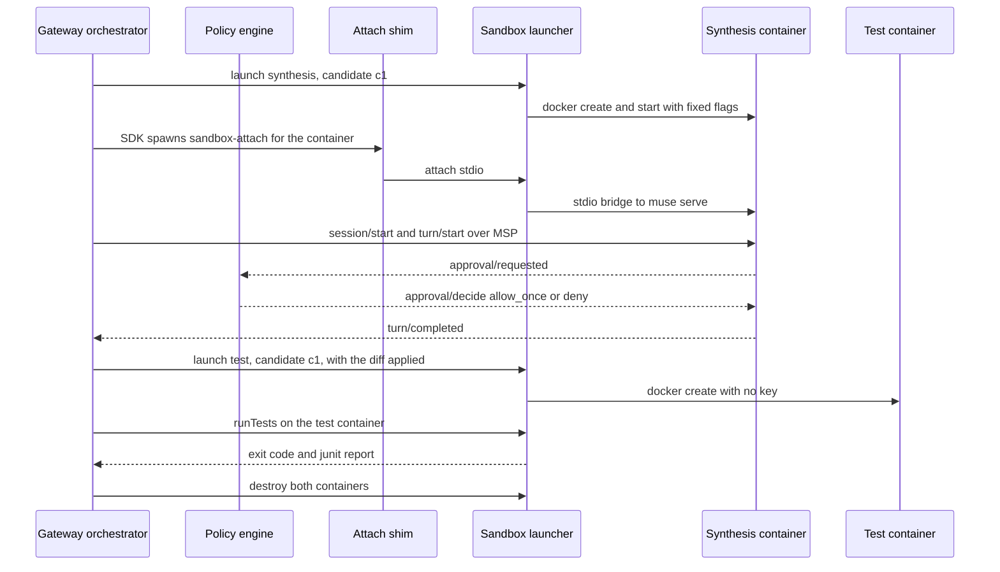

### 5.7 `services/gateway/src/muse`

| Item | Specification |
| :--- | :--- |
| Owns | SDK connection lifecycle, the warm pool of one, `session/*` and `turn/*` calls, the policy engine, turn supervision (110 s cancel, 120 s kill), crash recovery through `session/resume`, diff extraction, candidate scoring |
| Errors | `SANDBOX_TIMEOUT`, `APPROVAL_UNRESOLVED`, `PATCH_BOUNDS_VIOLATION` [here], `PATCH_TESTS_FAILED` [here], `MUSE_TURN_FAILED` [here] |
| Tests | Golden session fixtures (recipe 02) replayed through a fake MSP peer. The policy-engine table test. Chaos `CHAOS_MUSE_TIMEOUT` and `CHAOS_MUSE_TERMINAL=<value>`, including unknown values. |

```text
WarmPool.ensureWarm() -> void                          # launch(synthesis) + handshake.initialize, no session
Candidate.run(spec: ApprovedSpec, hints: string[], attempt) -> CandidateResult
policyDecide(req: ApprovalRequested, ctx: { targetFiles, workspaceRoot: "/workspace" })
  -> { choiceId, feedback: string | null, rule: RuleId }    # §6.6
scoreCandidate(r: NumericResults, objectives) -> J         # overshoot/max + settle/max + sse/max
selectWinner(results: CandidateResult[]) -> CandidateResult | none   # lowest J, tie → smaller diff
```

### 5.8 Other gateway modules

| Module | Owns | Key surface | Tests |
| :--- | :--- | :--- | :--- |
| `asr` | Relay, handshake, upstream event mapping, close-code policy, 55-minute rotation, intent grammar | `openRelay(sessionId, clientSocket)`, `parseIntent(text, runState) -> Intent` | Grammar table including negation, close-code chaos, rotation with a fake clock |
| `diagnosis` | Prefix builder (P0–P4), dynamic parts (D1–D5), lane selection, strict-schema validation, range checks, bounds intersection, citation verification, hint sanitation | `buildPrefix(scenario, corpus) -> { bytes, corpusHash12 }`, `diagnose(input, ctx) -> Diagnosis`, `verifyCitation(ev, pages) -> Verified \| FoundOnPage \| Unverified` | Byte-stability test (same inputs give the same prefix bytes on every OS), citation verifier corpus tests |
| `gate` | Token codec, approval service, risk review call, static bounds check (with `twin` for the AST parts) | `issueToken`, `verifyToken`, `recordApproval`, `boundsCheck(diff, spec, hardBounds)` | Expiry, nonce reuse, debounce, hash binding, override length |
| `budget` | Cost formulas, reservation ledger, kill switch, per-visitor hourly cap | `reserve(visitorKey) -> Reservation \| Rejection`, `charge(runId, entry)`, `release(reservation)` | Burst load test, ledger replay on restart |
| `audit` | Hash-chained JSONL, by-reference payloads, report builder | `append(line) -> { seq, hash }`, `verifyChain(sessionId) -> HeadHash \| BrokenAt(seq)` | Tamper test (flip one byte), deletion-by-reference test |
| `storage` | Path layout, Files registry, sweeper | `put(dataClass, key, bytes)`, `sweep(now)` | TTL and sweeper tests with a fake clock |
| `replay` | Recorder (PUBLIC runs only), scrubber, bundle hashing, publisher | `record(runId) -> BundleManifest` | Refuses CONFIDENTIAL runs. Output contains no `cs_sid` or token strings. |
| `hud` | Pairing codes, HUD capability, SSE stream tickets | `newPairingCode()`, `redeem(code, sessionId) -> Capability`, `issueStreamTicket(cap) -> Ticket` | Brute-force rate limit, single use, expiry |
| `obs` | Logger with redaction, spans, metrics registry | `log`, `span(name)`, `metric(name).observe()` | A redaction test with a synthetic key pattern |

### 5.9 `services/twin`

| Package | Owns | Key surface |
| :--- | :--- | :--- |
| `app` | FastAPI routes (DESIGN §20.6), request validation, process supervision | `/render`, `/metrics/stream`, `/metrics`, `/visual-test`, `/patch/load`, `/healthz`, `/readyz` |
| `sim` | Plant models, integrator, seed tree, encoder model with the FILT register and the reset erratum | `simulate(scenario, controller, seed, durationS) -> Trajectory` |
| `render` | Scene drawing, markers A/B, noise, blur, camera shake, ffmpeg pipe | `renderClip(traj, camera, seed) -> { clipPath, groundTruthPath }` |
| `metrics` | `measure()` (DESIGN §13.2), spectra, Welch cross-check, S2 and S3 signals, streaming gauges | §6.10 |
| `vut` | Pre-check (DESIGN §14.1), assertion evaluators (§14.2, §14.3), result assembly | `precheck(telemetry) -> Ok \| Blocked(reason)`, `evaluate(scenario, pre, post) -> VisualTestResult` |
| `hotload` | Running the approved `controller.py` in a child process with rlimits, msgpack framing and the AST identity check for placebos | §6.11 |
| `mutation` | V1–V5 runners and confusion-table writer | `runSuite(scenario, seeds, mode: "fixture" \| "live") -> ConfusionTable` |

### 5.10 `apps/web`

| Area | Owns | Notes |
| :--- | :--- | :--- |
| `lib/transport` | One client with three transports and one `since` cursor | Reconnect with full-jitter backoff from 0.5 to 8 s. Dead after 35 s of silence. Fetches a snapshot on `resync.required`. |
| `lib/store` | The per-run store and slice selectors | The pane-state union (DESIGN §25.2) with a type-level exhaustiveness check |
| `lib/compositor` | Layers 0–4 on canvas | `requestVideoFrameCallback` gives the frame index. Rasters are decoded in the worker. |
| `lib/replay` | Bundle fetch, hash verify, offset scheduler | 1× and 2× speeds, and anything other than 1× is labelled on screen (DESIGN §24.3) |
| `proxy.ts` | Nonce, CSP, `frame-ancestors 'none'`, `Referrer-Policy`, `Permissions-Policy` | §13.3 |
| `app/hud` | The 600×600 HUD with its focus graph and speech queue | Under 60 KB gzipped (DESIGN §25.7). PNG icons only. |

---

## 6. Core interfaces and algorithms

These are the contracts most likely to be built wrong under time pressure. Each one states its invariants and the test that pins them.

### 6.1 Event sequencing, ring buffer and resume

| Rule | Detail |
| :--- | :--- |
| `seq` source | One counter per session in the gateway, incremented inside the same synchronous block that appends to the audit log. So `seq` order and audit order are always identical. |
| Ring buffer | The last 1,000 envelopes per session (DESIGN §9.3). It is the single source for WS, SSE and polling reads. |
| Coalescing | Applied **per socket at send time**, never in the ring. When `bufferedAmount` exceeds 1 MiB, the socket's pending queue keeps only the latest coalescible event per key (DESIGN §9.2 column). Non-coalescible events are never dropped. Above 8 MiB the socket closes with 1013. |
| Snapshot | `GET /api/sessions/:id/snapshot` returns `{ headSeq, state }`, where `state` is the reducer's output, so a client can always rebuild from it |
| Arithmetic | A clip produces about 450 `perception.frame` events (150 frames × 3 concept streams) plus about 45 rolling metrics. The ring holds roughly two clips, so a client that is offline for more than about one perception phase gets `resync.required`. That's the designed path, and `cs_resync_total` counts it (TR-4). |

### 6.2 Identifiers

```text
newId(prefix: "ses" | "run" | "clp" | "prc" | "dia" | "rsk" | "apr" | "pat" | "vut") -> `${prefix}_${ULID}`
trackKey(conceptIdx: u8, objectId: u16) -> `${conceptIdx}:${objectId}`
replayId(runId) -> `rpl_${runId}`
```

ULIDs use the monotonic factory, so IDs created in the same millisecond still sort in order. IDs never encode user data (DESIGN §7).

### 6.3 Canonical JSON and hashing (RFC 8785)

| Rule | Detail |
| :--- | :--- |
| Libraries | TS: `canonicalize` 5.1.x returns a **string**, which is UTF-8 encoded before hashing. Python: `rfc8785.dumps` returns **bytes**. |
| Where used | `patchSpecHash`, approval token payloads, audit `hash` chaining, replay manifests, the fixture fingerprint (§5.4) |
| Numbers | JCS uses ECMAScript number formatting, so `5.0` and `5` hash the same. That's intended. `NaN` and `±Infinity` are invalid JSON and must be rejected before hashing. |
| Parity test | `packages/run-model/test/vectors/jcs.json` holds about 40 vectors: key ordering with non-ASCII keys, `-0`, exponents (`1e21`, `1e-7`), escapes, nested arrays, and integers at ±(2⁵³−1) plus one beyond. **vitest and pytest both load the file and must produce identical bytes**, or report the same rejection. A mismatch fails CI. |
| Diff hash | `diffHash = sha256(unified diff bytes)` after normalizing to LF and dropping the `index` lines that git writes, which contain blob IDs that vary by environment (DESIGN §7) |

### 6.4 Approval token codec (DESIGN §17.2)

```text
issueToken(claims: { approvalId, sessionId, runId, diagnosisId, patchSpecHash, step, nonce, exp },
           key: APPROVAL_HMAC_KEY) -> string
  payload = jcsBytes(claims)
  return b64url(payload) + "." + b64url(HMAC_SHA256(key, payload))

verifyToken(token, key, now, run: RunView) -> Ok(claims) | Err(code)
  1. split on the single "." (otherwise TOKEN_MALFORMED)
  2. recompute the MAC over the decoded payload bytes, then compare with timingSafeEqual (otherwise TOKEN_BAD_MAC)
  3. parse the payload JSON. now < exp (otherwise TOKEN_EXPIRED)
  4. atomically consume the nonce from the run's nonce set (otherwise TOKEN_REPLAYED)
  5. run.state matches the step, and claims.patchSpecHash equals the current diagnosis's hash
     (otherwise TOKEN_STATE_MISMATCH or TOKEN_HASH_MISMATCH)
  6. step 2 only: now − step1At ≥ 400 ms (otherwise TOKEN_DEBOUNCE)
```

The error codes `TOKEN_*` are introduced here. The MAC is checked over the **received** payload bytes, never over a re-serialization, so a parser quirk can't change what was signed. `nonce` is 128 random bits. Rotating `APPROVAL_HMAC_KEY` invalidates every outstanding token, which is safe because tokens live 15 minutes at most.

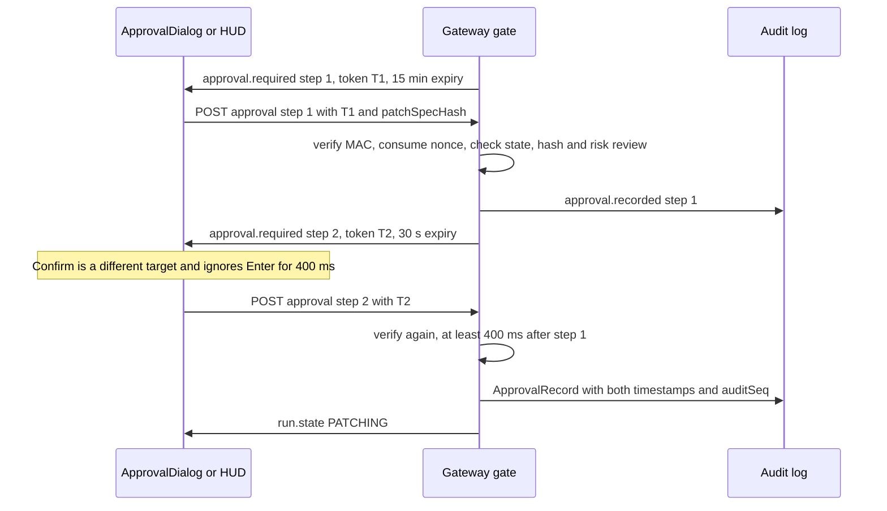

### 6.5 Static bounds check (DESIGN §17.4)

```text
boundsCheck(diff, spec, hardBounds) -> Ok | Err(PATCH_BOUNDS_VIOLATION, details[])
  paths    ⊆ spec.targetFiles
  params.py   PARAMS is a dict literal of numbers   (ast.literal_eval in the twin, via /patch/load dry-run)
  params.h    every non-blank line matches  constexpr float NAME = <number>;
  values   ∈ hardBounds ∩ spec.bounds               (closed intervals)
  imports  controller.py ⊆ {math, dataclasses, typing, collections, numpy}
  size     ≤ 400 diff lines
```

The Python parts run in the twin, because `ast` is the authoritative parser for Python. The gateway calls `/patch/load` with `dryRun: true` [here] and receives the structured result.

### 6.6 Policy engine (DESIGN §18.4)

```text
policyDecide(req, ctx) -> { choiceId, feedback, rule }
  if req is a file edit:
      allow_once if path ∈ ctx.targetFiles, else deny            (rule FILE_EDIT)
  argv = shellwords(req.command)                                 # POSIX rules. A parse error means deny.
  deny  if any token contains ; | & $ > < ` or a newline         (rule METACHAR)
  deny  if argv[0] matches NAME=VALUE                            (rule ENV_ASSIGN)
  deny  if any path argument resolves outside /workspace         (rule PATH_ESCAPE)
  allow if argv ∈ {
      ["pytest", opt("-q"|"-x")*, path_under("tests/")*],
      ["python", "-m", "pytest", same as above],
      ["pio", "run", "-t", "compile"]                           # SP-6 may change this to ["pio","run","-e","esp32dev"]
  }                                                              (rule ALLOWLIST)
  otherwise deny with feedback that lists the allowed commands   (rule DEFAULT_DENY)

  choice = req.choices.find(id == "allow_once")  for allow        # never "always" or "session" scopes
  choice = req.choices.find(kind == deny)        for deny
  no allow_once choice → deny
```

`sandbox/policies/allowlist.yaml` holds the allowlist as data, and the engine loads it at boot. A table test covers every rule, including tricky cases: `pytest tests/../../etc`, `pytest $(id)`, `PYTHONPATH=x pytest`, `pytest -k "a or b"`, a quoted `;`, and a Unicode homoglyph `ｐytest`.

### 6.7 SAM request and stream handling

| Step | Contract |
| :--- | :--- |
| Upload decision | Under 5 MB, inline. Otherwise Files API with `expires_after` by data class (DESIGN §11.4). Dedupe by `clip.sha256`. |
| Request | One per (clip, concept). Metadata values are strings (`"true"`, `"lossless"`). Never sends `propagation_direction`. |
| Tee | `body.tee()`. Branch 1 streams to `sam/{clipId}/{slug}.sse.partial`, which is renamed to `.sse` and fsynced at `response.completed`. Branch 2 feeds the parser. |
| Parse | `@meta-sam/parser` `parseVideoStream`. Fields are read by key. The encoding marker is the first character after `H,W,`. |
| Merge | Sorted by (concept-config order, ascending `objectId`) before emitting, whatever order the streams finish in |
| Marks | `t_upload_done`, `t_request_sent`, `t_first_byte`, `t_first_frame`, `t_completed` go into the span attributes and `docs/spikes/SP-2.md` |

### 6.8 Budget reservation (DESIGN §22.3)

```text
reserve(visitorKey, now) -> Reservation | Rejection           # one synchronous block, no await inside
  if not liveRunsEnabled                                   -> Rejection(LIVE_PAUSED)
  if liveRunsInLastHour(visitorKey, now) ≥ 2               -> Rejection(VISITOR_CAP)
  if spentToday + reservedToday + 0.60 > dailyCap          -> Rejection(DAILY_CAP)
  reservedToday += 0.60
  ledger.appendSync({ t: "reserve", runId, usd: 0.60, at: now })   # fsync before returning
  return Reservation(runId)

charge(runId, costEntry)   -> spentToday += usd; if runTotal > 0.60, mark the run for abort at the next boundary
release(reservation)       -> reservedToday −= 0.60; ledger.appendSync({ t: "release", … })
boot()                     -> replay today's ledger lines (UTC day) to rebuild spentToday and reservedToday
```

**TD-5 · One gateway replica.** Atomicity comes from Node's single-threaded event loop: there is no `await` between the check and the write. That holds only while there is **exactly one gateway process**. Compose pins `replicas: 1`, and the readiness probe refuses to start if another instance holds the ledger's lock file. Scaling out would need an atomic store, which is out of scope until after the hackathon.

### 6.9 `.csmk` byte layout (DESIGN §10)

| Region | Offset | Size | Field |
| :--- | --: | --: | :--- |
| Header | 0 | 4 | `magic` = `CSMK` |
| Header | 4 | 2 | `version` = 1 |
| Header | 6 | 2 | `flags` (bit 0 lossless, bit 1 one-bit, bit 2 crop placement) |
| Header | 8 | 2 + 2 | `frameW`, `frameH` |
| Header | 12 | 4 | `fps` (f32) |
| Header | 16 | 4 | `count`, written as 0 on open and patched in place on close |
| Record | 20 + … | 31 + n | `frameIdx` u32, `conceptIdx` u8, `objectId` u16, box 4×f32, `conf` f32, `payloadLen` u32, then the payload bytes |

**`.csmk.idx` layout** (introduced here): `CSMI` magic, a `version` u16, a `count` u32, then entries of `frameIdx` u32 plus `offset` u64, pointing at the first record of each frame (12 bytes per entry). A `from`/`to` request is two binary searches and one slice.

Records are 31 bytes plus the payload, so they are **not aligned**. Readers use `DataView` in TS and `struct.unpack_from` in Python, never typed-array views over the buffer. A reader rejects files whose `version` is unknown and whose `count` doesn't match the index count.

### 6.10 Telemetry spectrum contract (DESIGN §13.2, ADR-006)

```text
spectrum(t_k: float64[N], x_k: float64[N], fps) -> { f: Hz[M], S: px[M] }
  T_span = t_k[-1] − t_k[0]
  f      = arange(0.5, 0.4·fps + ε, 1 / (5·T_span))             # 5× oversampled. 5 s at 30 fps gives ≈ 288 bins.
  S      = scipy.signal.lombscargle(x=t_k, y=x_k, freqs=2π·f,     # angular frequencies, rad/s
                                    floating_mean=True,
                                    normalize="amplitude")        # a sinusoid of amplitude a peaks at ≈ a
  # never pass precenter (deprecated in SciPy 1.15, scheduled for removal)
dB(S)          = 20·log10(S + 1e-12)                              # amplitude spectrum
Pband(f0)      = 10·log10( Σ over |f − f0| ≤ 0.5 Hz of S(f)²·Δf ) # power: square first, then integrate
```

| Property | How it is guaranteed |
| :--- | :--- |
| Gap honesty | Only frames where the fault **and** `refA` are present enter `t_k`. Nothing is interpolated (FR-PER-5). |
| Normalization invariance | A hypothesis test draws `a ∈ [0.5, 20] px`, `f ∈ [1, 10] Hz`, gap rates of 0%, 10% and 30%, and noise. It asserts that the peak height is within ±0.5 dB of `a` and that `f*` is within the grid step of `f`. |
| Resolution | 1/T_span = 0.2 Hz for 5 s clips, which matches K2's 0.2 Hz and ADR-001 |
| Cost | M·N ≈ 288 × 150 operations per track. Vectorized, well under 10 ms. |
| Welch cross-check | Only when coverage ≥ 98%. A disagreement over 0.2 Hz adds the `spectralDisagreement` warning and never changes the verdict. |

### 6.11 Patch hot-load (DESIGN §20.4)

| Item | Contract |
| :--- | :--- |
| Process | `python -I -m twin_child <workdir>`. The child module sets its **own** `RLIMIT_AS` (512 MB) and `RLIMIT_CPU` (20 s) before it imports the controller. That avoids `preexec_fn`, which isn't safe in a threaded parent. |
| Working directory | Holds only the candidate's `controller.py` and `params.py`. Read-only after copy. |
| Framing | Each message is a 4-byte big-endian length followed by a msgpack map. Maximum frame size is 64 KB. |
| Messages | Parent → child: `init{params}`, `step{state, dt}`, `reset{}`. Child → parent: `ready{}`, `cmd{u, regWrites}`, `err{type, msg, tb}` |
| Timing | Each `step` must answer within 50 ms (a poll timeout on the pipe). The whole simulation must finish within 15 s. Otherwise `PATCH_RUNTIME_ERROR` with `reason: "hang"`. |
| Validation | `u` must be finite and in [−1, 1]. Register writes must target documented registers. Otherwise `PATCH_RUNTIME_ERROR` with `reason: "invalid_command"`. |
| Placebo | `ast.dump(parse(placebo)) == ast.dump(parse(baseline))` before loading. If they differ, the child run aborts (DESIGN §8.3). |
| Traceback | Sanitized: paths are rewritten to `controller.py:<line>`, and it is capped at 2 KB before it becomes D5 evidence |

### 6.12 Replay first-mask path (K7)

| Order | Fetch | Size | Why first |
| :-- | :--- | :--- | :--- |
| 1 | `manifest.json` | about 2 KB | Lists hashes and file sizes |
| 2 | `events.jsonl`, streamed | about 100–300 KB | The reducer can start before the whole file arrives |
| 3 | `masks/{pre}.csmk.idx` | under 2 KB | Gives the byte range of frames 0–29 |
| 4 | `.csmk` range for frames 0–29 of the fault track | about 30–150 KB | The first overlay |
| 5 | `clips/pre.mp4` (`+faststart`) | progressive | Plays as soon as `moov` and the first fragment arrive |

Range requests are single `bytes=a-b` ranges, which current browsers send without a CORS preflight. ⚠️ D6 checks that the CDN answers `206` with `Access-Control-Allow-Origin` for our origin. `cs_replay_first_mask_seconds` is beaconed only as an aggregate (DESIGN §29.2).

### 6.13 Sweeper (DESIGN §23.2)

```text
sweep(now) every 15 min:
  for each session with createdAt + SESSION_TTL_HOURS < now and dataClass touched CONFIDENTIAL:
      delete confidential/{sessionId}/**                            # the blobs that audit lines reference
      for each registry row with dataClass CONFIDENTIAL, sessionId match, deletedAt null:
          MetaClient.files.delete(fileId)                           # 404 counts as done
          set deletedAt = now
      audit.append({ type: "sweep", sessionId, blobs, files })       # the chain still verifies (by reference)
```

The sweeper is idempotent and resumable. A failed Files API delete is retried on the next pass, and after 3 failures it raises an admin alert. `expires_after = 86,400` remains the backstop (DL-15).

---

## 7. API reference

Four API surfaces exist, and each is reachable only from the zone shown. Public paths are served at `api.<domain>` (DL-23). Every body is JSON unless stated otherwise, and every response carries `x-cs-request-id`.

| Surface | Listener | Reachable from | Auth | Spec in this section |
| :--- | :--- | :--- | :--- | :--- |
| Public gateway API | `gateway:8080` behind Caddy `:443` | Z0 (browsers, HUD) | `cs_sid` cookie plus `Origin`, or a HUD capability, or an SSE ticket | §7.1, §7.2 |
| Admin API | Same listener, `/admin/*` | Z0, but token-gated | `Authorization: Bearer <ADMIN_TOKEN>`, constant-time compare | §7.3 |
| Twin and media-worker APIs | `twin:8090`, `media-worker:8091` on network `internal` | Gateway only | None. Network isolation is the control (TD-4). | §7.4, §7.5 |
| Launcher API | Unix socket in `launcher-sock` | Gateway only | Socket file mode `0660` with a shared group | §7.6 |

### 7.1 Public REST endpoints

"State" is the run state the orchestrator requires. A call made in any other state returns `409 STATE_CONFLICT` [here]. Endpoints marked with ▶ start work whose progress arrives as events (§7.2), and they return `202` immediately.

| Method | Path | Auth | Body → result | State | Source |
| :--- | :--- | :--- | :--- | :--- | :--- |
| POST | `/api/sessions` | None (sets `cs_sid`) | `{scenarioId?, mode: "replay" \| "live" \| "byo"}` → `{sessionId, wsUrl, budgetRemaining}`. Live mode runs `reserve()` (§6.8) when its first run starts, not here. | — | PRD §15.1 |
| GET | `/api/sessions/:id/snapshot` | Cookie or HUD cap | → `{headSeq, state}` (the reducer's output) | Any | DESIGN §9.3 |
| GET | `/api/sessions/:id/events?since=&limit=50` | Cookie or HUD cap | → `{events: Envelope[], headSeq}`, or `{resync: true, headSeq}` | Any | DESIGN §9.3 |
| POST | `/api/sessions/:id/clips` | Cookie | `multipart/form-data` upload, at most 100 MB, consent timestamp required → `{clipId, frames, fps}` | No active run | PRD §15.1, DESIGN §11.2 |
| POST ▶ | `/api/sessions/:id/perceive` | Cookie | `{clipId, concepts[]?}` → `{runId}`. Creates the run, defaulting `concepts` to the scenario's plan. | `IDLE` | PRD §15.1 |
| POST ▶ | `/api/sessions/:id/diagnose` | Cookie | `{transcript?, escalate?}` → `{diagnosisId}`. The button path for the same intent that voice produces. | `AWAITING_QUESTION`, `VERDICT_FAIL` | PRD §15.1 |
| POST | `/api/sessions/:id/approval` | Cookie or HUD cap with `approve` | `{diagnosisId, patchSpecHash, decision, step, token, note}` → `{accepted, nextStep?}`. Errors are the `TOKEN_*` codes (§7.7). | `AWAITING_APPROVAL_1` or `_2` | DESIGN §17.2 |
| POST ▶ | `/api/sessions/:id/patch` | Cookie | `{}` → `{patchId}`. Needs a step-2 `ApprovalRecord`, which the orchestrator also starts on its own. Idempotent. | `PATCHING` | PRD §15.1 |
| POST ▶ | `/api/sessions/:id/verify` | Cookie | `{patchId \| "placebo"}` → `{testId}`, or `{runId}` for a placebo child run (DESIGN §8.3) | `PASSED` for placebo, otherwise orchestrator-driven | PRD §15.1 |
| POST | `/api/runs/:runId/cancel` [here] | Cookie | `{}` → `{state: "ABORTED"}`. Calls `RunDriver.abort("user")`. Idempotent. | Any non-terminal | DESIGN §8 |
| GET | `/api/sessions/:id/report` | Cookie | `Accept: text/html` or `application/json` → the audit report with the span tree and head hash | Any | PRD §15.1 |
| GET | `/api/runs/:runId/clips/:clipId/masks?track=&from=&to=` | Cookie (PUBLIC clips need none) | → `application/octet-stream` (`.csmk`). PUBLIC: `Cache-Control: public, max-age=31536000, immutable`. | Any | DESIGN §10 |
| POST | `/api/hud/codes` [here] | None, rate-limited | `{}` → `{code, expiresAt}`. HUD-first pairing (DESIGN §26.5). | — | DESIGN §26.5 |
| POST | `/api/sessions/:id/hud/pair` [here] | Cookie | `{code}` binds a HUD-first code to the session, or `{}` mints a link-first code → `{code, deepLink?}` | — | DESIGN §26.5 |
| POST | `/api/hud/redeem` [here] | None, 5 per minute per IP | `{code}` → `{capability, sessionId, expiresAt}` once the code is bound, otherwise `202 {pending: true}` | — | DESIGN §26.5 |
| POST | `/api/hud/stream-ticket` [here] | HUD cap | `{}` → `{ticket}`, single use, 60 s, for `EventSource`, which can't set headers | — | DESIGN §26.4 |
| POST | `/api/beacons` [here] | None, rate-limited, `sendBeacon` | `{metric: "replay_first_mask", scenarioId, seconds}` → `204`. Aggregated only, never stored per visitor (DESIGN §29.2). | — | DESIGN §29.2 |
| GET | `/api/healthz`, `/api/readyz` | None | Liveness, and readiness of twin, media worker, launcher, the ledger lock and the Meta breaker states | — | DESIGN §28.3 |

**Request rules for every public endpoint.**

- CORS lists only `PUBLIC_ORIGINS`. Credentialed requests are allowed only from those origins.
- Every state-changing request must carry an `Origin` header in the allowlist, in addition to the `SameSite=Strict` cookie. Either check alone fails closed.
- Rate limits are per `visitorKey`: 60 requests per minute in general, 10 uploads per hour, and the live-run caps of §6.8. A limit returns `429 RATE_LIMITED` with `Retry-After`.
- Bodies over 64 KB are rejected, except on `/clips`.
- Path IDs must match `^(ses|run|clp)_[0-9A-HJKMNP-TV-Z]{26}$` before any lookup.

### 7.2 Streaming endpoints

| Path | Transport | Auth | Resume | Notes |
| :--- | :--- | :--- | :--- | :--- |
| `/ws/sessions/:id?since=<seq>` | WebSocket | Workbench: cookie plus `Origin`. HUD: the **first frame** must be `{type: "auth", capability}` within 5 s, otherwise close 1008 [here]. | `since` | Ping every 15 s. Coalescing and the 1013 close follow §6.1. |
| `/sse/sessions/:id?ticket=<t>` | Server-sent events | Single-use ticket (§7.1) | `Last-Event-ID` equals `seq` | HUD fallback 1 (DESIGN §26.4) |
| `/api/sessions/:id/events` | Polling every 2 s | Cookie or HUD cap | `since` | HUD fallback 2 |
| `/ws/asr/:id` | WebSocket, binary frames | Cookie plus `Origin` | None (utterances restart) | Client sends 24 kHz s16le mono, 80 ms frames. The relay rotates upstream at 55 min (DESIGN §15.5). |

A browser can't set an `Authorization` header on a WebSocket or `EventSource`. That's why the HUD uses a first-frame capability and a short-lived ticket, and never puts the 4-hour capability in a URL.

**Event producers and consumers.** Each event type has exactly one producing module.

| Event | Producer | Workbench | HUD | Audit | Replay bundle |
| :--- | :--- | :-: | :-: | :-: | :-: |
| `run.state` | `orchestrator` | ✓ | ✓ | ✓ | ✓ |
| `perception.frame` | `sam` | ✓ | — | Not audited (the `.sse` tee is the evidence) | ✓ |
| `perception.metrics` | `orchestrator` (from twin `/metrics/stream`) | ✓ | Final only | ✓ | ✓ |
| `transcript.partial` | `asr` | ✓ (owner only) | — | — | — |
| `transcript.final` | `asr` | ✓ (text to the owner only) | Intent only | By reference | Intent only |
| `diagnosis.delta`, `diagnosis.final` | `diagnosis` | ✓ | Title and confidence | ✓ | ✓ |
| `risk.review` | `gate` | ✓ | ✓ | ✓ | ✓ |
| `approval.required` | `gate` | ✓ | ✓ | ✓ (token hashed) | Token removed |
| `approval.recorded` | `gate` | ✓ | ✓ | ✓ | ✓ |
| `patch.progress`, `patch.diff`, `patch.tests` | `muse` | ✓ | Summary | ✓ | ✓ |
| `twin.render` | `orchestrator` | ✓ | — | ✓ | ✓ |
| `test.result` | `orchestrator` (from twin `/visual-test`) | ✓ | Verdict and headline | ✓ | ✓ |
| `cost.update` | `budget` | ✓ | — | ✓ | ✓ |
| `ratelimit` | `limits` | ✓ | ✓ | — | ✓ |
| `error` | Any stage, through `orchestrator` | ✓ | ✓ | ✓ | ✓ |
| `resync.required` | `ws` | ✓ | ✓ | — | — |

### 7.3 Admin API (DESIGN §22.4)

| Method | Path | Body → result | Notes |
| :--- | :--- | :--- | :--- |
| GET | `/admin/spend` | → today's spend and reservations by model and lane, and the 10-day total | Read from the ledger (§6.8) |
| POST | `/admin/live` | `{enabled: boolean}` → `{enabled, persistedAt}` | Persists to `data/state/live.json` [here], which overrides `LIVE_RUNS_ENABLED` at boot |
| GET | `/admin/sessions` | → live sessions with state, cost and data class | No transcripts and no clip names |
| GET | `/admin/health` | → breakers, buckets, cache-hit ratio, warm-pool state, sweeper failures, the §14 metrics | — |
| POST | `/admin/warm` [here] | `{scenarioId?}` → `{sent}` | Runs the cache warmer once, Contributor lane only (DESIGN §16.3) |

Ten failed admin attempts in 10 minutes from one `visitorKey` lock that key out for 15 minutes. The web `/admin` page keeps the token in memory only, never in storage.

### 7.4 Twin internal API (DESIGN §20.6)

| Method | Path | Body → result | Timeout |
| :--- | :--- | :--- | --: |
| POST | `/render` | `{scenarioId, seed, controller: "baseline" \| patchId, durationS}` → `{clipPath, frames, fps, groundTruthPath}` | 30 s |
| POST | `/metrics/stream` | NDJSON of frames with placed masks → NDJSON of rolling metrics | Stream |
| POST | `/metrics` | `{clipId, csmkPath, scenarioId, phase}` → telemetry summary with the pre-check result | 10 s |
| POST | `/visual-test` | `{scenarioId, pre, post}` → `VisualTestResult` | 10 s |
| POST | `/patch/load` | `{patchId, files, dryRun?}` → `{ok}` or `PATCH_RUNTIME_ERROR`. With `dryRun: true` [here] it returns the AST bounds-check result (§6.5) and loads nothing. | 15 s |
| GET | `/healthz` | → liveness, the renderer version and the ffmpeg version | 1 s |
| GET | `/readyz` [here] | → scenario packages loaded, baseline cache index readable | 1 s |

Paths in bodies (`clipPath`, `csmkPath`) are resolved against the mounted volumes and must stay inside them. Any `..` or absolute path is rejected with `400`.

### 7.5 Media-worker API (introduced here)

| Method | Path | Body → result | Limits |
| :--- | :--- | :--- | :--- |
| POST | `/probe` | `{path}` → `{durationS, width, height, fps, vcodec, hasAudio}`, or `MEDIA_DURATION` or `MEDIA_UNDECODABLE` | 1 CPU, 512 MB, 20 s (DESIGN §11.2) |
| POST | `/normalize` | `{path, profile: "sam"}` → `{outPath, sha256, frames, fps, wavPath?, commandLine}` | The parameters are read from `profiles/normalize.json` (DESIGN §11.3). The command line is logged per clip (FR-CAP-2). |
| GET | `/healthz` | → liveness and the ffmpeg version | — |

The worker never fetches URLs and has no network route (TD-4). Only file paths inside `media-scratch` are accepted.

### 7.6 Launcher API (DL-22, introduced here)

| Method | Path | Body → result |
| :--- | :--- | :--- |
| POST | `/launch` | `{kind: "synthesis" \| "test", candidateId, files?}` → `{containerId, workspaceVolume}` |
| GET | `/attach/:containerId` | HTTP upgrade to a raw duplex stream bridged to `muse serve` stdio |
| POST | `/run-tests/:containerId` | → `{exitCode, junitXml, stdoutTail}` |
| DELETE | `/containers/:containerId` | → `204`. Idempotent. |
| GET | `/healthz` | → Docker reachable, image digest present, count of live sandboxes |

Any field that isn't in these shapes is rejected. `candidateId` must match `^c[1-3]$`, and `files` may contain only the scenario's `targetFiles`.

### 7.7 Error catalogue

Every surfaced failure is one `error` event and, for synchronous calls, one HTTP body `{code, message, retryable, stage, requestId}`. Codes are stable strings, and messages are for people. The "Source" column says where each code is first defined.

| Code | HTTP | Retryable | Stage | Meaning and client action | Source |
| :--- | --: | :-: | :--- | :--- | :--- |
| `CAPTURE_TIMEOUT` | — | No | ST-2 | No clip within 60 s. The run aborts. | DESIGN §8.1 |
| `MEDIA_TOO_LARGE` | 413 | No | Upload | Over 100 MB, enforced while streaming | here (DESIGN §11.2) |
| `MEDIA_BAD_MAGIC` | 415 | No | Upload | No `ftyp` box with an allowed brand | here (DESIGN §11.2) |
| `MEDIA_DURATION` | 422 | No | Upload | Shorter than 3 s or longer than 60 s | here (DESIGN §11.2) |
| `MEDIA_UNDECODABLE` | 422 | No | Upload | ffprobe can't decode the video stream | here (DESIGN §11.2) |
| `CONSENT_REQUIRED` | 428 | No | Upload | The privacy notice wasn't acknowledged (PRD §17.4) | here |
| `SAM_BAD_REQUEST` | — | **Never** | ST-3, ST-11 | Terminal. Show the upstream message. | DESIGN §12.6 |
| `SAM_AUTH` | — | No | ST-3, ST-11 | Wrong key or exhausted balance. Alerts the team. | DESIGN §12.6 |
| `SAM_RATE_LIMITED` | — | Yes | ST-3, ST-11 | Backoff with a `ratelimit` countdown | DESIGN §12.6 |
| `SAM_UPSTREAM` | — | Yes, 3 times | ST-3, ST-11 | 5xx, then the breaker opens | DESIGN §12.6 |
| `SAM_STREAM_TRUNCATED` | — | Once | ST-3, ST-11 | No `response.completed`. The partial tee is kept. | DESIGN §12.6 |
| `SAM_AMBIGUOUS` | — | — | ST-3 | Warning only. The largest objects are kept. | DESIGN §12.6 |
| `SAM_TIMEOUT` | — | No | ST-3 | Over 60 s, which is the D1 kill criterion | DESIGN §8.1 |
| `DIAGNOSIS_SCHEMA_INVALID` | — | Once | ST-6 | Strict-schema output failed validation | DESIGN §16.8 |
| `DIAGNOSIS_UPSTREAM` | — | 3 times | ST-6 | 5xx after backoff | DESIGN §16.8 |
| `POLICY_VIOLATION` | — | No | Router | A Contributor call with CONFIDENTIAL data. It is a bug, and it alerts. | DESIGN §21.2 |
| `RATE_LIMIT_QUEUE_TIMEOUT` | — | Yes | Any model call | A bucket lease wasn't granted within the stage's guard | here |
| `APPROVAL_EXPIRED` | — | No | ST-7 | 15 minutes without a step-1 decision | DESIGN §8.1 |
| `TOKEN_MALFORMED` | 400 | No | ST-7, ST-8 | Not `payload.mac` | here (§6.4) |
| `TOKEN_BAD_MAC` | 403 | No | ST-7, ST-8 | MAC mismatch | here (§6.4) |
| `TOKEN_EXPIRED` | 410 | No | ST-7, ST-8 | Past `exp`. Step 2 falls back to step 1. | here (§6.4) |
| `TOKEN_REPLAYED` | 409 | No | ST-7, ST-8 | Nonce already used | here (§6.4) |
| `TOKEN_STATE_MISMATCH` | 409 | No | ST-7, ST-8 | Wrong state for the step | here (§6.4) |
| `TOKEN_HASH_MISMATCH` | 409 | No | ST-7, ST-8 | `patchSpecHash` is stale, because a new diagnosis exists | here (§6.4) |
| `TOKEN_DEBOUNCE` | 425 | Yes, after 400 ms | ST-8 | Step 2 arrived too soon after step 1 | here (§6.4) |
| `APPROVAL_UNRESOLVED` | — | No | ST-9 | Muse Code asked for an approval that the policy engine couldn't map to a choice | DESIGN §18.4 |
| `SANDBOX_TIMEOUT` | — | Next candidate | ST-9 | Over 110 s means cancel, and over 120 s means kill | DESIGN §18.5 |
| `MUSE_TURN_FAILED` | — | Once if `retryable` | ST-9 | `turn/completed` had a terminal other than `completed` | here (DESIGN §28.1 FM-8) |
| `PATCH_BOUNDS_VIOLATION` | — | Next candidate | ST-9 | The static bounds check failed (§6.5) | here (DESIGN §17.4) |
| `PATCH_TESTS_FAILED` | — | Next candidate | ST-9 | The independent re-run failed | here (DESIGN §18.9) |
| `PATCH_RUNTIME_ERROR` | — | Back to ST-6 | ST-10 | Crash, hang or invalid command in the twin child | DESIGN §20.4 |
| `LIVE_PAUSED` | 503 | No | ST-1 | Kill switch on. Show "Live runs paused. Watch a replay." | here (DESIGN §22.3) |
| `VISITOR_CAP` | 429 | After the hour | ST-1 | Two live runs in the last hour | here (DESIGN §22.3) |
| `DAILY_CAP` | 503 | Next UTC day | ST-1 | The reservation would exceed the daily cap | here (DESIGN §22.3) |
| `STATE_CONFLICT` | 409 | No | Any | The endpoint isn't valid in the current state | here |
| `SESSION_NOT_FOUND` | 404 | No | Any | Unknown or expired session | here |
| `ORIGIN_DENIED` | 403 | No | Any | `Origin` missing or not allowlisted | here (DESIGN §27.2) |
| `PAIRING_INVALID` | 404 | No | HUD | Code unknown, expired or used | here (DESIGN §26.5) |
| `RATE_LIMITED` | 429 | Yes | Any | A per-visitor endpoint limit | here (DESIGN §27.2) |

**Verdict reasons are not errors.** `COVERAGE_LOW`, `REL_REDUCTION_INSUFFICIENT`, `ABOVE_CEILING`, `SPECTRAL_DROP_INSUFFICIENT`, `NEW_RESONANCE` and `LOW_CONFIDENCE` (DESIGN §14.2) appear in `VisualTestResult.assertions[].reasons` of a valid FAIL verdict. They never appear in an `error` event.

---

## 8. Data, schemas and storage

### 8.1 One schema source, three consumers

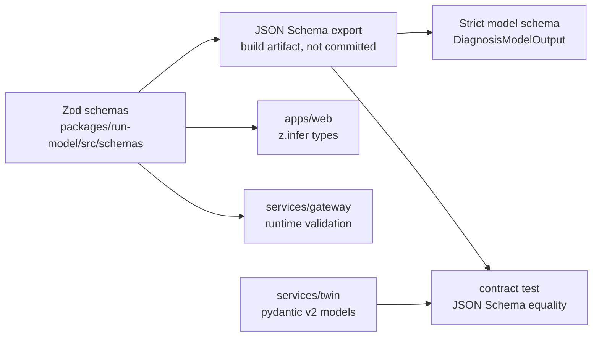

**TD-6 · Zod is the source of truth, and pydantic is checked against it.** The twin's pydantic models are hand-written, because the twin must not depend on a Node build step. A contract test exports both sides to JSON Schema and compares the shared types after normalizing titles and descriptions: `VisualTestResult`, the telemetry summary and the `/render` and `/visual-test` bodies. A drift fails CI. The strict `DiagnosisModelOutput` sent to Muse Spark is generated from the same Zod schema with `z.toJSONSchema` and then checked against the DESIGN §16.6 rules: every key required, `additionalProperties: false`, and nullable fields as `anyOf` with `null`.

### 8.2 Shared types

| Type | Defined in | Stored as | Versioning |
| :--- | :--- | :--- | :--- |
| `Envelope` | `run-model/src/envelope.ts` | Audit lines, `events.jsonl` | `v: 1`. Adding an optional field is non-breaking. Anything else bumps `v`, and the reducer keeps every older `v`. |
| `Diagnosis`, `DiagnosisModelOutput` | `run-model/src/schemas/diagnosis.ts` | `diagnosis/{id}.json` | Follows PRD §15.2 and DESIGN §16.6 |
| `VisualTestResult` | `run-model/src/schemas/visual-test.ts`, mirrored in `twin/vut/schema.py` | `test/{id}.json` | Follows DL-19 (`assertions[]`) |
| `ApprovalRecord` | `run-model/src/schemas/approval.ts` | An audit line | DESIGN §17.5 |
| `PatchSpec` | `run-model/src/schemas/patch-spec.ts` | Inside `Diagnosis` | Hashed with JCS (§6.3) |
| `BundleManifest` | `run-model/src/schemas/manifest.ts` | `manifest.json` | `bundleVersion: 1` (DESIGN §24.1) |
| `ScenarioConfig` | `twin/scenarios/schema.py`, exported to TS for the UI | `scenario.yaml` | `version` key, read with `safe_load` only |
| `.csmk` and `.csmk.idx` | `run-model/src/csmk.ts` and `twin/metrics/csmk.py` | Binary | `version` u16 (§6.9) |

### 8.3 Storage layout on the `data` volume

```text
data/
├── public/
│   ├── replays/{runId}/…                     DESIGN §24.1, mirrored to the CDN, immutable
│   └── baselines/{scenarioId}/{baselineKey}/ pre clip, .sse tees, .csmk + .idx, telemetry.json
├── confidential/{sessionId}/                 clips, audio, transcripts, upload names (24 h)
├── audit/{sessionId}.jsonl                   hash-chained (DESIGN §23.3)
├── registry/files.jsonl                      Files API registry (DESIGN §11.4)
├── budget/ledger.jsonl                       reservation ledger, plus ledger.lock (§6.8) [here]
└── state/live.json                           admin kill-switch override (§7.3) [here]
```

| File | One line or record | Written by | Durability |
| :--- | :--- | :--- | :--- |
| `audit/*.jsonl` | `{seq, ts, sessionId, runId, type, data, prevHash, hash}` | `audit.append` | Appended and fsynced before an audited event is broadcast, so no audited event a client saw can be missing from the log. High-rate types (`perception.frame`, `transcript.partial`) aren't audited. |
| `registry/files.jsonl` | `{fileId, sha256, dataClass, bytes, uploadedAt, expiresAt, deletedAt}`. Updates are new lines, and the last line per `fileId` wins. | `storage` | fsync per line |
| `budget/ledger.jsonl` | `{t: "reserve" \| "charge" \| "release", runId, usd, model?, at}` | `budget` | fsync before `reserve` returns (§6.8) |
| `state/live.json` | `{enabled, by: "admin", at}` | `admin` | Atomic write: a temp file, then rename |
| `baselines/…/key.json` | `{scenarioId, seed, controllerSha, rendererVersion, samModel, conceptsHash}` | `orchestrator` | Written last, so a half-written baseline is never used |

The baseline key is the sha256 of the JCS of `key.json` (DESIGN §20.5). If OD-5 shows that encoded MP4 bytes aren't deterministic, `controllerSha` stays the same and the key adds a raw-frame hash, so a cache hit never depends on encoder output.

### 8.4 Retention and deletion

Retention follows DESIGN §23.2 exactly. This section adds where each deletion runs.

| Artifact | Deleted by | Proof |
| :--- | :--- | :--- |
| `confidential/{sessionId}/**` | `storage.sweep` every 15 min (§6.13) | A `sweep` audit line with the counts |
| Meta Files copies of CONFIDENTIAL clips | `sweep` with `files.delete`, plus `expires_after = 86,400` | `deletedAt` in the registry |
| Prompt-cache entries for CONFIDENTIAL content | Meta's eviction. We send `prompt_cache_retention: "in_memory"`. | The request fixture in contract tests |
| `media-scratch` uploads and outputs | `sweep`, with the session | — |
| `ws-<candidate>` volumes | The launcher's `destroy`, and its startup cleanup | The sandbox hardening suite |
| Ring buffers | Freed when the session expires | — |

---

## 9. Configuration

### 9.1 Environment variables

Names and documented defaults only. `.env.example` lists the names with no values (PRD §15.3, DESIGN §34.3). "Secret" values are delivered to the host as Compose secrets or host env, never committed, never sent to the browser.

| Variable | Purpose | Default | Read by | Secret | Source |
| :--- | :--- | :--- | :--- | :-: | :--- |
| `META_API_KEY` | Meta Model API bearer key | — | gateway, sandbox-launcher (synthesis containers only) | Yes | PRD §15.3 |
| `META_API_BASE` | API base URL | `https://api.meta.ai/v1` | gateway | No | PRD §15.3 |
| `PARTNER_ENDPOINTS_ENABLED` | P2 partner calls | `false` | gateway | No | PRD §15.3 |
| `BASETEN_API_KEY`, `BASETEN_MODEL_ID` | P2 second opinion | — | gateway | Key: yes | PRD §15.3 |
| `MODAL_TOKEN_ID`, `MODAL_TOKEN_SECRET` | P2 partner compute | — | gateway | Yes | PRD §15.3 |
| `STORAGE_BUCKET_URL`, `STORAGE_KEY` | CDN bucket for PUBLIC bundles | — | gateway (`replay` publisher) | Key: yes | PRD §15.3 |
| `BUDGET_GLOBAL_DAILY_USD` | Daily live cap | `3` | gateway `budget` | No | PRD §15.3 |
| `BUDGET_PER_VISITOR_RUNS_PER_HOUR` | Visitor cap | `2` | gateway `budget` | No | PRD §15.3 |
| `LIVE_RUNS_ENABLED` | Boot default of the kill switch (prod: off during judging, DESIGN §34.1) | `true` | gateway | No | PRD §15.3 |
| `ADMIN_TOKEN` | Admin API bearer | — | gateway `admin` | Yes | PRD §15.3 |
| `SESSION_TTL_HOURS` | Session and CONFIDENTIAL lifetime | `24` | gateway `storage` | No | PRD §15.3 |
| `APPROVAL_HMAC_KEY` | Signs approval tokens | — | gateway `gate` | Yes | DESIGN §34.3 |
| `SESSION_SIGNING_KEY` | Signs `cs_sid`, HUD capabilities, stream tickets | — | gateway `hud`, `http` | Yes | DESIGN §34.3 |
| `MOCK_META` | `true`, `false` or `record` | `true` in dev | gateway `meta` | No | DESIGN §34.3 |
| `SANDBOX_IMAGE` | Digest-pinned sandbox image | — | sandbox-launcher | No | DESIGN §34.3 |
| `EGRESS_PROXY_URL` | `HTTPS_PROXY` for Z4 | — | sandbox-launcher | No | DESIGN §34.3 |
| `PUBLIC_ORIGINS` | CORS and `Origin` allowlist | — | gateway | No | DESIGN §34.3 |
| `HUD_PAIRING_TTL_S` | Pairing code lifetime | `600` | gateway `hud` | No | DESIGN §34.3 |
| `CACHE_WARMER_INTERVAL_H` | Warmer period | `4` | gateway `diagnosis` | No | DESIGN §34.3 |
| `CHAOS_*` | Fault injection, inert in production | unset | gateway `chaos` | No | DESIGN §33 |
| `NEXT_PUBLIC_GATEWAY_ORIGIN` | `https://api.<domain>` (DL-23) | — | apps/web (client) | No | here |
| `NEXT_PUBLIC_CDN_ORIGIN` | Replay and baseline CDN origin | — | apps/web (client) | No | here |
| `TWIN_URL`, `MEDIA_WORKER_URL` | `http://twin:8090`, `http://media-worker:8091` | as shown | gateway | No | here |
| `LAUNCHER_SOCKET` | Unix socket path in `launcher-sock` | — | gateway, sandbox-launcher | No | here |
| `DATA_DIR` | Root of the `data` volume (§8.3) | `/data` | gateway | No | here |

Boot validation: the gateway parses its environment with a Zod schema at startup and refuses to start if a required secret is missing, if `CHAOS_*` is set while `NODE_ENV=production`, or if `MOCK_META=record` in production.

### 9.2 Configuration files (keys only)

| File | Top-level keys | Validated by |
| :--- | :--- | :--- |
| `config/routing.yaml` | `version`; `tasks.<taskId>.{primary.{model, effort, summary}, dataClasses[], fallback, retries, lane}`; `lanes.{contrib, std}.{cacheRetention, filesExpiresAfterS}` | Router table test (§5.3) |
| `config/prices.json` | `verifiedOn`; `models.<id>.{inputPerM, cachedInputPerM, outputPerM, perImage?, perHour?, perFrame?}`; `searchPer1k` | `budget` boot check |
| `config/buckets.yaml` | `models.<id>.{rpm, tpm?}`; `asr.maxConcurrent` | `limits` boot check |
| `scenarios/*/scenario.yaml` | `version, id, title, hazardousVoltage, durationS, fps, concepts[{slug, prompt, role, expectedCount}], markers{sizeMm}, camera, seeds{baseline, calibration[], mutation[]}, objectives, hardBounds, targetFiles[], assertions[{type, role, params}]` | `ScenarioConfig` (§8.2) |
| `sandbox/policies/allowlist.yaml` | `version`; `commands[{argv0, args}]`; `fileEdits.targetFilesOnly` | Policy table test (§6.6) |

---

## 10. Local development

### 10.1 Prerequisites

| Need | Pin or choice | Why | Check |
| :--- | :--- | :--- | :--- |
| OS | Linux, macOS, or **Windows 11 with WSL2** (Ubuntu 24.04 distro) | The stack is Linux containers, and the launcher uses a unix socket (§5.6) | `wsl --status` shows version 2 |
| Container engine | Docker Engine, or Docker Desktop with the WSL2 backend | Compose networks with `internal: true` (TD-4) behave the same on both | `docker info` shows a Linux server |
| Node | 24.x (DL-20), from `engines` in the root `package.json` | One runtime for gateway, launcher, web and tools | `node -v` starts with `v24.` |
| Python | 3.12.x, provisioned by `uv` 0.13 (§2.2) | numpy 2.5 and scipy 1.18 need ≥ 3.12 | `uv python find 3.12` |
| ffmpeg | Not required on the host | It runs only inside the media-worker and twin images, so every developer gets the same build (DESIGN §11.3 profile) | — |
| git | Any current version, configured as in §10.2 | `diffHash` and the prefix byte-stability test depend on LF bytes (§6.3, §5.8) | `git config core.autocrlf` prints `false` or `input` |

### 10.2 Windows and cross-OS rules

These rules exist because three hashes in the system are computed over bytes, and Windows changes bytes silently.

| Rule | What breaks without it | Enforced by |
| :--- | :--- | :--- |
| Clone the repo **inside the WSL filesystem** (`~/src/chronosight`), never under `/mnt/c` | Bind mounts from `/mnt/c` are slow, file watchers miss changes, and file modes are lost | A `tools/` doctor script warns when the path starts with `/mnt/` [here] |
| `.gitattributes` sets `* text=auto eol=lf`, and marks `*.mp4`, `*.csmk`, `*.pdf`, `*.png` and `*.sse` as `binary` | CRLF in `corpus/encx14/pages/*.md` changes the cached prefix bytes, so the cache key and `corpusHash12` differ per OS (DESIGN §16.3). CRLF in a candidate diff changes `diffHash`. | The prefix byte-stability test runs on Linux and Windows runners (§11.1) |
| Symlinks must survive checkout: the scenario `corpus` link (§4.1) | On native Windows git, a symlink becomes a text file holding the target path, and the twin loads garbage | WSL checkouts handle symlinks natively. On native Windows, `core.symlinks=true` with Developer Mode. The twin's `/readyz` fails if `corpus` isn't a directory. |
| File names are lower-case ASCII with no spaces | Case-insensitive file systems hide collisions | A lint rule over the tree [here] |
| Never commit `.env`. Local secrets live in a git-ignored `.env.local` at the root, or in the shell. | K8 | gitleaks pre-commit hook and CI (§11.2) |

### 10.3 Run modes

| Mode | What runs | Meta calls | Use it for |
| :--- | :--- | :--- | :--- |
| **Fixture dev** (default) | `apps/web` dev server, gateway in watch mode, twin under `uv run`, media-worker in its container | **None.** `MOCK_META=true` plays back `fixtures/` (§5.4). An unknown fingerprint is an error, not a live call. | Daily work by every role. It costs nothing, so it's always the default. |
| **Full stack** | Every service in Compose on the developer machine, including the launcher and egress proxy | Fixtures, unless the developer switches on recording | Sandbox and network work (C), and the hardening suite |
| **Record** | Full stack with `MOCK_META=record` and the dev key | Real calls, written to `fixtures/` with `Authorization` and `accessToken` stripped | Only when a request shape changes. The diff of `fixtures/` is reviewed like code. |
| **Twin only** | `services/twin` under `uv run`, with pytest and the calibration notebooks | None | Simulation, metrics and verdict work (A, B) |

The npm script names are part of the contract, so CI and people run the same thing.

| Script (root `package.json`) | Does | Used by |
| :--- | :--- | :--- |
| `dev` | Starts web, gateway and twin in fixture mode with one combined log | Everyone |
| `lint` | ESLint CLI with the flat config, `ruff check`, and the import-boundary rules of §3.6 | CI `static` job |
| `typecheck` | `tsc -b` across workspaces, then `mypy` in strict mode for `metrics/`, `vut/` and `hotload/` | CI `static` job |
| `test` | vitest (unit, contract, golden replay), then pytest (unit, property) | CI `unit` job |
| `test:sim` | Calibration, mutation suite V1–V5 on fixture SAM, determinism hashes | CI `sim` job |
| `test:sandbox` | The hardening suite against a running launcher | CI `sandbox` job, and C locally |
| `test:e2e` | Playwright judge path and HUD keyboard-only | CI `e2e` job |
| `fixtures:record` | Full stack in record mode for one named scenario | C, by hand only |
| `docs:check` | `tools/mermaid-parse` and `tools/md-tables` over every Markdown file | CI `compliance` job |

### 10.4 Fixture discipline

- A fixture file is named by its request fingerprint (§5.4), so a changed request shape produces a *missing* fixture, which fails loudly. A stale fixture can't pass silently.
- `fixtures/README.md` records, for each folder, the date recorded, the model ID and the reason. A re-recorded SAM fixture also re-runs the SP-1 IoU check (FM-5).
- Fixtures never contain CONFIDENTIAL content. They are recorded only from twin clips and synthetic inputs, which are PUBLIC by definition (DESIGN §21.4).
- The `muse/*.session.jsonl` golden sessions come from SP-4 (D4). Until then, the `muse` tests run against hand-written sessions marked `synthetic: true`, and SP-4 replaces them.

### 10.5 Each role's inner loop

| Role | Edits mostly | Fast loop (seconds) | Before pushing |
| :--- | :--- | :--- | :--- |
| A (perception and verdict) | `twin/metrics`, `twin/vut`, `gateway/src/sam` | `pytest -k metrics` with hypothesis on the `dev` profile | `test:sim`, and the SP-1 IoU fixture when placement code changed |
| B (twin and corpus) | `twin/sim`, `twin/render`, `scenarios/`, `corpus/` | Render one seed and diff its determinism hash | `test:sim`, and the prefix byte-stability test when the corpus changed |
| C (gateway and sandbox) | `gateway/src/*`, `sandbox-launcher`, `sandbox/` | vitest watch on the touched module | `test`, and `test:sandbox` when sandbox code changed |
| D (web, HUD, docs) | `apps/web`, `docs/`, `README.md` | The Next dev server against fixture events | `test:e2e`, `docs:check` |

---

## 11. Build, CI/CD and release

DESIGN §34.2 defines the pipeline stages, and §3.9 shows them as a diagram. This section makes each stage a job with a time budget and a failure rule. The workflow files are written on D0-4 and D6, and their bodies are not in this document (E16).

### 11.1 Workflows and jobs

| Workflow | Trigger | Job | Runs | Needs | Fails the build when | Budget |
| :--- | :--- | :--- | :--- | :--- | :--- | --: |
| `ci` | Every push and pull request | `static` | `lint`, `typecheck` | — | Any lint or type error | 3 min |
| `ci` | Every push and pull request | `compliance` | gitleaks, `term-grep`, `licence-audit`, `provenance-check`, `docs:check` | — | A secret, a banned term (PRD §12.4), a licence outside the allowlist (§13.5), a module missing from `HACKATHON_PROVENANCE.md`, a Mermaid parse error, a broken table | 2 min |
| `ci` | Every push and pull request | `unit` | `test` with coverage | `static` | A failure, or coverage below 80% on parser, decoder and metrics (PRD §17.6) | 4 min |
| `ci` | Every push and pull request | `cross-os` | JCS parity vectors and the prefix byte-stability test on a Windows runner | `static` | Bytes differ from the Linux job's output | 4 min |
| `ci` | Every push and pull request | `sim` | `test:sim` | `unit` | Any V2 PASS (one false pass fails CI, DESIGN §33), a calibration miss, or a determinism hash change without a scenario version bump | 6 min |
| `ci` | Every push and pull request | `images` | Build every image, emit digests and an SBOM, scan | `unit` | A critical vulnerability with a fix available, or a missing digest | 6 min |
| `ci` | Every push and pull request | `sandbox` | `test:sandbox` against the built images | `images` | Any hardening assertion (§15.2) | 3 min |
| `ci` | Every push and pull request | `e2e` | `test:e2e` against a production build of the web app with fixture events | `images` | Any failure in Chromium or WebKit | 5 min |
| `nightly` | Schedule, 02:00 UTC | `live` | The full loop against the real API for each P0 and P1 scenario, then the live mutation suite | — | K1 below 90% from D8 on, or any false pass | 25 min |
| `deploy` | Tag `v*` on `main`, with the `prod` environment approval | `release` | §11.4 | `ci` green on the tagged commit | The smoke test fails, and then rollback runs | 10 min |

The `ci` critical path is about 16 minutes (`static` → `unit` → `images` → `sandbox` and `e2e` in parallel). Jobs that don't depend on each other run in parallel.

**The nightly cost cap.** The `live` job starts the gateway with `BUDGET_GLOBAL_DAILY_USD=2` and the dev environment key (DESIGN §34.1), so the job's own budget guard enforces the $2 cap (DESIGN §33). The job also fails at 25 minutes, whatever the guard says. Its report is the K1 and K3 trend line that the D5 and D8 gates read.

### 11.2 Compliance tools

| Tool (in `tools/`) | Input | Rule | Source |
| :--- | :--- | :--- | :--- |
| gitleaks | Full history on push, staged files in the pre-commit hook | Any finding fails. `.gitleaks.toml` adds a rule for the Meta key pattern. | PRD §18.4, K8 |
| `term-grep` | Every tracked text file except `PRD.md`, `DESIGN.md` and `TECHNICAL.md`, which discuss the terms | The banned-term list of PRD §12.4 | PRD §12.4 |
| `licence-audit` | `package-lock.json`, `uv.lock`, the corpus manifest | Every licence is on the allowlist (§13.5). The SAM Licence is matched by its text hash, not by name. | DESIGN §34.2 |
| `provenance-check` | `HACKATHON_PROVENANCE.md` and `git log` | Every top-level module has a row, and its first commit is after kickoff (Oct 26, 21:30 IST) | PRD §18.2, E16 |
| `mermaid-parse` | Every fenced `mermaid` block in Markdown | `mermaid.parse()` with `mermaid` 11.17 succeeds | §2.2 |
| `md-tables` | Every Markdown table | Each row has the header's cell count, counting escaped `\|` as text | [here] |
| `verify-bundle` | A replay bundle directory | Every manifest hash matches, using `rfc8785` for JSON files | DESIGN §24.1, TH-3 |

### 11.3 Supply chain

| Control | Implementation | Threat |
| :--- | :--- | :--- |
| Locked installs | `npm ci` and `uv sync --frozen`. Images install Python packages from `uv export` with hashes. | TH-15 |
| No install scripts by default | **TD-7:** `npm ci --ignore-scripts` in CI and in every image. A package that needs its install script is named in a short allowlist and rebuilt explicitly. The list is fixed on D0-4. | TH-15 |
| Pinned actions | Every third-party GitHub Action is pinned to a full commit SHA, never a tag | TH-15 |
| Pinned base images | Every `FROM` uses a digest. A weekly job opens a pull request with digest bumps, which runs the full `ci`. It is paused during the freeze (§11.6). | TH-15 |
| SBOM | One SBOM per image, attached to the release and linked from `docs/` | Judges' audit |
| Image scan | A critical vulnerability with a fix available fails `images`. Anything else is reported. | TH-12, TH-15 |
| Registry | **TD-8:** GitHub Container Registry, one repository per service, tags `sha-<commit>` plus the release tag. Deploys use digests, never tags. | TH-15 |

### 11.4 Release, deploy and rollback

A release is a tag `vYYYY.MM.DD-N` on `main`. The `deploy` workflow does the following, and stops at the first failure.

| Step | Action | Gate |
| :--- | :--- | :--- |
| 1 | Resolve the image digests that `ci` built for the tagged commit, and write the release record `{tag, commit, digests{service: sha256}}` | `ci` green on that commit |
| 2 | **Drain.** Call `POST /admin/live {enabled: false}`, then wait until `/admin/sessions` shows no active run, for at most 5 minutes | No run is cut off mid-loop |
| 3 | On the host, write the digests into the Compose environment, then pull and start. Health checks gate start order (DESIGN §28.3). | Every `/healthz` and `/readyz` is green |
| 4 | Promote the Vercel deployment built from the same commit | — |
| 5 | **Smoke.** `/api/readyz`, one replay first-mask check from a CI runner, one fixture-backed session round trip | All pass within 2 minutes |
| 6 | Restore the kill switch to its value before step 2 | — |

**Rollback** is the same procedure with the previous release record. The host keeps the last 5 records in a `releases.jsonl` beside its Compose project [here], outside the repository, and Vercel's instant rollback restores the matching web deployment. Rollback doesn't touch the `data` volume. Any change to a stored format must stay readable by the previous release (`Envelope` `v`, `bundleVersion`, §8.2), so a rollback never strands data.

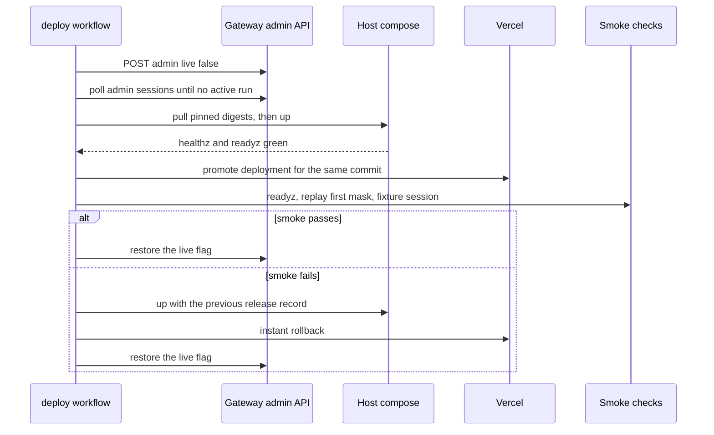

### 11.5 Environments

DESIGN §34.1 defines dev, demo and prod. This table says where each one runs.

| Environment | Web | Gateway host | Domain (DL-23) | Deploys from |
| :--- | :--- | :--- | :--- | :--- |
| dev | `next dev` on laptops | Laptops (fixture dev, §10.3) | `localhost` | The working copy |
| demo | A protected Vercel preview | A second Compose project on the prod host, with its own `data` volume and key | `demo-app.<domain>`, `demo-api.<domain>` | Any green commit, by hand |
| prod | Vercel production | The prod host | `app.<domain>`, `api.<domain>` | Tags only (§11.4) |

The custom domain and its DNS must be live on **D6**, together with the Vercel production deployment. Until then the web app is on `*.vercel.app`, which can't send the `SameSite=Strict` cookie to the gateway (DL-23). Live runs from the hosted web app therefore wait for D6 (TR-2), and fixture dev on `localhost` is unaffected.

### 11.6 Change freeze

From D9 (Nov 4) through Nov 9 only P0 fixes ship (PRD §19 J, DESIGN §34.2). Each one needs a tag, a green `ci`, the drain procedure and a line in the J log (§12.5). The nightly job keeps running, and its result is read every morning.

---

## 12. Operations runbook

The operator is whichever team member is on duty. The tools are the `/admin` page (the token is held in memory only, §7.3), the uptime monitor's webhook, the nightly report, and SSH to the host by key. Alerts are defined in §14.4. This section says what to do when one fires.

### 12.1 Operator controls

| Control | How | Effect | Survives restart | Source |
| :--- | :--- | :--- | :--- | :--- |
| Kill switch | `POST /admin/live {enabled: false}`, or the toggle on `/admin` | New live runs get `LIVE_PAUSED`. Runs in progress finish. Replays are unaffected. | Yes, through `data/state/live.json` | DESIGN §22.3 |
| Breakers | Automatic: 5 × 5xx in 60 s opens a model's breaker, and a probe runs after 30 s (§5.3) | Calls to that model fail fast. The FM-2 response starts. | No. They start closed. | DESIGN §21.3 |
| Cache warmer | Automatic every `CACHE_WARMER_INTERVAL_H`. Once by hand with `POST /admin/warm`. | Keeps the Contributor-lane prefix cached (FM-15) | — | DESIGN §16.3 |
| Sweeper | Automatic every 15 min (§6.13) | Deletes expired CONFIDENTIAL data | Resumes on boot | DESIGN §23.2 |
| Budget caps | `BUDGET_*` environment variables, changed only by a redeploy | Daily and per-visitor limits (§6.8) | Yes | DESIGN §22.3 |
| Rollback | The `deploy` workflow with the previous release record (§11.4) | Previous images and web deployment | — | [here] |

There is deliberately **no manual breaker override** and **no runtime cap edit**. A breaker forced closed and forgotten, or a cap raised in a hurry, are exactly the mistakes a tired operator makes during J [here].

### 12.2 Failure-mode playbooks (DESIGN §28.1)

"Automatic" is what the system already does. "Operator" is the human step, if any.

| FM | You see | Automatic | Operator |
| :--- | :--- | :--- | :--- |
| FM-1 SAM 429 | `ratelimit` events, rising `cs_ratelimit_wait_seconds` | Backoff and a countdown | If it lasts over 30 min, compare `config/buckets.yaml` with the limits on the Meta console. If runs start timing out, switch live off. |
| FM-2 SAM 5xx, breaker open | Breaker open on `/admin/health`, `cs_model_requests_total{status="5xx"}` | 3 retries, then the replay offer | If it's open for more than 15 min, switch live off so visitors land on replays. Switch it back on after a successful probe. |
| FM-3 SAM stream truncated | `SAM_STREAM_TRUNCATED` | One fresh retry, then `ABORTED` with the partial tee | If it recurs, compare `.sse.partial` sizes and check the gateway's stream idle timeout |
| FM-4 SAM 400 | `SAM_BAD_REQUEST` | Terminal | This is a request-shape bug. Diff the request against its fixture, fix it as P0, then re-record. |
| FM-5 Wrong mask placement | The SP-1 IoU fixture fails in CI | Build blocked | Re-run SP-1 against the new response. No deploy until it's green. |
| FM-6 Diagnosis schema invalid | `DIAGNOSIS_SCHEMA_INVALID` | One retry with the error | Above 10% of runs, check the model pin and the SP-11 fallback (flattened nullables) |
| FM-7 Contributor throttled | Spill events, lane `std` in `cs_loop_cost_usd` | Spill to Standard for PUBLIC only | Watch the cost per run. No action unless K6 is at risk. |
| FM-8 Muse Code turn fails | `MUSE_TURN_FAILED` | Retry or next candidate | Read the session tee. Below 50% success on three nights running triggers the DESIGN §30.3 kill criterion. |
| FM-9 Sandbox timeout | `SANDBOX_TIMEOUT` | Cancel at 110 s, kill at 120 s | Check the live-sandbox count on the launcher's `/healthz`. Leftovers mean restart the launcher, whose startup cleanup removes them. |
| FM-10 Patch crashes in the twin | `PATCH_RUNTIME_ERROR` | Back to diagnosis with the sanitized traceback | None |
| FM-11 Verdict FAIL | `test.result` with FAIL | Retry with the verdict as evidence, up to attempt 3 | None. This is the product working. Watch K1. |
| FM-12 ASR close | Close code in the logs | DESIGN §15.5. Text input stays available. | 1008 means check the key. 1011 or 1013 means upstream trouble, so wait. |
| FM-13 WebSocket drops | `cs_resync_total`, `cs_ws_close_total{code}` | Resume from `lastSeq`, or a snapshot | A spike in 1013 closes means slow clients or host CPU. Check host load. |
| FM-14 Budget exhausted | `DAILY_CAP` | Live paused | **Don't raise the cap during judging** unless the whole team agrees. It resets at 00:00 UTC. |
| FM-15 Cache cold | `cs_cache_hit_ratio` below 0.5 | The warmer | Call `POST /admin/warm`. If it stays cold, a corpus or prefix change broke byte stability. Check `corpusHash12`. |
| FM-16 Files API 404 | Re-upload in the logs | One re-upload and a registry update | None |
| FM-17 Twin crash | Twin `/readyz` red, restarts | The Compose restart policy | In a restart loop, switch live off and read the twin logs. Replays are unaffected. |
| FM-18 Gateway host down | Uptime monitor alert | Replays keep working from the CDN (T3) | Get the host back over SSH. If it's lost, rebuild from `deploy/host-bootstrap.md` and redeploy the last release. See the note below. |

**Host loss and the ledger.** The `data` volume has no backup, by design: CONFIDENTIAL data lives at most 24 hours, and replays live on the CDN. Losing the volume loses today's budget ledger, though, so the guard would restart from $0 spent. After a rebuild, the operator keeps live **off** until the next UTC day. The Meta console's spend-limit notification (PRD §19 D0-1) is the backstop.

**Alerts with no FM row.**

| Signal | Meaning | Operator |
| :--- | :--- | :--- |
| `POLICY_VIOLATION` | The router tried to send CONFIDENTIAL data to a Contributor endpoint. This is a bug (DESIGN §21.2). | Switch live off at once. Fix it as P0, with a test. |
| `SAM_AUTH` | Wrong key, or the balance is exhausted | Check the Billing page. A person tops up or rotates the key (§12.3). |
| `cs_sweeper_failures_total` reaches 3 for one file | A Files API delete keeps failing | Check the registry row. `expires_after` deletes it within 24 h anyway (DL-15). Record it in the J log. |
| `/api/readyz` reports a ledger lock conflict | Two gateway processes (TD-5) | Stop the extra process. Never delete the lock while a gateway runs. |
| `verifyChain` fails for a session | The audit log was edited or corrupted (TH-4) | Preserve the file, switch live off, and investigate before anything else |

### 12.3 Secret rotation

People create and revoke keys in provider consoles. The operator only replaces the value on the host and restarts. No step here involves pasting a secret into chat, a ticket or a log.

| Secret | Rotate when | Procedure | Side effect |
| :--- | :--- | :--- | :--- |
| `META_API_KEY` (per environment) | A suspected leak, a member leaving, or a gitleaks hit | The key's owner creates a new key in the Meta console. Drain (§11.4 step 2), replace the host secret, restart the gateway and launcher, then the owner revokes the old key. | None for replays |
| `APPROVAL_HMAC_KEY` | A suspected leak | Drain, replace, restart | Outstanding tokens become invalid. They live 15 min at most. |
| `SESSION_SIGNING_KEY` | A suspected leak | Drain, replace, restart | Every `cs_sid`, HUD capability and stream ticket becomes invalid. Visitors start a new session, and HUDs pair again. |
| `ADMIN_TOKEN` | At the start of J, and whenever it has been shown to anyone outside the team | Replace and restart | Admins sign in again |
| `STORAGE_KEY` | A suspected leak | Replace and restart. The bucket provider revokes the old key. | Replay publishing pauses during the restart. Published replays are unaffected. |
| P2 partner keys | A suspected leak | Set `PARTNER_ENDPOINTS_ENABLED=false` first, then rotate | P2 features degrade first (DESIGN §28.2) |

**A secret reaches a pushed commit.** Rotate first, and treat the old value as compromised. Then remove it in a new commit. History isn't rewritten after the repository is public, because the provenance record depends on it (E16). K8 counts a secret in the repository, so a rotation doesn't reset it, and that's why the pre-commit hook exists.

### 12.4 Daily J checklist (Nov 5 to Nov 9)

| # | Check | Pass when | Source |
| :-- | :--- | :--- | :--- |
| 1 | Read the nightly report | K1 trend is ≥ 90%, and there are 0 false passes | §11.1 |
| 2 | `/admin/spend` | Yesterday's spend is under the cap, and the 10-day total is inside the credit plan | PRD §16 |
| 3 | Uptime monitor history | ≥ 99% for live, ≥ 99.9% for replays | K9, DESIGN §29.4 |
| 4 | `/admin/health` | Breakers closed, cache hit ratio ≥ 0.9 on the Contributor lane, warm pool ready, sweeper failures 0 | §14.1 |
| 5 | Cold-load a replay from a logged-out phone browser and a laptop | First mask within 5 s | K7 |
| 6 | Run `verifyChain` on one random session from yesterday | Head hash matches the report | TH-4 |
| 7 | Check the kill switch | It matches the plan. Prod defaults to live off, with Replay as the primary call to action. | DESIGN §34.1 |
| 8 | Write the J log line | Done | §12.5 |

### 12.5 J log

`docs/ops/j-log.md` [here] has one entry per day and one per P0 fix: date (UTC), operator role, checklist results 1–8, incidents with their FM ID, any deploy tag, and spend. It is public with the repository, so it never contains a secret, a session ID or visitor content.

---

## 13. Security implementation

DESIGN §27 is the threat model. This section says which file implements each control and which test proves it.

### 13.1 Threats to code and tests

| Threat | Control | Implemented in | Proven by |
| :--- | :--- | :--- | :--- |
| TH-1 Forged or replayed approval | HMAC token, single-use nonce, 400 ms debounce, `SameSite=Strict` cookie, `Origin` allowlist | `gateway/src/gate/` (§6.4), the origin check in `gateway/src/http/` | Token tests for every `TOKEN_*` code. A cross-origin POST returns `ORIGIN_DENIED`. |
| TH-2 HUD pairing brute force | About 10⁹ codes, 10-minute TTL, single use, 5 attempts per minute per IP | `gateway/src/hud/` | A brute-force rate-limit test, and expiry and reuse tests |
| TH-3 Tampered replay bundle | sha256 manifest, immutable CDN objects, client-side verification | `gateway/src/replay/`, `apps/web/lib/replay/`, `tools/verify-bundle` | A tamper test flips one byte, and the player shows an integrity error instead of playing |
| TH-4 Edited audit log | Hash chain, with the head hash in the report | `gateway/src/audit/` | A tamper test flips one byte, and `verifyChain` returns `BrokenAt(seq)` |
| TH-5 Agent weakens tests | Read-only `tests/` mount, an independent re-run in a fresh test container, the verdict from video | `sandbox-launcher` (`runTests`), `twin/vut` | The sandbox suite asserts the mount is read-only. Mutation V1–V5. |
| TH-6 Disputed approval | `ApprovalRecord` with channel, timestamps, hashes and audit sequence | `gateway/src/gate/`, `audit/` | Unit tests on the record, and the report renders it |
| TH-7 Key reaches the browser | Keys only in gateway and launcher. ASR relay. CSP `connect-src`. Log redaction. Only two `NEXT_PUBLIC_` variables. | `gateway/src/asr/`, `obs/`, `apps/web/proxy.ts` | A redaction test with a synthetic key. A **client-bundle scan** in the `e2e` job that greps the built web output for the key pattern and for any `NEXT_PUBLIC_` name not on the list of two [here]. |
| TH-8 Sandbox code reads the Meta key | Egress allowlist, no key in test containers, per-environment keys, budget guard | `services/egress-proxy/`, `sandbox-launcher` | Sandbox suite: a connection to anything but `api.meta.ai:443` fails, and the test container's env has no key. **Residual: medium, accepted** (DESIGN §27.1). |
| TH-9 CONFIDENTIAL data to a Contributor endpoint | The refusal invariant, taint propagation | `gateway/src/router/`, `run-model/src/taint.ts` | The router table test over every row with `CONFIDENTIAL` |
| TH-10 Visitor content kept past 24 h | The sweeper, explicit Files API delete, `in_memory` cache retention | `gateway/src/storage/` (§6.13) | Sweeper tests with a fake clock. A contract fixture asserts `prompt_cache_retention`. |
| TH-11 Credit burn | Reservation guard, visitor caps, kill switch, Replay as the primary call to action | `gateway/src/budget/` (§6.8) | k6 burst: 20 `startLiveRun` calls never exceed the cap |
| TH-12 Oversized or malicious media | 100 MB streaming cap, magic bytes, isolated probe with no network and resource limits | `gateway/src/http/` (upload), `services/media-worker/` | Unit validation tests, the oversize chaos test, and a small corpus of malformed MP4s (truncated `moov`, a huge declared size, a wrong brand) that must fail cleanly [here] |
| TH-13 Prompt injection | Schema-only diagnosis with no tools, Muse Code gets only the spec and code, sanitized hints, the command allowlist, the human gate, bounds that only narrow | `gateway/src/diagnosis/`, `muse/` (§6.6), `gate/` (§6.5) | The policy table test. An injection fixture: a corpus page and a transcript containing instructions, which must change nothing beyond the schema fields [here]. |
| TH-14 Sandbox escape | DESIGN §19 hardening, the launcher as sole socket holder (DL-22), non-root, pinned image | `services/sandbox-launcher/` (§5.6) | The sandbox suite inspects every flag. A Compose lint asserts that only the launcher mounts `docker.sock` [here]. |
| TH-15 Malicious dependency | §11.3 | `package-lock.json`, `uv.lock`, CI | `licence-audit`, the image scan, pinned digests and action SHAs |

### 13.2 Zone enforcement

Each zone of DESIGN §5 is enforced by a mechanism that doesn't depend on application code being correct.

| Zone | Enforced by | What a bug in our code can't do |
| :--- | :--- | :--- |
| Z0 Browser and HUD | CSP from `proxy.ts`, CORS allowlist, no secrets in the client build | Load a script from another origin, or read a key that was never shipped |
| Z1 Vercel and CDN | The publisher refuses CONFIDENTIAL runs, and bundle objects are immutable | Publish a CONFIDENTIAL run, or change a published bundle in place |
| Z2 Caddy and gateway | Only Caddy publishes a port. Secrets come from host secrets, not the image. | Expose twin, media worker or launcher to the internet |
| Z3 Twin and media worker | Network `internal` with `internal: true` (TD-4), no secrets in env | Reach the internet, even with a remote-code bug in ffmpeg |
| Z4 Sandbox | Network `sbx` with `internal: true`, egress only through the proxy allowlist, launcher-fixed flags | Reach anything but `api.meta.ai:443`, write the host, or start a container |

### 13.3 HTTP security headers

`apps/web/proxy.ts` sets these on every web response (DL-21, TQ-1). Caddy sets HSTS for `api.<domain>`, and Vercel sets it for `app.<domain>`.

| Header | Value (outline) | Why |
| :--- | :--- | :--- |
| `Content-Security-Policy` | `default-src 'self'`; `script-src 'self' 'nonce-{n}' 'strict-dynamic'`; `connect-src 'self'` plus the gateway origin (`https:` and `wss:`) and the CDN origin; `img-src` and `media-src 'self' blob:` plus the CDN; `worker-src 'self' blob:`; `object-src 'none'`; `base-uri 'none'`; `form-action 'self'`; `frame-ancestors 'none'` | DESIGN §27.2. Static routes use hashes instead of a nonce (TQ-1). |
| `Referrer-Policy` | `strict-origin-when-cross-origin` | Datasheet `#page` links don't leak session paths |
| `Permissions-Policy` | Camera and microphone for `self` only. Geolocation, payment, USB and the rest disabled. | Capture and voice need the first two (DESIGN §11.1, §15.2) |
| `X-Content-Type-Options` | `nosniff` | — |
| `Cross-Origin-Opener-Policy` | `same-origin` | Isolates the window from cross-origin openers |
| `Cache-Control` on session pages and gateway session endpoints | `no-store` | Session state never sits in a shared cache. PUBLIC masks keep `immutable` (§7.1). |

The gateway sets its own CORS headers (`PUBLIC_ORIGINS` only, credentials allowed) and never sends `Access-Control-Allow-Origin: *` on a credentialed route.

### 13.4 Secrets inventory

| Secret | Lives in | Read by | Never in |
| :--- | :--- | :--- | :--- |
| `META_API_KEY` | Host secret for the gateway. A separate secret file that only the launcher reads, for synthesis containers. | `gateway/src/meta/`, `sandbox-launcher` | Images, logs, the browser, test containers, fixtures |
| `APPROVAL_HMAC_KEY`, `SESSION_SIGNING_KEY` | Host secrets | `gateway/src/gate/`, `hud/`, `http/` | The sandbox, the twin, logs |
| `ADMIN_TOKEN` | Host secret, and the admin's memory in the browser | `gateway/src/admin/` | Browser storage, URLs |
| `STORAGE_KEY` | Host secret | `gateway/src/replay/` | The web app (it reads the CDN anonymously) |
| CI secrets (dev key for `nightly`, deploy SSH key, registry token) | GitHub environment secrets, with the `prod` environment requiring approval | The named workflow only | Pull requests from forks, which get no secrets |

### 13.5 Licence allowlist

`licence-audit` (§11.2) accepts: MIT, Apache-2.0, BSD-2-Clause, BSD-3-Clause, ISC, 0BSD, Python-2.0 and PSF-2.0, CC0-1.0, and CC-BY-4.0 for corpus and documentation only. The SAM Licence is accepted by the hash of its text. Anything else fails CI until someone adds it on purpose, in a reviewed commit.

- **ffmpeg and libx264** are GPL-licensed programs. They run as separate executables inside the media-worker and twin images and are never linked into our code. The images aren't published publicly, and the README's "Not ours" table lists them.
- ⚠️ **SAM client libraries in the browser bundle.** `@meta-sam/graphics` and `@meta-sam/video` ship to visitors inside the web bundle, which is redistribution. The licence text must allow that. D2, together with SP-9, reads the licence, and if it doesn't allow it, the SP-9 fallback (our own Canvas 2D compositor) becomes the plan (TR-11).

---

## 14. Observability implementation

DESIGN §29 defines what is observed. This section assigns each signal to the module that emits it. Everything stays in-process and is exposed on `/admin/health`, with an hourly JSONL snapshot on the `data` volume. There's no metrics vendor, so no new data processor is involved (DESIGN §29.2).

### 14.1 Metrics by module

| Metric | Type | Labels | Emitted by | Feeds | Source |
| :--- | :--- | :--- | :--- | :--- | :--- |
| `cs_loop_machine_seconds` | Histogram | scenario, outcome | `orchestrator`, through `run-model/src/k5clock.ts` | K5, the SLO | DESIGN §29.2 |
| `cs_loop_cost_usd` | Histogram | scenario, lane | `budget` | K6 | DESIGN §29.2 |
| `cs_cache_hit_ratio` | Gauge | scenario, lane | `diagnosis` (from `cached_tokens` over input tokens) | FR-DIA-1 AC, FM-15 | DESIGN §29.2 |
| `cs_model_requests_total` | Counter | model, status | `meta` | Breakers, `/admin/health` | DESIGN §29.2 |
| `cs_ratelimit_wait_seconds` | Histogram | model | `limits` | R-8, FM-1 | DESIGN §29.2 |
| `cs_verdict_total` | Counter | scenario, case, verdict | `orchestrator` (live), `twin/mutation` (CI and nightly) | K3, K4 | DESIGN §29.2 |
| `cs_citation_verified_ratio` | Histogram | scenario | `diagnosis` | K10 | DESIGN §29.2 |
| `cs_budget_spent_usd` | Gauge | window | `budget` | FR-OPS-2, the spend SLO | DESIGN §29.2 |
| `cs_replay_first_mask_seconds` | Histogram, aggregate only | scenario | `http` (from `/api/beacons`) | K7 | DESIGN §29.2 |
| `cs_stage_seconds` | Histogram | stage | `orchestrator`, one observation per span of DESIGN §29.1 | §16 budgets | here |
| `cs_resync_total` | Counter | transport | `ws` | TR-4 | here |
| `cs_ws_close_total` | Counter | code | `ws` | FM-13 | here |
| `cs_policy_decisions_total` | Counter | rule, decision | `muse` (§6.6) | TH-13 review, SP-4 evidence | here |
| `cs_sweeper_failures_total` | Counter | — | `storage` (§6.13) | TH-10, the admin alert | here |
| `cs_breaker_open` | Gauge (0 or 1) | model | `limits` | FM-2 | here |

Labels never carry a session ID, run ID, visitor key or any free text, so the metric set stays small and contains no personal data.

### 14.2 Spans

One `run` span per run, with the DESIGN §29.1 children. Each child is opened by exactly one module.

| Span | Opened by | Key attributes (no content) |
| :--- | :--- | :--- |
| `capture` | `http` (upload) or `orchestrator` (twin render) | `source`, `bytes`, `frames`, `fps` |
| `perceive.pre`, `perceive.post` | `sam` | `concepts`, `cached` (baseline hit), the five latency marks of §6.7 |
| `measure.pre`, `measure.post` | `orchestrator` (twin call) | `coverage`, `fStarHz`, `precheck` |
| `diagnose` | `diagnosis` | `model`, `lane`, `laneReason`, `inputTokens`, `cachedTokens`, `firstTokenMs` |
| `risk_review` | `gate` | `model`, `outcome` |
| `approval.wait` | `gate` | `channel`, `step1Ms`, `step2Ms`. This interval is subtracted for K5 (DESIGN §29.3). |
| `patch.candidate[n]` | `muse` | `candidateId`, `turns`, `policyDenies`, `diffLines`, `J` |
| `tests.independent` | `muse` (through `runTests`) | `exitCode`, `durationMs` |
| `sim.post` | `orchestrator` (twin call) | `seed`, `renderMs` |
| `verdict` | `orchestrator` (twin call) | `verdict`, `reasons[]` |

The span tree is serialized into the run report (`/api/sessions/:id/report`) and into the replay bundle, so a judge sees where the time went without any tracing backend.

### 14.3 Logs

| Rule | Gateway (pino) | Twin (structlog) |
| :--- | :--- | :--- |
| Format | JSON lines in UTC, with `sessionId`, `runId`, `stage` and `requestId` on every line | The same fields, passed in by the gateway on every call |
| Redaction | `req.headers.authorization`, `*.accessToken`, `*.token`, `*.capability`, `*.apiKey`, plus a value-level regex for the Meta key pattern (DESIGN §27.2) | No secrets exist in the twin. Paths are logged relative to the volume root. |
| CONFIDENTIAL content | Never logged. Transcripts, upload names and clip bytes appear only as references. | Same |
| Retention | Container logs rotate at 10 MB × 5 files, which is well under 24 h at hackathon scale | Same |

### 14.4 Alerts

All alerts go to the team's webhook (DESIGN §28.3). The response for each is in §12.

| Alert | Condition | Severity | Source |
| :--- | :--- | :--- | :--- |
| Replay down | 2 consecutive uptime-monitor failures on the CDN | Page | DESIGN §29.4 |
| Live down | 3 consecutive failures on `/api/readyz` | Page | DESIGN §29.4 |
| Loop slow | p90 of `cs_loop_machine_seconds` above 180 s over the last 10 runs | Warn | DESIGN §29.4 |
| Spend | `cs_budget_spent_usd{window="day"}` at 80% of the daily cap | Warn | DESIGN §29.4 |
| False pass | Any `cs_verdict_total{case="V2", verdict="PASS"}` | Page | DESIGN §29.4 |
| Policy violation | Any `POLICY_VIOLATION` | Page | DESIGN §21.2 |
| Key or balance | Any `SAM_AUTH`, or a 401 from any Meta call | Page | DESIGN §12.6 |
| Sweeper | `cs_sweeper_failures_total` reaches 3 for one file | Warn | DESIGN §23.2 |
| Cache cold | `cs_cache_hit_ratio{lane="contrib"}` below 0.5 for 1 h | Warn | FM-15 |

---

## 15. Test implementation

DESIGN §33 defines the test layers. This section puts each layer in a folder and ties it to a module.

### 15.1 Test matrix by module

| Module | Unit | Property | Contract and golden | Other | Lives in |
| :--- | :--- | :--- | :--- | :--- | :--- |
| `run-model` | Reducer transitions, invariants 1–6, taint, K5 clock | Random event orderings never break an invariant | Golden replay snapshots, JCS parity vectors | — | `packages/run-model/test/` |
| `gateway/sam` | Request builder, merge order, `placeRaster`, `.csmk` writer and reader | — | Recorded `.sse` through the official parser. Byte parity with Python on 10 fixtures (FR-PER-3). | SP-1 IoU fixture (FM-5) | `services/gateway/test/sam/` |
| `gateway/router`, `limits` | Every routing row × data class × attempt, buckets, backoff, breakers | — | — | The refusal invariant for every CONFIDENTIAL row | `services/gateway/test/router/` |
| `gateway/diagnosis` | Lane rules, validator, range checks, bounds intersection, hint sanitation | — | `DiagnosisModelOutput` accepted by the validator, recorded responses | Prefix byte stability on Linux and Windows (§11.1), the injection fixture (TH-13) | `services/gateway/test/diagnosis/` |
| `gateway/gate` | Every `TOKEN_*` path, debounce, override length, `ApprovalRecord` | — | — | E2E approval through the dialog and the HUD | `services/gateway/test/gate/` |
| `gateway/muse` | Policy table (§6.6), candidate scoring, winner selection | — | Golden MSP sessions through a fake peer | Chaos `CHAOS_MUSE_TIMEOUT` and `CHAOS_MUSE_TERMINAL` | `services/gateway/test/muse/` |
| `gateway/budget` | Cost formulas, reserve, charge and release, ledger replay | — | Prices from `config/prices.json` | k6 burst (§15.4) | `services/gateway/test/budget/` |
| `gateway/audit`, `storage`, `replay`, `hud` | Hash chain, sweeper with a fake clock, publisher refusals, pairing expiry and reuse | — | — | Tamper tests (TH-3, TH-4) | `services/gateway/test/` |
| `gateway/asr` | Intent grammar with negation, close-code policy, rotation | — | Recorded ASR event streams | Chaos `CHAOS_ASR_CLOSE` | `services/gateway/test/asr/` |
| `sandbox-launcher` | Request validation (`^c[1-3]$`, `targetFiles` only) | — | — | The hardening suite (§15.2) | `services/sandbox-launcher/test/` |
| `twin/metrics` | Spectrum grid, `Pband`, signals per scenario | Known amplitude and frequency recovered under gaps, shake and noise; normalization invariance ±0.5 dB; no new peak on noise | — | Calibration (PRD §10.5) | `services/twin/tests/metrics/` |
| `twin/vut` | Pre-check, every assertion type, every reason code | Placebo input never passes | `VisualTestResult` schema equality with Zod (TD-6) | Mutation V1–V5 | `services/twin/tests/vut/` |
| `twin/sim`, `render` | Integrator step, seed tree | — | — | Determinism hashes (DESIGN §20.5), render-time benchmark | `services/twin/tests/sim/` |
| `twin/hotload` | Framing, limits, invalid commands, AST identity | — | — | Hang and crash children | `services/twin/tests/hotload/` |
| `media-worker` | Validation rules | — | — | The malformed-MP4 corpus (TH-12) | `services/media-worker/tests/` |
| `apps/web` | Store selectors, pane-state exhaustiveness, transport backoff | — | Golden replay through the same reducer | Playwright judge path, HUD keyboard-only, client-bundle scan (TH-7) | `apps/web/e2e/`, colocated `*.test.ts` |

### 15.2 Sandbox hardening assertions

`test:sandbox` creates one synthesis and one test container through the launcher and asserts each item below by inspecting the container and by trying to break it.

| # | Assertion | How |
| :-- | :--- | :--- |
| 1 | Root file system is read-only | Container config, and a write to `/usr` fails |
| 2 | Runs as UID and GID 10001 | `id` inside the container |
| 3 | No capabilities, and `no-new-privileges` is set | Container config |
| 4 | `/tmp` is a 64 MB `noexec` tmpfs | Copy a binary to `/tmp` and run it, which fails |
| 5 | CPU, memory, swap and PID limits as in §5.6 | Container config, and a fork bomb stops at 256 PIDs |
| 6 | Only the proxy is reachable, and the proxy only allows `api.meta.ai:443` | Connections to the gateway, twin, a public IP and another host through the proxy all fail |
| 7 | No `docker.sock`, no host mounts other than the workspace volume | Container config |
| 8 | `tests/` is mounted read-only in the test container | A write to `tests/` fails (TH-5) |
| 9 | The test container has no Meta key | Its environment |
| 10 | Containers die at 120 s | A `sleep 300` command is killed by the launcher |
| 11 | The launcher rejects unknown fields, bad candidate IDs and files outside `targetFiles` | Direct API calls (§7.6) |

### 15.3 Chaos flags and expected outcomes

| Flag (DESIGN §33) | Expected visible outcome | Expected state |
| :--- | :--- | :--- |
| `CHAOS_SAM_429` | A `ratelimit` countdown, then success | The run completes |
| `CHAOS_SAM_5XX` | 3 retries, then the replay offer | `ABORTED` with `SAM_UPSTREAM`, and the reservation released |
| `CHAOS_SAM_TRUNCATE` | One retry. If it's injected twice, an error with the partial tee kept. | Completes, or `ABORTED` |
| `CHAOS_SPARK_SCHEMA_INVALID` | One retry with the validation error | Completes, or an error state with a message |
| `CHAOS_MUSE_TIMEOUT` | Cancel at 110 s, then the next candidate | No orphaned container (launcher `/healthz` count is back to 0) |
| `CHAOS_MUSE_TERMINAL=<value>` | Retry when `retryable`. Otherwise the next candidate. An unknown value is treated as non-retryable. | No stuck run |
| `CHAOS_ASR_CLOSE=<code>` | The DESIGN §15.5 message for that code. Text input still works. | The run is unaffected |
| `CHAOS_WS_DROP` | Silent reconnect and resume from `lastSeq` | Client state equals the snapshot |

### 15.4 Load tests

| Scenario (k6) | Shape | Pass when | Source |
| :--- | :--- | :--- | :--- |
| Replay viewers | 50 concurrent viewers fetching bundles from the CDN origin | No 5xx, and p90 first mask ≤ 2 s at the origin | DESIGN §33, K7 |
| Live runs | 5 concurrent live runs with `MOCK_META` and cost injection | No 5xx, and the event ring holds (no `resync.required` for connected clients) | DESIGN §33 |
| Burst | 20 `startLiveRun` calls in under 1 s against a cap with room for 3 | Exactly 3 reservations, 17 `DAILY_CAP` or `VISITOR_CAP` rejections, and the ledger sums correctly | DESIGN §33, TH-11 |

### 15.5 Gates and flake policy

- **Coverage:** ≥ 80% line coverage on the SAM parser use, the mask decoder and `twin/metrics` (PRD §17.6). Other modules report coverage but aren't gated on it.
- **Hypothesis profiles:** `ci` uses 200 examples and a fixed database, and `nightly` uses 2,000. A failure found nightly is added as an explicit example.
- **Flakes:** a test that fails and then passes on retry is quarantined the same day, with an issue and an owner. A quarantined test can't be in the `sim`, `sandbox` or `compliance` jobs. Those must pass deterministically.
- **No network in CI** except the `nightly` workflow. `MOCK_META` is forced to `true` in `ci`, and an unknown fixture fingerprint fails the test.

---

## 16. Performance budget by module

### 16.1 The loop budget, by owning module

The stage budget is DESIGN §30.1. Each stage is owned by one module and measured by one span, so a regression points at the code responsible.

| Stage | p50 | p90 | Owning module | Measured by |
| :--- | --: | --: | :--- | :--- |
| Replay load → first mask | 1.5 s | 2 s | `apps/web/lib/replay`, `lib/compositor` | `cs_replay_first_mask_seconds` |
| Pre perception, cached baseline | 0.5 s | 1 s | `gateway/src/sam` (baseline lookup) | `perceive.pre` with `cached=true` |
| Pre perception, uncached (BYO) | 12 s | 15 s | `gateway/src/sam`, Meta | `perceive.pre` |
| Measure pre | 1 s | 2 s | `twin/metrics` | `measure.pre` |
| Diagnosis | 20 s, first token ≤ 3 s | 30 s, first token ≤ 4 s | `gateway/src/diagnosis`, Meta | `diagnose`, `firstTokenMs` |
| Wonder review | 8 s | 15 s | `gateway/src/gate` | `risk_review` (inside the human interval) |
| Patch and agent tests | 60 s | 90 s | `gateway/src/muse`, sandbox | `patch.candidate[n]` |
| Independent tests | 5 s | 8 s | `sandbox-launcher` | `tests.independent` |
| Post render | 5 s | 8 s | `twin/render` | `sim.post` |
| Post perception | 12 s | 15 s | `gateway/src/sam`, Meta | `perceive.post` |
| Measure post and verdict | 2 s | 3 s | `twin/metrics`, `twin/vut` | `measure.post`, `verdict` |
| **Machine total** | **≈ 106 s** | **≈ 157 s** | — | `cs_loop_machine_seconds` |

### 16.2 Micro-budgets (introduced here)

These keep the stages above honest. Each has a benchmark or test that fails when the budget is missed.

| Budget | Target | Owner | Checked by |
| :--- | :--- | :--- | :--- |
| Spectrum per track | Under 10 ms for 150 frames (§6.10) | `twin/metrics` | A pytest benchmark in `sim` |
| Event fan-out | Under 1 ms from `emit` to the socket write, per subscriber | `gateway/src/ws` | A vitest benchmark with 5 subscribers |
| Reducer | Under 0.2 ms per event, so a 3,000-event replay folds in under 1 s on a 2020-era laptop | `run-model` | A vitest benchmark over a golden replay |
| Compositor frame | Under 16.7 ms per frame, so 60 fps with at most 1 frame of lag (SP-9) | `apps/web/lib/compositor` | A Playwright performance trace on the replay page |
| Mask decode | Off the main thread, under 4 ms per frame per track | `apps/web/lib/workers` | The same trace |
| HUD bundle | Under 60 KB gzipped (DESIGN §25.7) | `apps/web/app/hud` | A bundle-size check in `e2e` |
| Raster cache | At most 600 decoded rasters (LRU, §4.1) | `apps/web/lib/compositor` | Unit test |
| Event ring | 1,000 envelopes per session (§6.1) | `gateway/src/ws` | Unit test, and `cs_resync_total` in production |
| Patch child step | Under 50 ms per `step`, under 15 s per simulation (§6.11) | `twin/hotload` | Hang tests |
| Prefix build | Under 200 ms for the 300k-token corpus, with identical bytes on every run | `gateway/src/diagnosis` | The byte-stability test |

### 16.3 Levers and kill criteria

The DESIGN §30.2 levers map to code as follows: cached baselines in `sam` and `twin/render` (key in §8.3), the byte-identical prefix in `diagnosis`, the warm container in `muse` (`WarmPool`, §5.7), inline post clips in `meta` (§6.7), one winning candidate before SAM in `muse` (`selectWinner`), and the concept count in `scenario.yaml`. The DESIGN §30.3 kill criteria are read from `docs/spikes/SP-2.md` (D1) and the D4 Muse Code success rate.

---

## 17. Build sequencing by day and file

PRD §19 sets the days and exit gates. This section says which files each day creates, which spikes it settles, and the technical check that must pass before the PRD gate counts. Today is **D1 (Tue Oct 27)**.

### 17.1 Day plan

| Day | Spikes | Files and modules created (role) | Technical check | PRD exit gate |
| :--- | :--- | :--- | :--- | :--- |
| **D0** Mon Oct 26, from 21:30 | SP-7 | Root `package.json` with workspaces, `package-lock.json`, `pyproject.toml`, `uv.lock`, `eslint.config.mjs`, `tsconfig.base.json`, `.gitattributes`, `.gitignore`, `.gitleaks.toml`, `.env.example`, `HACKATHON_PROVENANCE.md`, `CODEOWNERS`, the `ci` workflow (`static`, `compliance`), `tools/term-grep`, `tools/mermaid-parse`, `tools/md-tables` (D). The TD-7 install-script allowlist (C). | `compliance` is green on the first commit, and the first API call succeeds | Credits visible, Muse Code model pin decided |
| **D1** Tue Oct 27 (today) | SP-1, SP-2, SP-3 | `gateway/src/meta` (raw-fetch SAM stream and fixture mode), `gateway/src/sam` (request, tee, parser adapter, `.csmk` writer, `placeRaster`), `run-model/src/hash.ts` with `test/vectors/jcs.json`, `run-model/src/csmk.ts`, `twin/metrics/csmk.py`, `fixtures/sam/`, `docs/sam-format.md`, `docs/spikes/SP-1.md` to `SP-3.md` (A, C) | JCS vectors and `.csmk` bytes identical in TS and Python. OD-1 and OD-5 answered in the spike logs. | IoU ≥ 0.95 on the synthetic square, latency numbers in `docs/` |
| **D2** Wed Oct 28 | SP-9 | `twin/sim`, `twin/render`, `twin/metrics` (spectrum, signals), `scenarios/s1/`, `docs/calibration/` (A, B). `apps/web/lib/compositor`, `lib/workers` (D). The SAM licence check for the browser bundle (TQ-4). | Property tests green. The compositor micro-budget (§16.2) is met, or the SP-9 fallback is chosen. | Faulted and fault-free clips separate cleanly |
| **D3** Thu Oct 29 | SP-8, SP-11 | `corpus/encx14/`, `gateway/src/diagnosis`, `router`, `limits`, `config/routing.yaml`, `prices.json`, `buckets.yaml` (B, C). `gateway/src/asr`, `apps/web/lib/audio` (C, D). | Prefix byte stability on Linux and Windows. The refusal invariant test is green. | A correct diagnosis with a correct page citation in 8 of 10 runs |
| **D4** Fri Oct 30 | SP-4, SP-5, SP-6 | `sandbox/` (Dockerfile, `muse-settings.json`, `policies/allowlist.yaml`), `services/sandbox-launcher`, `services/egress-proxy`, `gateway/src/muse` (C). Golden MSP sessions replace the synthetic ones (§10.4). | The hardening suite (§15.2) is green. SP-4 decides between ADR-011 and its fallback, and TR-1. | Muse Code produces a passing patch in ≥ 7 of 10 runs |
| **D5** Sat Oct 31 | — | `gateway/src/orchestrator` (full loop), `gate`, `audit`, `twin/vut`, `twin/hotload`, `twin/mutation`, `docs/validation/s1.md` (all) | Reducer invariants hold across the full loop. The chaos table (§15.3) passes. | **P0 freeze: K1 ≥ 80%, K3 = 0 false passes** |
| **D6** Sun Nov 1 | SP-12 [here] | `gateway/src/replay`, `budget`, `admin`, `storage` (sweeper), `apps/web/lib/replay`, `apps/web/proxy.ts`, `deploy/`, the `deploy` and `nightly` workflows (C, D). Custom domain and DNS (DL-23). Uptime monitor. | The CDN answers `206` with CORS for our origin (TQ-3). The k6 burst test holds. SP-12 settles TQ-1. | A judge-style cold load works on a phone and a laptop |
| **D7** Mon Nov 2 | SP-10 | `scenarios/s2/`, Muse Image overlays, the Wonder risk review in `gate`, `apps/web/app/hud`, `hud/probe`, `gateway/src/hud` (B, C, D) | HUD bundle under 60 KB. Pairing tests green. | **P1 gate at 23:59** |
| **D8** Tue Nov 3 | — | `scenarios/s3/`, device-sound analysis, P2 only if green, `README.md`, `/about`, `docs/adr/`, `docs/architecture.md` generated from §3 and §4 (all) | All `ci` jobs green. Nightly K1 ≥ 90%. | All CI checks green, repo audit |
| **D9** Wed Nov 4 | — | The video, the final secret scan, the repository made public, prod switched to Replay primary | Logged-out link check on repo, video and app | Submitted by 19:30 IST |
| **J** Nov 5 to 9 | — | `docs/ops/j-log.md` entries only, plus P0 fixes | The daily checklist (§12.4) | Uptime ≥ 99% |

### 17.2 Spike added by this document

| ID | Day | Question | Method | Exit criterion | Fallback |
| :--- | :--- | :--- | :--- | :--- | :--- |
| SP-12 | D6 | Does Next 16.4 produce a working hash-based CSP for the statically rendered routes (`/`, `/replay`, `/about`), so the nonce is needed only on dynamic routes (TQ-1)? | Build the app, load each static route with the §13.3 policy, and read the console for CSP violations. Measure K7 on `/replay`. | No violations, and K7 unchanged | Render `/replay` dynamically with a cached shell, and measure K7 again (§2.4) |

SP-1 to SP-11 are in DESIGN §31. Every spike writes its log to `docs/spikes/SP-n.md` with the exit evidence, and a spike that fails its exit criterion switches to its fallback the same day.

### 17.3 Critical path

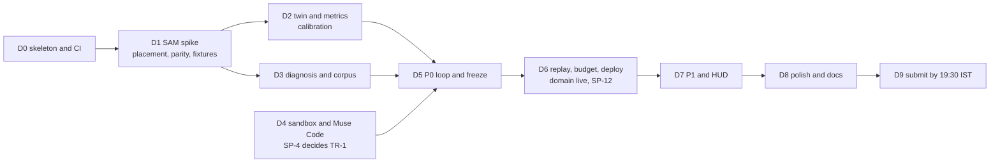

D4 depends only on D0, so the sandbox work (C) can start in parallel with D1 to D3 if C isn't needed on the SAM spike.

---

## 18. Risks, open questions and deltas

### 18.1 Implementation risks

The PRD's R-* register covers product and delivery risk. These are the technical risks this document creates or sharpens.

| ID | Risk | Likelihood | Impact | Mitigation | Trigger and owner |
| :--- | :--- | :--- | :--- | :--- | :--- |
| TR-1 | The Muse Code SDK won't accept a custom spawn command, so the launcher shim can't sit between the SDK and the container (DL-22) | Medium | The launcher design changes on D4 | The two fallbacks in §5.6. The socket stays in the launcher either way. | SP-4 on D4, C |
| TR-2 | The custom domain isn't live by D6, so a `SameSite=Strict` cookie never reaches the gateway from the hosted web app (DL-23) | Medium | No live runs from the hosted app | Buy the domain and add it to Vercel by D2, since DNS takes time. Emergency fallback only: `SameSite=None; Secure` plus the `Origin` check and a per-session CSRF header, recorded as a DL. | DNS check on D2, C |
| TR-3 | Nonce CSP forces dynamic rendering on routes that need to be static (TQ-1) | Medium | K7 regresses | SP-12, with the dynamic-shell fallback | SP-12 on D6, D |
| TR-4 | Ring-buffer churn: about 450 `perception.frame` events per clip means an offline client often gets `resync.required` (§6.1) | High | More snapshot fetches, but no data loss | It's the designed path. Watch `cs_resync_total`. If it's high, raise the ring to 2,000, or propose a DL that batches one event per frame across concepts. | `cs_resync_total` from D5, C |
| TR-5 | Windows checkouts change bytes (CRLF, symlinks), so hashes differ by OS | Medium | Cache misses and diff-hash mismatches | §10.2, and the `cross-os` CI job | `cross-os` job, D |
| TR-6 | One gateway replica (TD-5) | Certain | Host loss means no live runs (FM-18) | Replays don't depend on the host. Accepted for the hackathon. | Uptime monitor, C |
| TR-7 | `canonicalize` and `rfc8785` disagree on an edge-case number | Low | Token or manifest hash mismatches across languages | The parity vectors (§6.3). Fallback: only the gateway computes hashes, and the twin never hashes. | `unit` job, C |
| TR-8 | Encoded MP4 bytes aren't deterministic (OD-5) | Medium | Baseline cache keys miss | The raw-frame hash in the key (§8.3) | SP-1 on D1, B |
| TR-9 | Node 26 becomes Active LTS on Oct 28, which invites a mid-sprint upgrade | Medium | Churn during the sprint | Pin `engines` to Node 24 until after Nov 9 (DL-20) | Dependency pull requests, C |
| TR-10 | `opencv-python-headless` 5.0 is a new major, and a lockfile refresh could pull it | Low | Rendering API breaks | Pin `<5` in `pyproject.toml`. Upgrade after judging. | `uv lock` diff review, B |
| TR-11 | The SAM Licence may not allow shipping `@meta-sam/graphics` and `@meta-sam/video` in the browser bundle | Low | Compositor layers 0 and 1 need our own code | The SP-9 fallback, our own Canvas 2D compositor | Licence read on D2, D |
| TR-12 | TypeScript 6.1 or 7 lands, and `typescript-eslint` 8.72 doesn't support it | Medium | Lint breaks | Pin `typescript` to `~6.0` | Dependency pull requests, D |
| TR-13 | The independent test container misses its 8 s p90 because of PlatformIO compile time | Medium | The patch stage overruns K5 | Pre-built toolchains in the image (SP-6). Run the compile only for scenarios that have `controller.cpp`. | SP-6 on D4, C |

### 18.2 Open technical questions

| ID | Question | Settled by | Default if unsettled |
| :--- | :--- | :--- | :--- |
| TQ-1 | Can static routes use a hash-based CSP while dynamic routes use nonces (§2.4)? | SP-12 (D6) | Dynamic `/replay` shell |
| TQ-2 | Does the SDK accept a custom spawn command for the launcher shim (§5.6)? | SP-4 (D4) | The §5.6 fallbacks (TR-1) |
| TQ-3 | Does the CDN answer single-range requests with `206` and the CORS header for our origin (§6.12)? | D6 deploy check | Serve `.csmk` through the gateway's masks endpoint for featured replays |
| TQ-4 | Does the SAM Licence allow browser redistribution of the client libraries (§13.5)? | D2 licence read | Our own compositor (TR-11) |

### 18.3 Technical decisions made in this document

| ID | Decision | Section |
| :--- | :--- | :--- |
| TD-1 | npm workspaces, not pnpm | §2.2 |
| TD-2 | The `openai` SDK for Responses and Files. Raw `fetch` with `tee()` for SAM streaming. | §5.4 |
| TD-3 | `ws` for server sockets and the upstream ASR client | §2.1 |
| TD-4 | The `internal` network has `internal: true`, so Z3 has no default route | §3.3 |
| TD-5 | Exactly one gateway replica, guarded by the ledger lock | §6.8 |
| TD-6 | Zod is the schema source of truth, and pydantic is checked against its JSON Schema export | §8.1 |
| TD-7 | `npm ci --ignore-scripts`, with an explicit allowlist | §11.3 |
| TD-8 | GitHub Container Registry, and deploys by digest | §11.3 |

### 18.4 Deltas (summary)

DL-20 (Node 24), DL-21 (Next.js 16.4 and `proxy.ts`), DL-22 (`services/sandbox-launcher`) and DL-23 (one registrable domain) are specified in §2.3. They are **adopted**: back-ported on 2026-10-27 as DESIGN v1.1 §3.2 rows, with DESIGN §36 updated, and as PRD v1.4. TQ-1 is now also tracked as DESIGN OD-8. Any new delta gets a DL-24+ row here first, then the same back-port, which keeps the three documents from drifting (DESIGN §36).

---

## 19. Traceability: requirement to code

DESIGN §35 traces each FR to a design section and a test. This table adds the modules that implement each family and the K targets each family moves.

| FR family | Implemented in | Verified by | Moves |
| :--- | :--- | :--- | :--- |
| FR-CAP-1 to 5 (capture) | `apps/web/lib/capture`, `gateway/src/http` (upload), `services/media-worker`, `gateway/src/meta` (Files) | Unit validation, the malformed-MP4 corpus, Files API contract fixtures, E2E in Chrome and Safari | K7 |
| FR-VOI-1 to 4 (voice) | `apps/web/lib/audio`, `gateway/src/asr` | Grammar and negation tests, ASR close-code chaos, SP-8 WER | K5 (hands-free turn-taking) |
| FR-PER-1 to 7 (perception) | `gateway/src/sam`, `run-model/src/csmk.ts`, `twin/metrics/csmk.py`, `apps/web/lib/compositor` | Merge-order test, recorded `.sse` contract, byte parity, SP-1 IoU, SP-9, the baseline cache-key test | K5, K6, K7 |
| FR-MEA-1 to 3 (measurement) | `twin/metrics`, `gateway/src/orchestrator` (streaming gauges) | Property tests, scale unit tests, E2E gauges | K2 |
| FR-DIA-1 to 7 (diagnosis) | `gateway/src/diagnosis`, `router`, `corpus/` | SP-3 and `cs_cache_hit_ratio`, the citation verifier, lane rules, strict-schema contract | K5, K6, K10 |
| FR-SAF-1 to 5 (safety) | `gateway/src/gate`, `run-model/src/invariants.ts`, `twin/hotload` (AST checks) | Every `TOKEN_*` test, reducer invariants, bounds intersection, the `stop` risk review blocking Approve | TH-1, TH-6, TH-13 |
| FR-PAT-1 to 7 (patch) | `gateway/src/muse`, `services/sandbox-launcher`, `services/egress-proxy`, `sandbox/` | Golden MSP sessions, the policy table, the hardening suite, the independent harness, SP-4 to SP-7 | K1, K5 |
| FR-TWN-1 to 4 (twin) | `twin/sim`, `twin/render`, `twin/hotload`, `scenarios/` | Determinism hashes, the render-time benchmark, calibration, mutation V5 | K1, K2 |
| FR-VUT-1 to 4 (visual unit test) | `twin/vut`, `twin/mutation`, `apps/web` (verdict components) | Mutation suite V1–V5, AST identity, the K2 table | K2, K3, K4 |
| FR-OVL-1 (overlays) | `gateway/src/diagnosis` (Muse Image call), `apps/web/components` | Manual check (R-19) | — |
| FR-HUD-1 to 5 (HUD) | `apps/web/app/hud`, `gateway/src/hud`, `lib/transport` | Keyboard-only E2E, pairing tests, SP-10 | K9 (the HUD shares the live path) |
| FR-MCP-1 to 2 (WebMCP) | `apps/web/lib/webmcp` | Unit (no approval capability exposed), E2E with the API absent | — |
| FR-OPS-1 to 5 (operations) | `gateway/src/budget`, `audit`, `replay`, `apps/web` (provenance footer) | Cost formula tests, the k6 burst, the hash-chain tamper test, the provenance check, golden replays | K6, K8, K9 |

Every K target has at least one automated check: K1 (`nightly`), K2 and K3 and K4 (`sim`), K5 and K6 (span tree and cost meter, nightly), K7 (beacons and the D6 cold-load check), K8 (gitleaks), K9 (uptime monitor), K10 (`cs_citation_verified_ratio`, plus the manual audit of 20 diagnoses that PRD §6.3 requires).

---

## 20. Sources

All consulted on 2026-10-27, in addition to the PRD and DESIGN source lists (DESIGN §37). Version pins in §2 were read from each registry's `latest` tag that day.

**Runtimes and frameworks**
- Node.js release schedule: [github.com/nodejs/Release](https://github.com/nodejs/Release)
- Next.js 16 upgrade guide: [nextjs.org/docs/app/guides/upgrading/version-16](https://nextjs.org/docs/app/guides/upgrading/version-16)
- Next.js support policy: [nextjs.org/support-policy](https://nextjs.org/support-policy)
- Next.js Content Security Policy guide: [nextjs.org/docs/app/guides/content-security-policy](https://nextjs.org/docs/app/guides/content-security-policy)
- Fastify LTS policy: [fastify.dev/docs/latest/Reference/LTS](https://fastify.dev/docs/latest/Reference/LTS/)
- Python downloads and release schedules: [python.org/downloads](https://www.python.org/downloads/), [PEP 693 (3.12)](https://peps.python.org/pep-0693/), [PEP 719 (3.13)](https://peps.python.org/pep-0719/)
- `typescript-eslint` supported TypeScript versions: [typescript-eslint.io/users/dependency-versions](https://typescript-eslint.io/users/dependency-versions/)

**Canonical JSON and numerics**
- RFC 8785, JSON Canonicalization Scheme: [rfc-editor.org/rfc/rfc8785](https://www.rfc-editor.org/rfc/rfc8785)
- `rfc8785` for Python: [pypi.org/project/rfc8785](https://pypi.org/project/rfc8785/)
- `canonicalize` for JavaScript: [npmjs.com/package/canonicalize](https://www.npmjs.com/package/canonicalize)
- SciPy `lombscargle`: [docs.scipy.org … scipy.signal.lombscargle](https://docs.scipy.org/doc/scipy/reference/generated/scipy.signal.lombscargle.html)

**Web platform and security**
- `SameSite` cookies: [MDN, Set-Cookie](https://developer.mozilla.org/en-US/docs/Web/HTTP/Reference/Headers/Set-Cookie)
- Public Suffix List: [publicsuffix.org](https://publicsuffix.org/)
- Docker `network create --internal`: [docs.docker.com/reference/cli/docker/network/create](https://docs.docker.com/reference/cli/docker/network/create/)
- Docker daemon attack surface: [docs.docker.com/engine/security](https://docs.docker.com/engine/security/#docker-daemon-attack-surface)

**Diagrams**
- Mermaid syntax and parser: [mermaid.js.org](https://mermaid.js.org/)

**Registries** (for the version tables): [npmjs.com](https://www.npmjs.com/), [pypi.org](https://pypi.org/), and GitHub Releases for Caddy.
